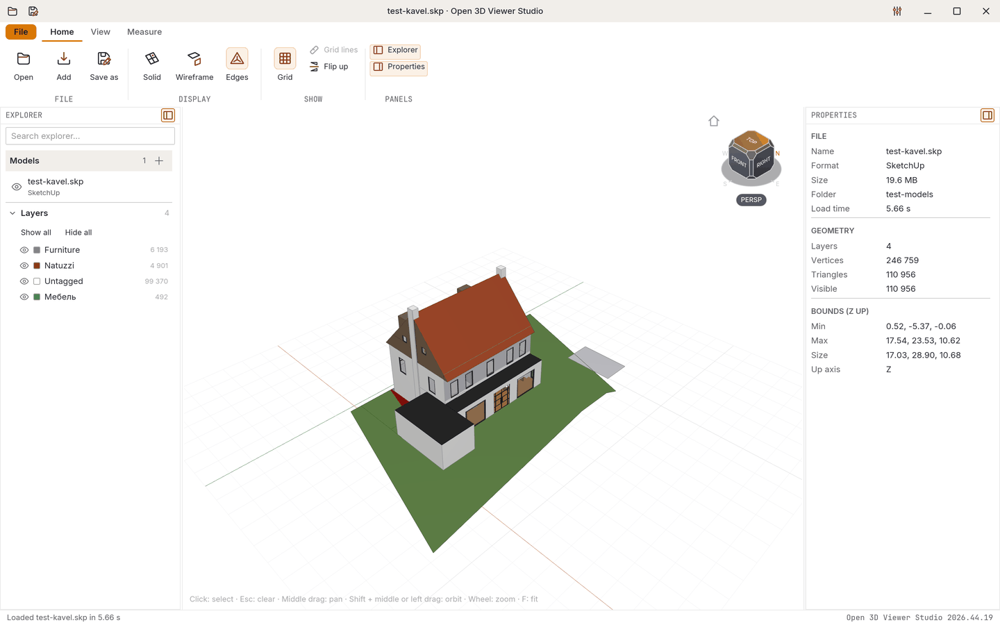
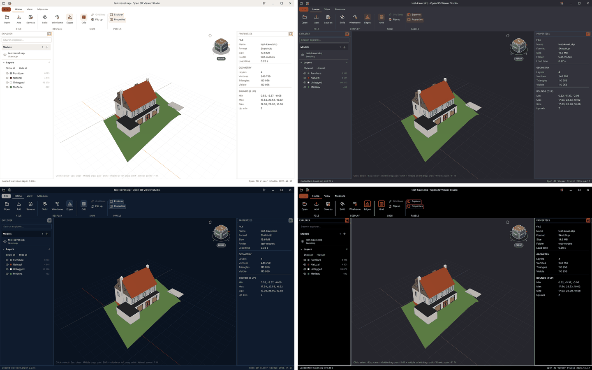
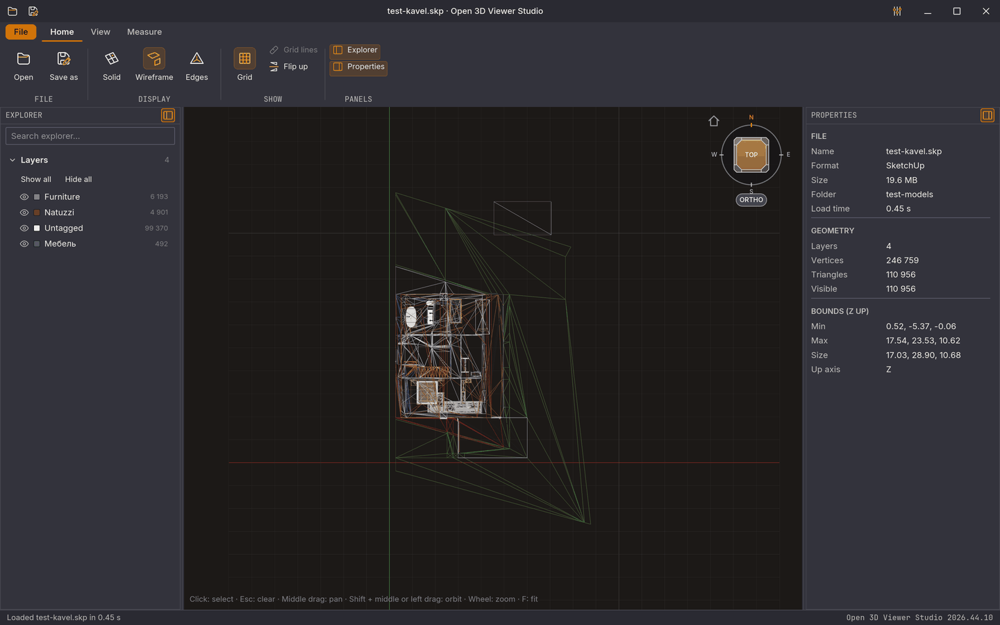
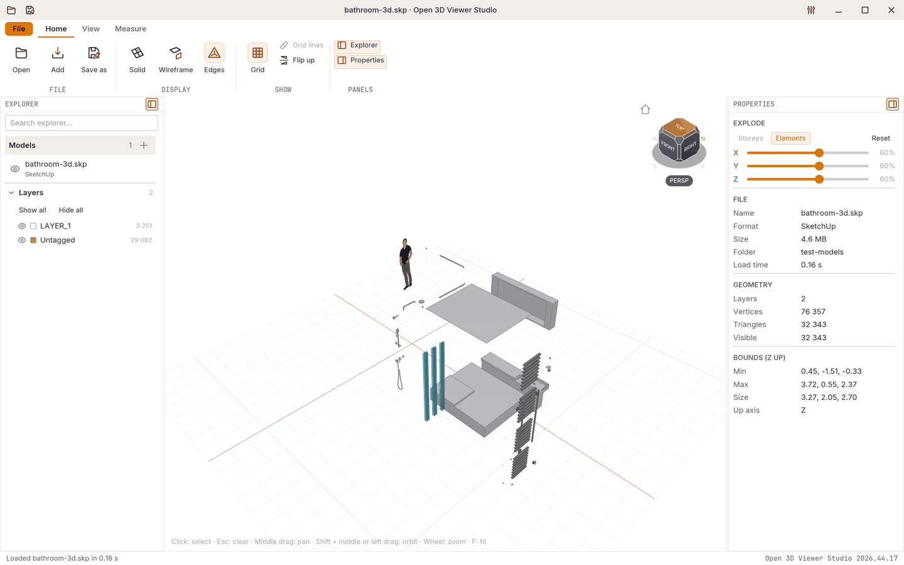
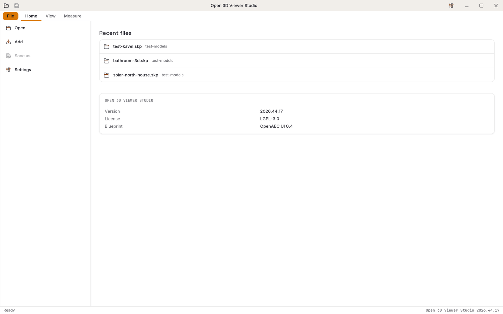
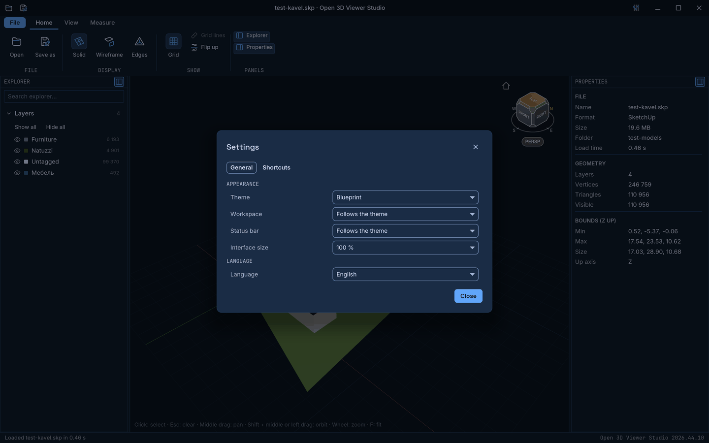
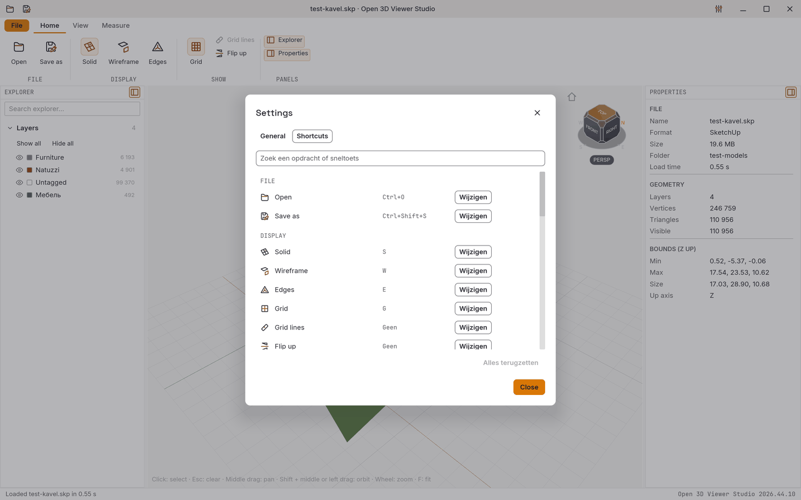
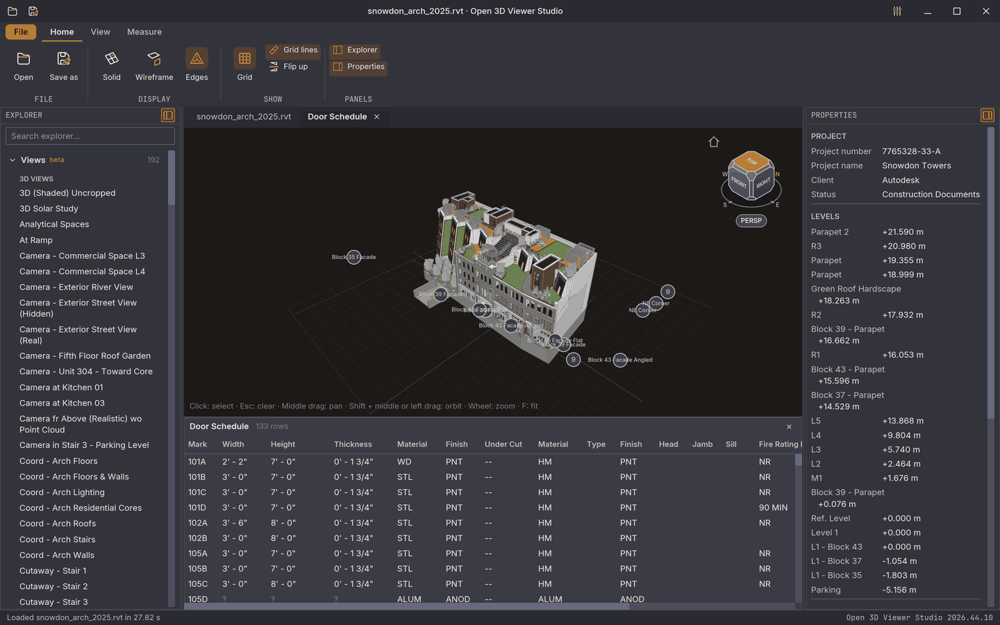

**English** · [Nederlands](README.nl.md)

<div align="center">

# Open 3D Viewer Studio

**A free 3D viewer for building models: it opens IFC, Revit, SketchUp, Tekla, DWG/DXF, MicroStation DGN, CityJSON, LandXML, glTF, OBJ, STL and PLY, measures and sections them, and saves them as IFC, on the desktop and in the browser.**

[](https://github.com/OpenAEC-Foundation/open-3d-viewer/releases/latest)
[](https://github.com/OpenAEC-Foundation/open-3d-viewer/actions/workflows/build.yml)
[](https://github.com/OpenAEC-Foundation/open-3d-viewer/actions/workflows/release.yml)
[](#license)

### [Try in your browser](https://open-3d-viewer.open-aec.com) &nbsp;·&nbsp; [Download](https://github.com/OpenAEC-Foundation/open-3d-viewer/releases/latest) &nbsp;·&nbsp; [Watch the video](https://www.youtube.com/watch?v=cxHO8M8W2Ow)

[](https://www.youtube.com/watch?v=cxHO8M8W2Ow)

*▶ The product video (73 s) on the [OpenAEC Foundation channel](https://www.youtube.com/@OpenAECFoundation).*

</div>

## What this repository is

This repository is the complete source of **Open 3D Viewer Studio**, the 3D viewer of the [OpenAEC Foundation](https://github.com/OpenAEC-Foundation). Architects, engineers and builders send each other models in many formats; with this viewer you open any of them without the program that made it. You walk around the model, pick an element and read its properties, measure, cut it open, pull it apart per storey or per element, and save it as IFC.

One Rust code base gives three things: the **desktop app** for Windows, macOS and Linux, the **browser version** at [open-3d-viewer.open-aec.com](https://open-3d-viewer.open-aec.com), and the **MCP server** through which AI agents drive the desktop app. The repository also holds what turns that code into signed installers and a live website.

| Folder | What is in it |
|--------|---------------|
| [`src/`](src/) | The viewer: the window ([`shell.rs`](src/shell.rs)), the app state ([`app.rs`](src/app.rs)), the 3D view ([`viewport/`](src/viewport/)), measuring, sections, the exploded view, and the remote control for the MCP server |
| [`src/loaders/`](src/loaders/) | One adapter per file format; [`src/export/`](src/export/) writes IFC 4 |
| [`src/bin/open-3d-viewer-mcp.rs`](src/bin/open-3d-viewer-mcp.rs) | The MCP server for AI agents |
| [`vendor/openaec-ui/`](vendor/openaec-ui/), [`assets/b2/`](assets/b2/) | The shared OpenAEC window shell and icons, copied from [OpenAEC Blueprint](https://github.com/OpenAEC-Foundation/OpenAEC-Blueprint) 2026.44.1 |
| [`packaging/`](packaging/) | The Windows installer, the macOS app bundle and the Linux packages |
| [`.github/workflows/`](.github/workflows/) | `build.yml` tests every change, `release.yml` builds and signs a release, `live.yml` publishes the browser version |
| [`scripts/`](scripts/) | The README images, the B2 icon copy and the product video, all made by script |
| [`test-models/`](test-models/) | The models the tests open |

The readers for SketchUp, Tekla and PLY, and the Revit library, live in their own OpenAEC repositories ([`skp-reader`](https://github.com/OpenAEC-Foundation/skp-reader), [`tekla-reader`](https://github.com/OpenAEC-Foundation/tekla-reader), [`ply-reader`](https://github.com/OpenAEC-Foundation/ply-reader), [`rvt-dll`](https://github.com/OpenAEC-Foundation/rvt-dll)). This repository pins each to a fixed commit.



## Try it

**[Open the browser version](https://open-3d-viewer.open-aec.com)**. Drop a model on the page or choose **Open**, then orbit with the left mouse button, pan with the middle button and zoom with the wheel. You need a browser with WebGPU: a current Chrome, Edge, Firefox or Safari. Your file stays on your computer; nothing is uploaded.

## Download

Every release is on the [releases page](https://github.com/OpenAEC-Foundation/open-3d-viewer/releases/latest). The easiest way is the [OpenAEC Installer](https://github.com/OpenAEC-Foundation/openaec-installer): it installs, updates and starts every OpenAEC tool.

| Platform | Files |
|----------|-------|
| **Windows** | `.exe` installer (x64, no administrator rights needed) or `.zip` |
| **macOS** | `.dmg` (universal: Apple silicon and Intel) |
| **Linux** | `.deb`, `.rpm`, `.AppImage` or `.tar.gz` |

When the OpenAEC Installer has a newer version, the title bar of the viewer says so, and **Update** hands over to the installer. Every file is signed: Windows with Authenticode, macOS with a Developer ID and notarized by Apple, Linux with the OpenAEC OpenPGP key (`.asc` next to each package and to `SHA256SUMS`), and all of them with a GitHub build attestation. The release notes say per platform whether it is signed; a release that misses a signature is marked as a pre-release.

To check a download yourself:

```bash
sha256sum -c SHA256SUMS --ignore-missing
gpg --import docs/openaec-releases.asc   # OpenAEC Foundation Releases, fingerprint 13F6 D414 ADEE 4ED4 CD09 AC60 601D 86C9 3C50 4D29
gpg --verify SHA256SUMS.asc SHA256SUMS
gh attestation verify open-3d-viewer_2026.44.18_amd64.deb --repo OpenAEC-Foundation/open-3d-viewer
```

## Why use it?

- **Free and open.** LGPL-3.0. No licence fees, no account, no upload.
- **Opens what you get sent.** IFC and Revit on the desktop; SketchUp (version 3 and later), Tekla Structures, DWG/DXF, MicroStation DGN (V7), CityJSON, LandXML, glTF, OBJ, STL and PLY on the desktop and in the browser.
- **Several models at once.** **Open** replaces the model, **Add** puts another file next to it, and each model has its own visibility toggle.
- **Saves as IFC.** Any model the viewer opens can be saved as IFC 4, with storeys, classes, properties and materials.
- **The same app in the browser and on the desktop.** One code base; the browser version needs no installation.
- **Measure and cut.** Distances, angles, areas and polygons, a section box and a section plane with filled cuts, and an exploded view.
- **AI agents can drive it.** An MCP server lets Claude and other agents open files, look around, select and measure, in the window you see.

## Screenshots

| | |
|---|---|
|  **Light, Dark, Blueprint and High contrast dark** |  **Top view, wireframe and orthographic** |
|  **Exploded view per element** |  **The File page with recent files** |
|  **Settings, theme Blueprint** |  **Your own shortcuts for every command** |

## Viewing and navigating

- **Orbit, pan and zoom.** Left drag orbits, middle drag pans, the wheel zooms to the cursor. The view cube turns the model to a side; **F** fits the model in view.
- **Standard views.** Iso, top, front and right (`0`, `1`, `2`, `3`), perspective or orthographic (`P`, `O`), and the saved views of a Revit model.
- **Render modes.** Solid, wireframe and solid with edges (`S`, `W`, `E`), the ground grid (`G`) and **Flip up** for files with the other up axis.
- **Models, layers and properties.** The explorer lists the open models and their layers (IFC presentation layers or classes, Revit categories, SketchUp tags, Tekla classes, CAD layers) with their colour and count; a click on an element shows its properties. IFC spaces start hidden in a layer of their own.
- **Shortcuts.** Every command has one entry in one list, used by the ribbon, the title bar and the keyboard. In **Settings** you give any command your own key.

## Measure, section and explode

- **Measure** distances, angles, polygons and areas by clicking in the model, or between two elements. Measurements stay in the view until you clear them.
- **Section box and section plane** cut the model open, with the cut faces filled. The box can fit the selection.
- **Exploded view** pulls the model apart per storey or per element, by a percentage per axis.

## Revit

The desktop app opens Revit files (`.rvt`, `.rfa`) through the OpenAEC Revit library [`rvt-dll`](https://github.com/OpenAEC-Foundation/rvt-dll). It shows the levels, grids, rooms, saved views and schedules of the file. A schedule opens in its own tab as a table under the 3D view, and a row selects its elements. Revit keeps only the definition of a schedule in the file, so the viewer computes the rows from the elements; cells it cannot work out yet show `?`.



The images on this page are made by [`scripts/build_readme_images.py`](scripts/build_readme_images.py), which renders the real window with `open-3d-viewer --screenshot`. The schedule image uses the Autodesk sample `snowdon_arch_2025.rvt`.

## Interoperability

| Format | Open | Save |
|--------|------|------|
| **IFC 4** (`.ifc`) | Desktop | Yes |
| **Revit** (`.rvt`, `.rfa`) | Desktop | No |
| **SketchUp** (`.skp`, version 3 and later) | Yes | No |
| **Tekla Structures** (`.db1`, beta) | Yes | No |
| **DWG / DXF** (`.dwg`, `.dxf`) | Yes, polygon geometry | No |
| **MicroStation DGN** (`.dgn`, V7) | Yes | No |
| **CityJSON** (`.json`, `.cityjson`, `.jsonl`) | Yes | No |
| **LandXML** (`.xml`, `.landxml`, TIN surfaces) | Yes | No |
| **glTF** (`.gltf`, `.glb`) | Yes | No |
| **Wavefront OBJ** (`.obj`) | Yes | No |
| **STL** (`.stl`, ASCII and binary) | Yes | No |
| **PLY** (`.ply`) | Yes | No |

What does not come through:

- **IFC export** writes each element as triangles (`IfcTriangulatedFaceSet`), not as parametric geometry. Classes come from the Revit category or the Tekla part name, else `IfcBuildingElementProxy`; elements of an opened IFC file do not keep their class yet. Checked with IfcOpenShell 0.8 on Revit, SketchUp, OBJ, STL and glTF models.
- **DWG and DXF** show the polygon geometry of model space. ACIS solids, annotations, curves and external references are left out and counted.
- **MicroStation DGN** opens version 7 design files (V8 files are recognised but not read yet). Lines, arcs and curves are drawn as thin ribbons as wide as their line weight, text as its box with the characters in the element properties; shapes, cones, extruded solids and B-spline surfaces of 3D files are faces. Levels are layers. Dimensions, shared cells, line styles and reference files are left out and counted. The reader is written from Intergraph's public ISFF description and a clean-room analysis.
- **LandXML** shows TIN surfaces; survey points and alignments are not turned into surfaces. **CityJSON** shows the highest level of detail per object.
- **Textures** of glTF, OBJ and SketchUp become their average colour; SketchUp soft edges are not smoothed.
- **Tekla** profiles are approximations; the reader is written from a clean-room specification.
- **In the browser**, IFC and Revit do not open, `.gltf` files need their buffers embedded, and OBJ materials are not read.

New formats: implement `loaders::Loader` and add it to `loaders::registry()`; new writers implement `export::Writer` and go in `export::registry()`.

## MCP

`open-3d-viewer-mcp` is an [MCP](https://modelcontextprotocol.io) server through which an AI agent (Claude Code, Claude Desktop or any MCP client) drives the desktop viewer as a person does: open files, take screenshots, set the camera and the standard and saved views, show, hide and isolate layers, find elements by property, select, read properties, set a section box or plane, pull the model apart, change the render mode, read Revit schedules and measure.

- **You see what it does.** Commands go through the same path as your clicks, in the window on your screen. Measurements stay in the view.
- **It stays on your computer.** The window listens on `127.0.0.1` only, with a random token in `%APPDATA%\OpenAEC\Open 3D Viewer Studio\remote.json`. `--no-remote` or `O3V_REMOTE=0` switches it off.
- **Install:** keep `open-3d-viewer-mcp` next to the viewer (the installers do) and register it, for example `claude mcp add open-3d-viewer -- "C:\path\to\open-3d-viewer-mcp.exe"`. `open-3d-viewer-mcp --print-config` prints the JSON for other clients.

## Testing and reliability

- **119 unit tests** in `src/` (118 run, 1 needs a local sample), plus 2 for the MCP server and 56 for the window library in `vendor/openaec-ui`, run on every pull request and before every release: 42 for the loaders, 14 for the app, 11 for measuring, 8 for the window shell, 7 for the section tools, 7 for IFC export, and more for the 3D view, view cube, remote control, model and exploded view.
- **The window shell is tested without a screen.** One test lays out every view and fails when a control has no name for a screen reader; others check that no two commands share a shortcut and that every command in the ribbon and the title bar exists.
- **Generated files are checked.** `python scripts/build_readme_images.py --check` fails when an image is missing, unused or larger than 150 kB; `python scripts/b2_icons.py <Blueprint> --check` fails when an icon differs from the OpenAEC Blueprint release.
- **IFC export** is checked with IfcOpenShell 0.8 (schema and where rules, spatial containment, unique GlobalIds, geometry) on Revit samples of 456 and 6773 elements, 11 SketchUp test models, OBJ, STL and glTF.
- **Releases are built only after the tests pass**, and the release notes state per platform whether the files are signed.

Count sources: `cargo test --release` and `cargo test --release -p openaec-ui --lib`; the release runs the same checks in [`release.yml`](.github/workflows/release.yml).

## Current limitations

- **IFC and Revit open on the desktop only.** The browser version does not include those readers.
- **Some formats are missing.** Point clouds (E57, LAS), FBX, 3DS, Collada, 3MF, STEP and IGES do not open. PLY files without faces are rejected.
- **No undo yet.** Measurements and the section are cleared by hand.
- **The browser version blocks while it loads** a large model (no worker threads yet) and does not keep your settings between visits.
- **Five icons are stand-ins.** The OpenAEC icon set has no icons yet for solid, wireframe, edges, perspective and orthographic; the viewer uses the closest ones.
- **No walk mode or hidden-line mode.**

Found something? [Open an issue](https://github.com/OpenAEC-Foundation/open-3d-viewer/issues).

## Under the hood

The viewer is written in Rust. The interface is [iced](https://iced.rs) 0.14 and the 3D view is an own wgpu pipeline with 4x MSAA inside iced's `shader` widget, so the same code runs natively and as WebAssembly on WebGPU, without a web view or JavaScript framework. The window follows the OpenAEC standard application: the shell, design tokens, fonts and B2 icons come from [OpenAEC Blueprint](https://github.com/OpenAEC-Foundation/OpenAEC-Blueprint) 2026.44.1 (`vendor/openaec-ui`, `assets/b2`). IFC is read with [IFClite](https://github.com/LTplus-AG/ifc-lite) and DWG/DXF with [acadrust](https://github.com/HakanSeven12/acadrust). On a computer with integrated AMD graphics, a Revit sample of 18.8 MB loads in about 2.5 s and draws at about 110 frames per second at 1920x1080 (`open-3d-viewer --bench`).

## Contributing

- **Try it on a real project** and report bugs or missing features as an [issue](https://github.com/OpenAEC-Foundation/open-3d-viewer/issues/new). Describe what you did, what you expected and what happened, and attach the file if you can share it.
- **Share test files.** Models that open wrongly help most; `test-models/` holds the ones the tests use.
- **Write code** and open a pull request. `cargo test --release` must pass.

## Quick start (developers)

```bash
git clone https://github.com/OpenAEC-Foundation/open-3d-viewer.git
cd open-3d-viewer
cargo run --release -- test-models/test-kavel.skp
```

Requires Rust 1.89 or later (with the MSVC toolchain on Windows) and read access to the private OpenAEC format repositories above; set `CARGO_NET_GIT_FETCH_WITH_CLI=true` so Cargo uses your Git credentials. The browser version also needs `rustup target add wasm32-unknown-unknown` and `cargo install --locked trunk`; then `trunk serve --release` serves it on `http://127.0.0.1:8080`. The scripts in `scripts/` need Python 3.

The command line:

```
open-3d-viewer [FILE] [--theme light|dark|blueprint|high-contrast-dark|high-contrast-light] [--language en|nl]
open-3d-viewer [FILE] --screenshot OUT.png [--size 1440x900] [--mode solid|wireframe|edges] [--view iso|top|front|right]
               [--ortho] [--page workspace|file|settings|shortcuts] [--schedule NAME] [--explode X,Y,Z]
open-3d-viewer FILE --save-as OUT.ifc
open-3d-viewer --bench FILE [--frames 300]
```

Versions follow the OpenAEC scheme `YYYY.W.N`: year, ISO week without a leading zero, and a number within the week that starts at 0, such as `2026.44.18`. A tag `vYYYY.W.N` starts [`release.yml`](.github/workflows/release.yml), which tests, builds and signs the release for Windows, macOS and Linux and publishes it.

Open 3D Viewer Studio is part of the [OpenAEC Foundation](https://github.com/OpenAEC-Foundation) family of apps.

## License

The viewer's own source is LGPL-3.0-or-later. See [LICENSE](LICENSE). The Inter font is under the SIL Open Font License (`assets/fonts/Inter-LICENSE.txt`); `vendor/openaec-ui` and its fonts and icons are described in its [`NOTICE.md`](vendor/openaec-ui/NOTICE.md). IFClite and acadrust are MPL-2.0. The desktop app links the OpenAEC Revit library `rvt-dll`, which keeps its own proprietary licence, so the desktop builds are not wholly open source; the browser version does not include it.

## Trademarks

SketchUp is a trademark of Trimble Inc., Revit and DWG of Autodesk, Inc., Tekla Structures of Trimble Solutions Corporation, and MicroStation of Bentley Systems, Inc. Open 3D Viewer Studio is an independent project and is not affiliated with, endorsed by or sponsored by them.
