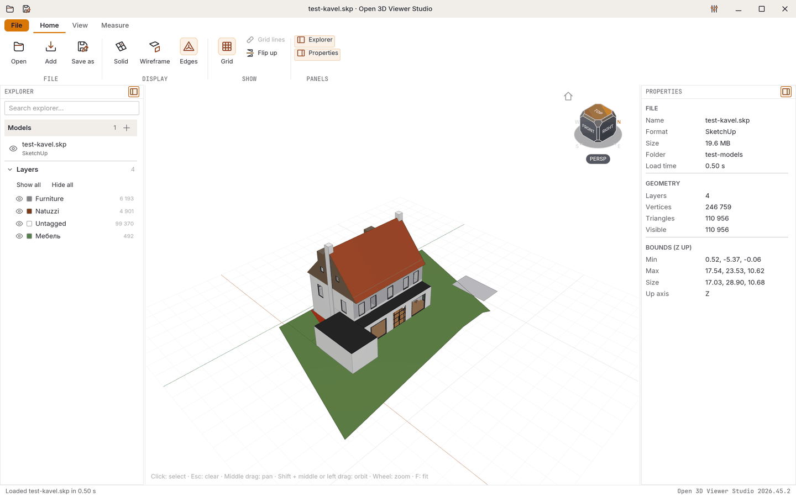
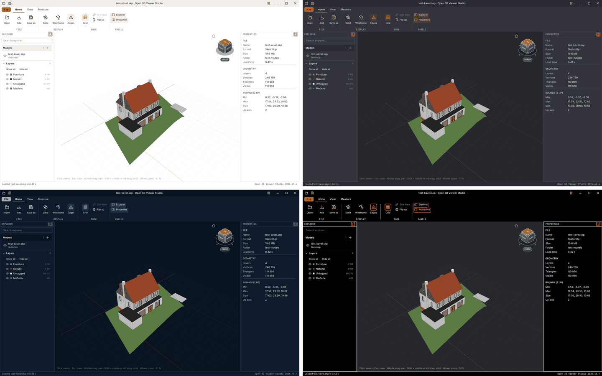
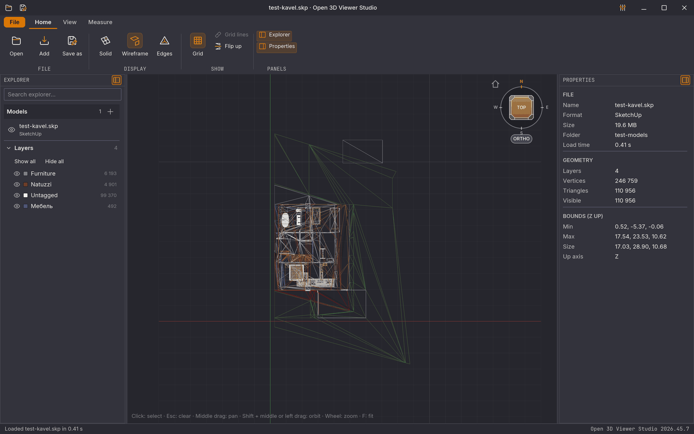
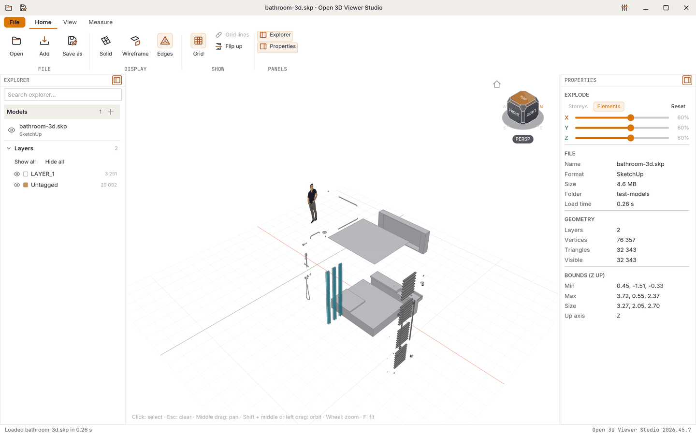
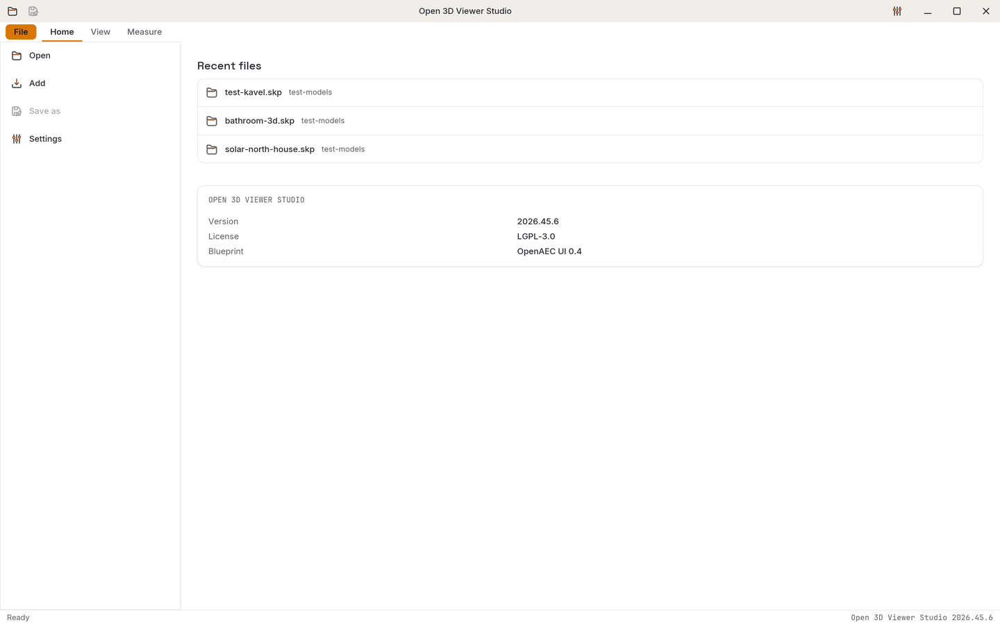
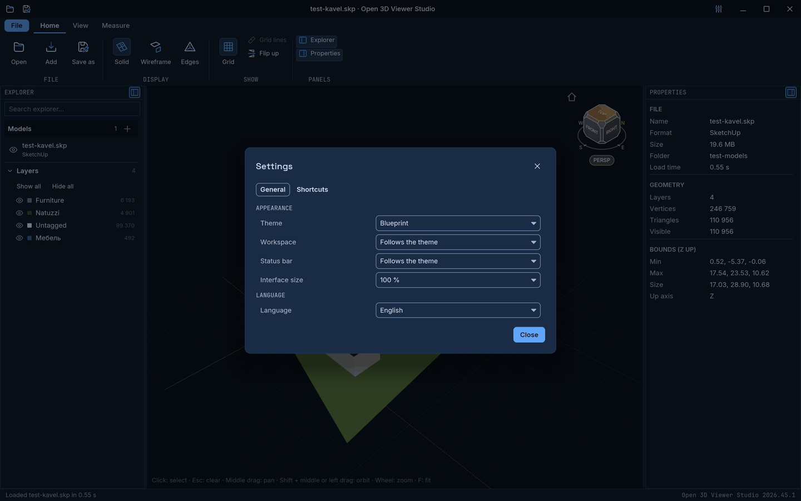
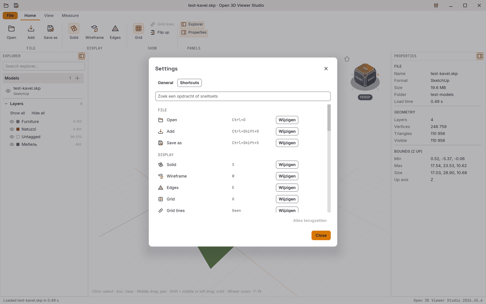
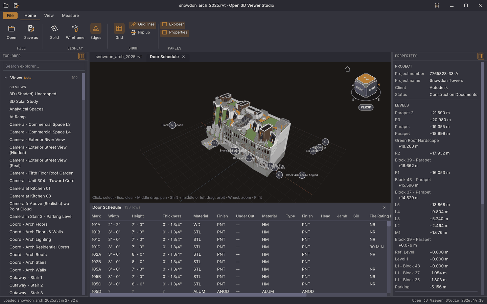

**English** · [Nederlands](README.nl.md)

<div align="center">

# Open 3D Viewer Studio

**A free 3D viewer for building models: it opens IFC, Revit, SketchUp, Tekla, Allplan, Archicad, Vertex BD, BTL, DWG/DXF, MicroStation DGN, STEP, IFC5 (IFCX), CityJSON, CityGML, GeoJSON, Shapefile, LandXML, glTF, USD, Rhino, COLLADA, 3MF, AMF, FBX, 3DS, VRML/X3D, OBJ, OFF, STL and PLY models, structural analysis models (sam-json), and LAS, LAZ, E57, PTS, PTX, PCD and ASCII XYZ point clouds, measures and sections them, saves them as IFC, and exports their floor plans, sections and sheets as DWG, DXF, IFCCAD, PDF, PNG and SVG, on the desktop and in the browser.**

[](https://github.com/OpenAEC-Foundation/open-3d-viewer/releases/latest)
[](https://github.com/OpenAEC-Foundation/open-3d-viewer/actions/workflows/build.yml)
[](https://github.com/OpenAEC-Foundation/open-3d-viewer/actions/workflows/release.yml)
[](#license)

### [Try in your browser](https://open-3d-viewer.open-aec.com) &nbsp;·&nbsp; [Download](https://github.com/OpenAEC-Foundation/open-3d-viewer/releases/latest) &nbsp;·&nbsp; [Watch the video](https://www.youtube.com/watch?v=cxHO8M8W2Ow)

[](https://www.youtube.com/watch?v=cxHO8M8W2Ow)

*▶ The product video (73 s) on the [OpenAEC Foundation channel](https://www.youtube.com/@OpenAECFoundation).*

</div>

**Open 3D Viewer Studio** is the 3D viewer of the [OpenAEC Foundation](https://github.com/OpenAEC-Foundation). Architects, engineers and builders send each other models in many formats; with this viewer you open any of them without the program that made it. You walk around the model, pick an element and read its properties, measure, cut it open, pull it apart per storey or per element, and save it as IFC.

One Rust code base gives three things: the **desktop app** for Windows, macOS and Linux, the **browser version** at [open-3d-viewer.open-aec.com](https://open-3d-viewer.open-aec.com), and the **MCP server** through which AI agents drive the desktop app. The repository also holds what turns that code into signed installers and a live website.



## Try it

**[Open the browser version](https://open-3d-viewer.open-aec.com)**. Drop a model on the page or choose **Open**, then orbit with the left mouse button, pan with the middle button and zoom with the wheel. You need a browser with WebGPU: a current Chrome, Edge, Firefox or Safari. Your file stays on your computer; nothing is uploaded. To see what it does first, watch the [product video](https://www.youtube.com/watch?v=cxHO8M8W2Ow) (73 s).

## Download

Every release is on the [releases page](https://github.com/OpenAEC-Foundation/open-3d-viewer/releases/latest). The easiest way is the [OpenAEC Installer](https://github.com/OpenAEC-Foundation/openaec-installer): it installs, updates and starts every OpenAEC tool.

| Platform | Files |
|----------|-------|
| **Windows** | `.exe` installer (x64, no administrator rights needed) or `.zip` |
| **macOS** | `.dmg` (universal: Apple silicon and Intel) |
| **Linux** | `.deb`, `.rpm`, `.AppImage` or `.tar.gz`, for x86_64 and arm64 |

When the OpenAEC Installer has a newer version, the title bar of the viewer says so, and **Update** hands over to the installer. Every file is signed: Windows with Authenticode, macOS with a Developer ID and notarized by Apple, Linux with the OpenAEC OpenPGP key (`.asc` next to each package and to `SHA256SUMS`), and all of them with a GitHub build attestation. The release notes say per platform whether it is signed; a release that misses a signature is marked as a pre-release.

To check a download yourself:

```bash
sha256sum -c SHA256SUMS --ignore-missing
gpg --import docs/openaec-releases.asc   # OpenAEC Foundation Releases, fingerprint 13F6 D414 ADEE 4ED4 CD09 AC60 601D 86C9 3C50 4D29
gpg --verify SHA256SUMS.asc SHA256SUMS
gh attestation verify open-3d-viewer_2026.45.11_amd64.deb --repo OpenAEC-Foundation/open-3d-viewer
```

## Android

The viewer runs on Android phones and tablets: it is the browser version, installed as an app.

- **Install from the browser (recommended).** Open [open-3d-viewer.open-aec.com](https://open-3d-viewer.open-aec.com) in Chrome and tap **Install** in the bar that appears, or choose **Install app** (or **Add to home screen**) in Chrome's menu. The app gets its own icon, opens full screen without the address bar, and starts without a network once it has been opened. It updates itself with the website.
- **APK.** Every run of [`android.yml`](.github/workflows/android.yml) on `main` ([the list of those runs](https://github.com/OpenAEC-Foundation/open-3d-viewer/actions/workflows/android.yml?query=branch%3Amain+event%3Apush)) keeps an `open-3d-viewer-android-*.apk` under *Artifacts* on the run's page (you need to be signed in to GitHub; the download is a `.zip` holding the APK). Copy it to the phone, open it and allow installing from that source. The APK is a [Trusted Web Activity](https://developer.chrome.com/docs/android/trusted-web-activity): the same web app, opened by Chrome as an app of its own. It is a debug build with a throw-away key, so Android may warn about it, installing a newer one means uninstalling the old one first, and Chrome shows a thin address bar at the top until the site lists the app's release key in `/.well-known/assetlinks.json`. It is not in the Play Store.

On a touch screen **one finger orbits**, **two fingers pinch to zoom** and **move together to pan**, a **tap selects** an element (or places a measuring point), a **long press without dragging opens the menu** of the selection, and a **long press, then drag, pans** (as the right mouse button does). At phone width the window is compact: the ribbon scrolls sideways under your finger and folds away when you tap **Home**, and the two panel buttons at the top right swap the 3D view for the explorer or the properties.

What works and what does not on Android:

- Every format of the browser version opens through **Open** (Android's file picker) or a `?file=` link. Revit, Vertex BD and BTL do not, as in any browser; opening one says so in the status bar and opens a dialog whose **Download** button opens the desktop app's download page.
- The 3D view needs WebGPU or WebGL2; a current Chrome has one of them on most phones of the last years.
- A large model loads slowly and the app waits while it does; a phone has less memory than a computer, so a very large model can stop the tab.
- Typing into the explorer's search field does not bring up the on-screen keyboard (iced has no on-screen keyboard support in the browser yet).
- There is no native Android build: iced 0.14, the interface library, cannot start on Android by itself, so the app is the web version, installed from Chrome or wrapped in the APK.

## Why use it?

- **Free and open.** LGPL-3.0. No licence fees, no account, no upload.
- **Opens what you get sent.** Revit, Vertex BD (`.vxz`) and BTL timber machine files on the desktop; IFC (also zipped), SketchUp (version 3 and later), Tekla Structures, Allplan, Archicad (walls with their windows and doors, slabs, columns, beams, roofs, library objects as boxes, terrain meshes, zones, morphs, stairs and railings), DWG/DXF, MicroStation DGN (V7 and V8), STEP (AP203, AP214, AP242), IFC5 (IFCX, alpha), CityJSON, CityGML, GeoJSON, Shapefile, LandXML, glTF, USD, Rhino (version 4 to 8), COLLADA, 3MF, AMF, FBX, 3DS, VRML/X3D, OBJ, OFF, STL and PLY, structural analysis models in sam-json (`.samjson`), and LAS, LAZ, E57, PTS, PTX, PCD and ASCII XYZ point clouds, on the desktop and in the browser.
- **Several models at once.** **Open** puts a file in a tab of its own beside the open model (several files dropped at once load side by side, each in its tab), **Add** puts another file in the same view (an IFCX file layers over an open IFCX model instead), and each model has its own visibility toggle.
- **Saves as IFCX and IFC.** **Save as** writes IFCX (IFC5) unless you pick another type: the viewer's own project file, with the model by element, its levels, and its floor plans, sections, elevations, sheets and dimensions, which come back when the file is opened again. Any model the viewer opens can also be saved as IFC 4, with storeys, classes, properties and materials.
- **The same app in the browser and on the desktop.** One code base; the browser version needs no installation.
- **Measure and cut.** Distances, angles, areas and polygons, a section box and a section plane with filled cuts, and an exploded view.
- **AI agents can drive it.** An MCP server lets Claude and other agents open files, look around, select and measure, in the window you see.

## Screenshots

| | |
|---|---|
|  **Light, Dark, Blueprint and High contrast dark** |  **Top view, wireframe and orthographic** |
|  **Exploded view per element** |  **The File page with recent files** |
|  **Settings, theme Blueprint** |  **Your own shortcuts for every command** |

## Viewing and navigating

- **Orbit, pan and zoom.** Left drag orbits, middle drag pans, the wheel zooms to the cursor. The view cube turns the model to a side; **F** fits the model in view.
- **Standard views.** Iso, top, front and right (`0`, `1`, `2`, `3`), perspective or orthographic (`P`, `O`), and the saved views of a Revit model.
- **Render modes.** Solid, wireframe and solid with edges (`S`, `W`, `E`), the ground grid (`G`) and **Flip up** for files with the other up axis.
- **Models, layers and properties.** The explorer lists the open models. The right pane has two tabs. **Layers** lists the layers (IFC presentation layers or classes, Revit categories, SketchUp tags, Tekla classes, Allplan element categories, Archicad walls, slabs, columns, beams, roofs, openings, objects, terrain, zones, morphs, stairs and railings, IFCX classes, STEP presentation layers or products, CAD layers, Rhino layers) with their colour and count, and switches them in the view shown only. Each floor plan, section and elevation keeps its own layers, saves them with it in IFCX, and is drawn through them on every sheet it is placed on; the 3D view keeps its own. On a sheet, Layers switches the view picked there. **Properties** names the view shown (its kind, a plan's level, a section's length, how many elements it hides) and lets you type its name, a floor plan's cut height and view depth, and a section's depth: the view is drawn again as you type, in its tab and on every sheet it is on. It also shows the properties of an element you click. IFC spaces and opening volumes start hidden in layers of their own; the openings stay cut from their walls and slabs.
- **Levels.** The explorer's **Levels** tab lists the levels of the building, high to low with their elevation: the levels of a Revit, Archicad or Allplan model and the storeys of an IFC or IFCX file. **Add level** adds one the model lacks (a name and an elevation in metres), and the cross next to an added level removes it again. The viewer keeps the levels as IfcX (IFC5) storeys and saves them with **Save as** IFCX; IFC writes the added levels as storeys next to the model's own. The grids of a Revit or IFC model show in the 3D view at the level nearest the building's zero, with their names at both ends; **Grid lines** switches them off and on. A floor plan draws them just above its cut, over the floor it looks at; a section or elevation draws the grids it crosses upright, with their bubbles above and below, and the levels across it, each with its name and height at both ends (a level too close below a named one keeps only its mark until you zoom in). A click on a grid line or its bubble picks it (the line where nothing stands in front of it, the bubble always): it is drawn in the accent colour, and the properties show its name, length, direction, elevation and ends; Escape or a click on anything else lets it go. **Underlay** next to a level lays a DWG, DXF, IFCCAD or PDF drawing on it (a PDF's first page: its paths, with the drawings it places, laid at 1:100, which the scale next to its name changes): its lines (lines, polylines with their arcs, arcs, circles, ellipses and the blocks inserted, in metres by the drawing's units; texts and hatches are left out and counted) show in the 3D view and the floor plans at the level's height, in blue. A drawing far from the model (in national grid coordinates, say) is laid in the model's middle. Under the level, a click on its name switches it off and on, and the cross takes it away.
- **Views, sheets and dimensions.** The explorer's **Views** tab lists the views by kind: floor plans, structural plans, ceiling plans, 3D views, sections, elevations and sheets (IFCX keeps each view's kind). **New** next to a kind of plan lists the levels to make one of; it opens in a tab next to the 3D view, as sections, elevations and sheets do. A floor plan is seen from above and cut 1.2 m above its level. A structural plan is cut as a floor plan, looks 1 m below its level so the beams under the floor show, and leaves out what carries nothing: by the element's `LoadBearing` property, else its IFC class or its Revit, Tekla or Archicad category (walls, slabs, columns, beams, members, plates, foundations, piles, roofs, stairs and ramps stay; elements nothing is known of stay too). A ceiling plan is cut 2.3 m above its level and seen from below, up to the next level; on a sheet it is drawn as the floor plan is laid out (a reflected ceiling plan). **New** next to the 3D views keeps what the 3D tab shows, its camera, section box, layers and hidden elements, as a 3D view with a name of its own (`3D view 1`, ..., renamed in the Properties tab); its tab turns as the 3D view does, and it keeps how it was left, also in the IFCX file. Each plan, section and elevation has a camera of its own; a drag moves it instead of turning it, and the selection is shared by all views both ways. A view's tab has a bar over it: **Dimension** (two clicks, snapping to the ends of its lines), **Text** (a click places it; a picked text is dragged to move it or reworded in the bar), on a floor plan **Section** (two clicks draw a section that looks to the left of its line; it opens in its tab, and the plan shows its line and letter) and **Standard dimensions** (its overall size outside it, with a chain along the grids, and in a section along the levels, then the overall 1 m further out). A picked dimension goes to its **Other side**, and Delete removes what is picked. Dimensions and texts belong to the view, so every sheet it is placed on shows them. **Four elevations** come with one click, and the sheet's **Section** tool draws a section with two clicks on a floor plan (it looks to the left of the line; the plan shows its line and letter). **New sheet** makes a sheet in its own tab (A4 to A0): drag floor plans, sections and elevations onto it from the **Views** list (or place them from its bar), drawn as lines (the cut bold, what lies beyond thin; sections and elevations without hidden lines), drag them over the paper, and with **Dimension** click two points of a view (they snap to the ends of its lines) to add a dimension in millimetres, or with **Text** put a text on it, which shows wherever the view is placed. A click picks a placed view, a dimension or a text: a view gets its scale (1:20 to 1:1000), a floor plan its cut height, a drag on a side of its frame crops it (the plan's tab follows), and Delete takes away what is picked. **Arrange** in a sheet's bar gives its views one scale, the largest at which they all fit, and sets them in rows, centred, with room for their names and the sheet's title; **Put loose views on sheets** in the Views list puts every floor plan, section and elevation that is on no sheet yet on new A3 sheets, the floor plans from the lowest level up, at one scale per kind and as many on a sheet as fit. Everything is kept in the IfcX document and saved with **Save as** IFCX. **Views in 3D** (View tab) stands every view in the 3D view on its own plane: a floor plan at its cut height with the lines of its cut, a section or elevation upright on its line, each in an orange frame with its name; the views read from a Revit model show their frames (a plan at its cut height over the model, a section on the near side of its crop). They follow when a view is made, cropped or cut again.
- **Exports drawings.** **Export** in the bar over a view's or sheet's tab writes what the tab shows as DWG, DXF, IFCCAD (the open 2D drawing profile on IFCX), PDF, PNG (200 dpi) or SVG: the cut lines bold and what lies beyond thin, the dimensions and texts, and on a sheet its border, title, section marks and each view's name and scale. A floor plan or section takes the grid lines and levels its tab shows: a grid with a bubble and its name past both ends, a level with its name and height. CAD files are in millimetres, a view at 1:1 and a sheet at paper size, with a layer per kind of line (`O3V-Cut`, `O3V-Beyond`, `O3V-Dimensions`, `O3V-Text`, `O3V-Frame`, `O3V-Grids`) that carries its line weight. In the browser the file goes to the downloads.
- **The IFC tab.** **IFC structure** in the ribbon opens a tab that shows, under the 3D view, how the model's IFCX file is built up: the IFCX file the model was opened from, or the IFCX that **Save as** writes for any other model. **Text** shows the whole file, every member on its own line in the file's own order and a list of numbers on one line; **Nodes** the tree from its roots along children and inherits, with each node's class, name and attributes; **Table** the `data` entries in file order with their path, class, name, children, inherits and attributes; **Relations** the links between the nodes, named after the IFC relation they stand for (aggregation, containment in a storey, voids, fills, type and material), with a filter per relation. The search field finds what holds a word, in any case: the text marks the lines and jumps from one to the next (Enter or the arrows), the tree shows the nodes found opened down to them, and the table and the relations show only their rows. A node picked in the tab selects its elements in the model (a storey all it holds), and an element selected in the model is picked in the tab, the tree opened down to it. A 4 MB file of 15,000 lines opens in a tenth of a second and scrolls smoothly, because only the lines in sight are drawn.
- **Select, hide and isolate.** Ctrl-click adds or removes an element, Ctrl and drag draws a box (to the right it takes what lies inside, to the left what it touches), **Select layer** adds the rest of their layers, and the button next to a property selects every element with that value. **Hide** (`H`), **Isolate** (`I`) and **Show all** (`Ctrl+Shift+H`) work per element, also on structural nodes and members, and from the **right-click menu** in the 3D view (a right click on something not selected selects it first). In a floor plan, section, elevation or 3D view of the document they work in that view alone: it keeps the elements it hides, saves them with it in IFCX (naming the elements' own nodes in the file), and is drawn without them on every sheet it is placed on; the 3D view keeps its own. `Ctrl+Z` and `Ctrl+Y` undo and redo what is shown, in the view shown.
- **Shortcuts.** Every command has one entry in one list, used by the ribbon, the title bar and the keyboard. In **Settings** you give any command your own key.

## Measure, section and explode

- **Measure** distances, angles, polygons and areas by clicking in the model, or between two elements. Before you click, the point, edge or face under the cursor is highlighted, and the cursor snaps to corners, edge middles and edges within a few pixels. Measurements stay in the view until you clear them.
- **Section box and section plane** cut the model open, with the cut faces filled. The box can fit the selection.
- **Exploded view** pulls the model apart per storey or per element, by a percentage per axis.

## Viewer, Modeller and BIM Collaborator

One code base, one app, three products. The switch at the top right of the window moves between them; each has its own ribbon, panels and start screen over the same open project:

- **Viewer**: open, look, measure and cut, as above.
- **Modeller**: the **Model** tab with the base elements (below), and a **View** tab with the Viewer's display, camera, section and measure tools.
- **BIM Collaborator** (an outline): the project's models together, with issues (BCF), checking against IDS, comments and sharing to come. Its ribbon already shows those commands, not working yet, and its panel says what each will hold.

The window opens in the product used last; `--product viewer|modeller|collaborator` on the command line and `?product=modeller` in the browser pick one. Which modules each product uses, and how each builds: [`docs/architecture/products.md`](docs/architecture/products.md).

## Modelling (beta)

The **Modeller** is a BIM modeller in the same app. Every element is built from five base elements: **planar** (wall, slab), **linear** (column, beam), **system** (curtain wall), **point** (object) and **connection** (butt or mitre between two selected beams or columns, or a cut: the first selected element cuts its body out of the second, such as a beam through a wall).

- **New** on the File page (`Ctrl+N`, also in the title bar, on the start page and as **New model** in this tab) opens an empty project with a first level, in a tab of its own when a model is open already. A tool places its element with one or two clicks on the work plane: the level of the floor plan shown, else the level nearest 0. Clicks snap to the ends of elements, straighten when nearly in line, and walls and beams continue from the last end. **Esc** stops, **Delete** removes, with the joints.
- **The properties pane** shows a selected element's definition to type in (a wall's height, thickness and base, a member's profile and roll, a slab's thickness and top, an object's size and turn, a curtain wall's spacing, members and panels), and a wall's doors and windows, added, typed in and removed. A value is used as soon as the kernel can make the element with it.
- **Tab** on a selected element opens its edit mode, as in Blender: its points show (a beam's ends, a wall's axis ends, a slab's corners). Drag a point to move it; **G** grabs the picked points and **X**, **Y** or **Z** holds them to an axis; **A** picks all; **Delete** removes a slab's picked corners; **Tab** leaves. Every change goes through the kernel, and a refusal leaves the element as it was.
- **The kernel** (`crates/bim-core`) keeps every element as a definition in a tile frame: f64 coordinates from a tile origin on whole metres, so a model far from its origin keeps its precision. Decisions about sides and crossings use exact predicates, and a construction that cannot be made is refused with its reason, shown in the view, never drawn wrong. Walls with doors and windows are built directly, without booleans. Walls that meet end to end get a clean corner, also of two thicknesses and layer by layer, and a wall ending on another stops at its face; a cut is a boolean (union, difference and intersection of planar solids), whose sides are decided exactly and whose result is checked to be closed before it is used.
- **Saved as IFCX**, each element keeps its definition (`openaec::element`) next to its mesh, and opening the file gives editable elements back.
- **Libraries** (`crates/bim-library`), in the explorer's **Library** tab: Open BIM Studio's materials, each with its colour and its hatch per drawing standard (NEN 47, DIN 1356, ISO 128, ANSI), its layered build-ups of walls, floors, roofs and ceilings, its linear types with their profiles, and its system types: the recipes a system is generated by, a face divided like a curtain wall into bays and rows (stacked or in a stretcher bond), members on its lines, panels in its bays and more layers across it, for curtain walls, frames, timber frames as Open BIM Studio's building-systems catalogue builds them (studs 38×140, 184 or 235 at 600 or 610, from a breather membrane outside through plywood, a vapour control layer and a service zone to gypsum board, and an interior wall), masonry and sand-lime elements, zinc, timber and HPL cladding, hollow-core floors and a suspended ceiling (26, named by rule: "Vliesgevel aluminium 50×150 h.o.h. 1500", "Metselwerk 100 220×62.5 halfsteensverband"). A build-up is named by rule from its layers, in Dutch, English, German and French: "Metselwerk-spouw-isolatie PIR-kalkzandsteen 360". The European steel profiles are a catalogue of 323: IPE, IPN, HEA, HEB, HEM, UPN, UPE, angles, T, SHS, RHS and CHS (EN 10365, EN 10056-1, EN 10055, EN 10210), with their root fillets, tapered flanges and areas. A library is an IFCX file of types only; importing one adds the types a project lacks, matched by role and layers, and changes none it has. The tab draws a picked material's hatch, a build-up as a section through its layers, and a profile's outline with its sizes, area and second moments; **Import…** and **Export…** read and write library files. **Assign to selection** gives the selected walls (or slabs) a picked build-up: the kernel then makes one solid per layer, a cavity none, each in its material's colour, with the exterior on the wall's right; the thickness follows the layers and the type and its layers are among the properties. Beams and columns can take a steel profile of the catalogue by its designation (`ProfileDef::steel`); the Wall and Slab tools do not choose a type yet. The tab draws a system type's face as the kernel generates it (a few bays and rows of it) and a section through its layers; **Assign to selection** gives the selected systems (the Curtain wall tool's) the picked type: its grid, the running bond of masonry and cladding, a timber frame's plates through its length with the studs between them at their centres from the start and noggins under every seam of its boards, laid whole from the start with the last ones cut, and every member and panel in its material's colour. A timber frame takes doors and windows in the right pane, as a wall does: each is framed with king studs, trimmers, a header, a sill under a window and cripple studs, the bottom plate stops at a door, and the insulation, boards and membranes are cut around it. A frame longer than 3.3 m is made of prefab units, as equal as the stud lines and its openings let them be, each with its own plates and end studs, no board across a joint; the right pane lists them. The members meet through the kernel's join geometry, as join elements do: a mullion runs through and a transom stops against it, a bond's joints stop against its courses, and the corners of an aluminium or PVC frame are mitred. Lying types (hollow-core floors, the ceiling) and the window layouts cannot be placed yet.

## Revit

The desktop app opens Revit files (`.rvt`, `.rfa`) through the OpenAEC Revit library [`rvt-dll`](https://github.com/OpenAEC-Foundation/rvt-dll). It shows the levels, grids, rooms, saved views and schedules of the file. A schedule opens in its own tab as a table under the 3D view, and a row selects its elements. Revit keeps only the definition of a schedule in the file, so the viewer computes the rows from the elements; cells it cannot work out yet show `?`.



The images on this page are made by [`scripts/build_readme_images.py`](scripts/build_readme_images.py), which renders the real window with `open-3d-viewer --screenshot`. The schedule image uses the Autodesk sample `snowdon_arch_2025.rvt`.

## Graphics

The window draws with wgpu. On Windows it uses DirectX 12 when the graphics card is an Intel one, because Intel's Vulkan driver can flash the whole window white while you orbit ([#28](https://github.com/OpenAEC-Foundation/open-3d-viewer/issues/28)), and OpenGL on Intel chips too old for wgpu's DirectX 12 (Haswell, Broadwell); other cards keep wgpu's choice. Each start writes what the window got (card, driver, backend, surface format) to `gpu.log` in the settings folder: `%APPDATA%\OpenAEC\Open 3D Viewer Studio` on Windows, `~/.config/OpenAEC/Open 3D Viewer Studio` on Linux and macOS.

If the window flickers, stays black or is slow, try another backend or present mode, and mention which one helps in an issue together with `gpu.log`:

- **Once:** `open-3d-viewer.exe --gpu-backend vulkan` (or `dx12`, `gl`) and `--present-mode mailbox` (or `fifo`, `vsync`, `no_vsync`). Mailbox works with DirectX 12 and Vulkan, not with OpenGL.
- **Always:** set the user variable `WGPU_BACKEND` or `ICED_PRESENT_MODE` to one of these values, for example `setx WGPU_BACKEND vulkan` in a command prompt, and start the viewer again.

## OpenAEC Linux (SuperCloud)

The Linux release also runs in **OpenAEC Linux**, the environment of the OpenAEC SuperCloud in which each user's tools run on the server as regular Linux programs, streamed to the browser ([OpenAEC-Blueprint#61](https://github.com/OpenAEC-Foundation/OpenAEC-Blueprint/issues/61)). The SuperCloud builds that one image from the AppImage of a release, so this repository publishes no Docker image of its own. The viewer follows the SuperCloud contract for a desktop app in a streamed desktop (route B of [`docs/supercloud-koppeling.md`](https://github.com/OpenAEC-Foundation/OpenAEC-Blueprint/blob/main/docs/supercloud-koppeling.md)): files from Docs open by a path in the work folder, and the SuperCloud's assistant drives the viewer through its MCP server.

- **x86_64 and arm64:** the AppImage, `.deb`, `.rpm` and `.tar.gz` come for both (the SuperCloud's servers are ARM); the Vertex BD and BTL reader (`libvertex.so`) exists for x86_64 only.
- **Without FUSE:** `./open-3d-viewer_<version>_amd64.AppImage --appimage-extract` (or `_arm64.AppImage`), then `squashfs-root/AppRun [FILE]`. A relative `FILE` is looked up in the work folder when it is not in the current folder.
- **Without a GPU:** the 3D view draws with Mesa's software renderers, lavapipe (Vulkan, `mesa-vulkan-drivers`) or llvmpipe (OpenGL, `libegl-mesa0`). Without either, the window opens but the 3D view stays empty.
- **Under Wayland**, with a small compositor such as labwc, and without a system tray, notification service, keyring or D-Bus session.
- **Stopping:** on `SIGTERM` the viewer first finishes a save under way (8 seconds at most, within Docker's 10); when that does not work out, it removes the half-written temporary file (`.part`), so nothing half is left in the work folder. Then it stops. There is no other unsaved work: the viewer does not change models, and what it shows (camera, sections, measurements) is not kept between sessions.

| Variable | What it does |
|----------|--------------|
| `OPENAEC_BEHEERD=1` | Managed mode: no update notice (the SuperCloud refreshes the image), and the viewer runs in the work folder. The viewer never downloads updates itself. |
| `OPENAEC_MAP` | The work folder (`/openaec` in the SuperCloud): the open and save dialogs start there, and the MCP tools take paths relative to it. In managed mode, and always with the MCP server over HTTP, they reach no file outside it (also not through links, or through files a glTF or OBJ in the work folder refers to); without a work folder they reach no file at all. |
| `OPENAEC_TAAL` | The user's language: `nl`, `en`, `de` or `fr` (other languages get English). `--language` wins. |
| `OPENAEC_THEMA` | The theme: `light`, `dark`, `blueprint`, `high-contrast-dark` or `high-contrast-light`. `--theme` wins. |
| `OPENAEC_OPEN` | A file to open at the start when the command line names none. |
| `OPENAEC_MCP_POORT`, `OPENAEC_MCP_GEHEIM` | The MCP server over HTTP for the SuperCloud's assistant, see [MCP](#mcp). |
| `XDG_CONFIG_HOME` | Settings (preferences, own shortcuts, the MCP link) in `$XDG_CONFIG_HOME/OpenAEC/Open 3D Viewer Studio`, by default under `~/.config`. |
| `O3V_REMOTE=0` | No control port for the MCP server (and no MCP over HTTP). `O3V_REMOTE_PORT` fixes its port (otherwise a free one). |
| `WGPU_BACKEND` | `vulkan` or `gl` to choose the graphics backend; by default the first that works. |

A file to open goes on the command line, as do `--theme light|dark|blueprint|high-contrast-dark|high-contrast-light` and `--language en|nl|de|fr`.

**Network:** the viewer makes no outgoing connections and has no telemetry. It listens on `127.0.0.1` for its own MCP server (see [MCP](#mcp)) and, only with `OPENAEC_MCP_POORT` and `OPENAEC_MCP_GEHEIM`, on that port for the SuperCloud's assistant. The file dialogs go through the XDG desktop portal, or `zenity` when there is none.

Every pull request and every release starts the Linux build this way on GitHub Actions, on x86_64 and arm64 ([`packaging/linux/headless-test.sh`](packaging/linux/headless-test.sh)): the release extracts the AppImage, starts it under labwc without a screen or GPU, checks that the window and a model in the 3D view draw, drives it over MCP as the SuperCloud's assistant does (open a file by its path in the work folder, save the IFC next to it, see a model outside the work folder refused) and stops it with `SIGTERM` while it saves, keeps the screenshots, and puts the memory in use with no file open in the release notes.

## What is in this repository

| Folder | What is in it |
|--------|---------------|
| [`src/`](src/) | The viewer: the window ([`shell.rs`](src/shell.rs)), the app state ([`app.rs`](src/app.rs)), the 3D view ([`viewport/`](src/viewport/)), measuring, sections, the exploded view, and the remote control for the MCP server |
| [`src/loaders/`](src/loaders/) | One adapter per file format; [`src/export/`](src/export/) writes IFC 4 |
| [`src/bin/open-3d-viewer-mcp.rs`](src/bin/open-3d-viewer-mcp.rs) | The MCP server for AI agents |
| [`vendor/openaec-ui/`](vendor/openaec-ui/), [`assets/b2/`](assets/b2/) | The shared OpenAEC window shell and icons, copied from [OpenAEC Blueprint](https://github.com/OpenAEC-Foundation/OpenAEC-Blueprint) 2026.44.1 |
| [`packaging/`](packaging/) | The Windows installer, the macOS app bundle, the Linux packages and the Android app ([`packaging/android/`](packaging/android/)) |
| [`web/`](web/) | What makes the browser version an installable app: the web app manifest, the service worker and the icons |
| [`.github/workflows/`](.github/workflows/) | `build.yml` tests every change, `release.yml` builds and signs a release, `live.yml` publishes the browser version, `android.yml` builds the Android APK |
| [`scripts/`](scripts/) | The README images, the B2 icon copy and the product video, all made by script |
| [`test-models/`](test-models/) | The models the tests open |
| [`docs/architecture/`](docs/architecture/) | How one code base is three products: the Viewer, the Modeller and the BIM Collaborator |

The readers for SketchUp, Tekla and PLY, and the Revit library, live in their own OpenAEC repositories ([`skp-reader`](https://github.com/OpenAEC-Foundation/skp-reader), [`tekla-reader`](https://github.com/OpenAEC-Foundation/tekla-reader), [`ply-reader`](https://github.com/OpenAEC-Foundation/ply-reader), [`rvt-dll`](https://github.com/OpenAEC-Foundation/rvt-dll)). This repository pins each to a fixed commit.

## Interoperability

| Format | Open | Save |
|--------|------|------|
| **IFC 4** (`.ifc`, zipped `.ifczip`) | Yes; large files are slower in the browser | Yes |
| **Revit** (`.rvt`, `.rfa`) | Desktop | No |
| **IFC5 / IFCX** (`.ifcx`, alpha) | Yes | Yes |
| **SketchUp** (`.skp`, version 3 and later) | Yes | No |
| **Tekla Structures** (`.db1`, beta) | Yes | No |
| **Allplan** (`.ndw` drawing files, `.prj` project folders, beta) | Yes, 3D bodies, macros and 2D lines; project folders on the desktop | No |
| **Archicad** (`.pln`, `.pla`, Archicad 24 to 29, beta) | Yes, walls with openings, slabs, columns, beams, roofs, library objects as boxes, terrain meshes, zones, morphs, stairs, railings | No |
| **Vertex BD** (`.vxz` projects, `.vxm` models, beta) | Desktop, framing and building bodies with their library symbols and materials | No |
| **BTL** (`.btl`, Hundegger BTL 10, as exported by Vertex BD) | Desktop, timber parts with their processings cut out, layers per panel | No |
| **DWG / DXF** (`.dwg`, `.dxf`) | Yes, polygon geometry | No |
| **MicroStation DGN** (`.dgn`, V7 and V8) | Yes | No |
| **STEP** (`.stp`, `.step`, `.stpz`; AP203, AP214, AP242) | Yes | No |
| **CityJSON** (`.json`, `.cityjson`, `.jsonl`) | Yes | No |
| **CityGML** (`.gml`, `.citygml`, 1.0 to 3.0) | Yes | No |
| **GeoJSON** (`.geojson`, polygons and lines) | Yes | No |
| **Shapefile** (`.shp`, with the `.dbf` attributes on the desktop) | Yes | No |
| **LandXML** (`.xml`, `.landxml`, TIN surfaces) | Yes | No |
| **glTF** (`.gltf`, `.glb`, also point primitives) | Yes | No |
| **USD** (`.usd`, `.usda`, `.usdc`, `.usdz`) | Yes | No |
| **Rhino** (`.3dm`, Rhino 4 to 8) | Yes, meshes, the saved render meshes of polysurfaces and extrusions, blocks, point clouds | No |
| **Structural analysis model** (`.samjson`, sam-json v1) | Yes, nodes, members, surfaces, supports, releases, sections, loads and results as model data (drawing comes next) | No |
| **COLLADA** (`.dae`) | Yes | No |
| **VRML / X3D** (`.wrl`, `.x3d`, `.x3dv`, also gzipped) | Yes | No |
| **Wavefront OBJ** (`.obj`, also point clouds) | Yes | No |
| **STL** (`.stl`, ASCII and binary) | Yes | No |
| **PLY** (`.ply`, meshes and point clouds) | Yes | No |
| **3MF** (`.3mf`) | Yes | No |
| **AMF** (`.amf`, also zipped) | Yes | No |
| **FBX** (`.fbx`, binary and ASCII) | Yes | No |
| **3D Studio** (`.3ds`) | Yes | No |
| **OFF** (`.off`, ASCII) | Yes | No |
| **LAS / LAZ** point clouds (`.las`, `.laz`) | Yes | No |
| **E57** point clouds (`.e57`) | Yes | No |
| **ASCII XYZ** point clouds (`.xyz`, `.txt`, `.csv`, `.asc`) | Yes | No |
| **ESRI ASCII grid** elevation models (`.asc`) | Yes | No |
| **Leica PTS / PTX** point clouds (`.pts`, `.ptx`) | Yes | No |
| **PCD** point clouds (`.pcd`, Point Cloud Library) | Yes | No |

What does not come through:

- **IFC export** writes each element as triangles (`IfcTriangulatedFaceSet`), not as parametric geometry. Classes come from the Revit category, the Tekla part name or the Archicad element (wall, slab, column, beam, roof plane as a roof slab), else `IfcBuildingElementProxy`; Archicad openings are already cut from their walls and are not written, Archicad library objects are `IfcBuildingElementProxy`, meshes `IfcGeographicElement`, zones `IfcSpace`, morphs `IfcBuildingElementProxy`, stairs `IfcStair` and railings `IfcRailing`; elements of an opened IFC file do not keep their class yet. The storeys are the levels of the **Levels** tab, those added there included. Checked with IfcOpenShell 0.8 on Revit, SketchUp, OBJ, STL and glTF models.
- **DWG and DXF** show the polygon geometry of model space. ACIS solids, annotations, curves and external references are left out and counted.
- **MicroStation DGN** opens version 7 design files and V8 design files (MicroStation V8, V8i and CONNECT). Lines, arcs and curves are drawn as thin ribbons as wide as their line weight, text as its box with the characters in the element properties; shapes, cones, extruded solids and B-spline surfaces of 3D files are faces. Levels are layers, with their names in V8 files; cells and shared cells are one element each; 2D linear dimensions of V8 files are drawn as lines, with the measured values in the element properties. Other dimensions, multi-lines, tags, line styles and reference files, and in V8 files surfaces, solids, cones, B-spline surfaces, meshes and models other than the first, are left out and counted. The V7 reader is written from Intergraph's public ISFF description and a clean-room analysis, the V8 reader from the clean-room specification only.
- **LandXML** shows TIN surfaces; survey points and alignments are not turned into surfaces. **CityJSON** shows the highest level of detail per object.
- **CityGML** shows the polygons of each city object at its highest level of detail (LoD1 blocks or LoD2 surfaces), one layer per surface type (walls, roofs, ground, windows, doors, ..) or else per object type, one element per city object with its attributes and generic attributes; coordinates are moved to a local origin, not reprojected. Textures and colours (appearances), implicit geometry (placed library objects), geometry referenced from other objects and curves are not read.
- **GeoJSON** shows polygons as flat faces (with their holes) and lines as 0.3 m wide ribbons, one element per feature with its properties; a polygon with a `height`, `building:height` or `building:levels` (3 m a level, with `min_height` for the underside) becomes a block. Longitude/latitude are projected to local metres around the first coordinate (equirectangular, fine for a district, not for a country); projected coordinates are taken as metres. Points are not drawn. A polygon that is not flat (a wall) is triangulated in its own plane.
- **Shapefile** shows polygons (2D, Z and M) as faces with their holes, extruded into a block when a record has a height attribute (as for GeoJSON, in any case), lines as 0.3 m wide ribbons, MultiPatch strips, fans and rings as faces in a `Buildings` layer, and points as dots. Each record is a pickable element with the attributes of the `.dbf` next to the file, in its code page (`.cpg` or the `.dbf` header); the `.prj` names the coordinate system. Longitude/latitude are projected to local metres; projected coordinates are moved to a local origin, not reprojected. In the browser only the `.shp` is read, so there are no attributes. M values, `.shx` indexes and zipped shapefiles are not read. The reader is the pure-Rust `shapefile` crate.
- **Textures** of glTF, OBJ and SketchUp become their average colour; SketchUp soft edges are not smoothed.
- **COLLADA** shows the triangles and polygons of the visual scene, one layer per SketchUp tag or else per material, in the diffuse colour of the material; textures, lines, polygons with holes and animations are left out. **3MF** shows each build item as a layer, with its components, base materials and colour groups; textures, beam lattices and slices are not read. **AMF** places its objects by their constellations (else each once), one layer per material in its colour, each placed object a pickable element; colours of triangles, vertices, volumes and objects are kept. Colour formulas, curved triangle edges, textures and composite materials are not read.
- **VRML / X3D** (VRML 2.0 / VRML97, X3D in XML and classic encoding, also gzipped) flattens the scene graph (`Transform`, `Group`, `Switch`, `LOD`, `DEF`/`USE`) and shows `IndexedFaceSet` and the other triangle and quad sets, `ElevationGrid`, and `Box`, `Sphere`, `Cylinder` and `Cone` tessellated, one layer per material in its diffuse colour, each `Shape` a pickable element named after its `DEF`; `PointSet` as dots. VRML 1.0, textures, `Extrusion`, lines, text, `Inline` files, `PROTO` instances, scripts and animations are not read. The reader is written for this viewer from the ISO specifications.
- **STEP** (`.stp`, `.step`, gzip-compressed or zipped `.stpz`; AP203, AP214 and AP242) shows the solids and surfaces of CAD, MEP and steel parts: every face is triangulated from its exact geometry (planes, cylinders, cones, spheres, tori, NURBS, trimmed and with holes), and AP242 tessellated shapes are drawn where a part has no exact geometry. Each placed part of the assembly is a pickable element with its product name, part number, description and assembly path, placed with the transforms of its assembly; one layer per presentation layer of the file, or else per product, in the colours of the styled faces and solids; millimetres (or the file's unit) become metres. PMI and drawings, wireframes and points, textures, hidden items and references to other STEP files are left out; a face whose geometry cannot be triangulated is skipped and counted in the project information. The reader is the pure-Rust STEP codec and tessellator of `cadmpeg`. An IFC file saved as `.stp` is refused: open it as `.ifc`.
- **IFC5 / IFCX** (`.ifcx`, buildingSMART's JSON format, still alpha) composes the nodes of the file the way the reference viewer does: nodes with the same path layer over each other, children and inherits pull in other nodes (an occurrence gets the children and attributes of its type and material), `null` takes a child out. **Add** an `.ifcx` file to an open IFCX model and it layers over it (the later file wins), so an overlay such as a fire rating shows on its model; on the desktop a relative `.ifcx` in `imports` is read too. Each classified node is a pickable element with its name, class, path and attributes, one layer per class; spaces and openings start hidden. Meshes are placed with their `usd::xformop` transforms and coloured by `bsi::ifc::presentation` (colour and opacity) or a glTF base colour; `points::array` and `points::base64` point clouds are drawn. `IfcBuildingStorey` nodes are the model's levels, at their `bsi::ifc::prop::Elevation` or else at the height their transforms place them. Curves (alignments, axes), `pcd` point clouds, textures, georeferencing and imports from the web (the schema files on ifcx.dev) are left out; the format still changes, so newer files may not open.
- **USD** shows the meshes of the composed stage (sublayers, references, payloads, variants and instances), each mesh a pickable element with its name and path, placed with its transform ops, one layer per bound material in its `UsdPreviewSurface` diffuse colour, or else in its `displayColor`; up axis and units come from the stage. Textures, subdivision surfaces, implicit shapes (cube, sphere, ..), curves, points, skinning and animation (the default time is drawn) are left out. In the browser only the file itself is read, so references to other files are missing (a `.usdz` carries its own). The reader is the pure-Rust `openusd` crate.
- **Rhino** (`.3dm`, Rhino 4 to 8) shows meshes and the render meshes Rhino saves with polysurfaces, surfaces and extrusions (the analysis meshes when there are none), block instances with their nested blocks, and point clouds and points as dots. Each Rhino layer is a layer, by its full path (`Parent::Child`), in its colour, and starts hidden when it or a parent layer is off; a block instance on a layer that is off is hidden as a whole. Each object, and each block instance as a whole, is an element with its name, object type, layer, id, material and user text. Objects with a material take its diffuse colour and transparency, others their display colour (by layer, object or parent); black, the colour of Rhino's default layer, shows as the viewer's grey; colours of single polysurface faces (Rhino 7 and later) and mesh vertex colours are kept. Units are converted to metres, and a model far from zero (survey coordinates) moves to a local origin, shown in the file properties. Curves, annotations, hatches, lights, SubD objects (Rhino saves no mesh for them) and polysurfaces or extrusions saved without a mesh (`SaveSmall`) are left out and counted in the file properties, as are hidden objects and objects on layouts; textures are not read. The reader is written from McNeel's openNURBS source, which McNeel publishes for reading and writing 3dm files; no openNURBS code is compiled in.
- **Structural analysis models** (`.samjson`, the open sam-json v1 exchange format of `crates/bim-structural`, specified in `crates/bim-structural/docs/sam-json-v1.md`) open on the desktop and in the browser, also a file with only nodes. Nodes, members, surface members, line supports, sections, materials, load cases, combinations, loads and result sets are elements with stable ids: `get_element`, `find_elements` and the structural MCP tools find them and show their properties (coordinates, section, cardinal point and eccentricities, releases and supports as DOF codes such as `111000`), built from the model when asked. The file's origin is kept in f64: **Add** a second model whose origin lies within 10 km and it is moved into the first one's frame (within a millimetre); a model farther away stays in its own coordinates, with a note. What the file's producer could not map, and support or release types expanded from a name, show as model notes in the file properties. Nodes, axes and symbols are not drawn yet: this release reads the model; drawing follows.
- **FBX** shows the meshes of the scene, each model a pickable element with its name and user properties, placed with its parents and its full transform, one layer per material in its diffuse colour; units and axes come from the file. Textures, NURBS and curves, cameras, lights, animations, skinning and blend shapes are left out. The reader is written from the public description of the format, without the FBX SDK. **3DS** shows each mesh object as an element, one layer per material in its diffuse colour, in file units; textures, smoothing groups, lights, cameras and the keyframer (animation, instances) are not read. **OFF** shows one flat shaded mesh with its vertex or face colours; binary OFF is not read.
- **Point clouds** are drawn as dots of a few pixels. **LAS/LAZ** (1.0 to 1.4, LASzip compressed) shows a layer per classification class (Ground, Building, High vegetation, ...), each point in its RGB colour, or else in the colour of its class shaded by its intensity. **E57** shows each scan as a layer, placed by its pose, in its colours or else its intensity as grey; images in the file are not read. **PLY** without faces is a point cloud, in its colours, else its intensity, with a layer per class when it has a classification. **ASCII XYZ** (`.xyz`, `.txt`, `.csv`, `.asc`) reads X Y Z per line with optional colour (0..255, 0..1 or 16 bits), intensity and classification columns, named by a header line (also CloudCompare's `//X,Y,Z`) or else found from their values; separated by spaces, tabs, commas or semicolons (then with decimal commas). A `.txt` or `.csv` opens only when its lines are columns of numbers; other columns (normals, scalar fields) are not read. **PTS** shows each scan (a count line) as a layer, X Y Z, intensity, R G B. **PTX** shows each scan as a layer, moved by its registration matrix; points without a return are left out. **PCD** reads ASCII, binary and `binary_compressed` data with packed `rgb`/`rgba` or separate colours, else intensity; its `VIEWPOINT` is shown, not applied, and other fields (normals, labels) are not read. An **OBJ** file with vertices and no faces is a point cloud (`v x y z [r g b]`); **glTF** point primitives are dots in a point layer per material, and triangle strips and fans are drawn (glTF lines are not). Points without colour or intensity are coloured by height. An **ESRI ASCII grid** (`.asc` starting with `ncols`) becomes a terrain mesh between its cell centres, cells without data left out, every n-th row and column of a grid of more than 6 million cells (2 million in the browser). A cloud of more than 10 million points (4 million in the browser) shows every n-th point; the properties tell how many are in the file and how many are shown. Survey coordinates are moved to a local origin, which the properties show (`LAS world origin`, `XYZ world origin`, ..). Points cannot be selected, have no cut fill, and stay in place in the exploded view; saving as IFC leaves them out.
- **Tekla** profiles are approximations; the reader is written from a clean-room specification.
- **Allplan** opens a drawing file (`.ndw`) and shows its 3D bodies (walls, slabs, columns, windows, stairs) in a layer per category; openings and rooms start hidden in a layer of their own. A click on a body shows the name, element type and quantities (height, thickness, length, area, volume) of its Allplan element. Macros (furniture, windows, doors, railings) are placed in a `Macros` layer, one element per placement. Opened from its project folder, each body gets its colour from the project: its surface (`design/*.surf`, a textured surface by the average of its preview) or else its colour number in `animation.cfg`; in the browser, or for a drawing file on its own, the layers keep a fixed colour per category. On the desktop a whole project folder (`*.prj`, dropped on the window) opens as one model: the drawing files of its building structure, one layer per storey (the category becomes a property), and only the first building of the structure shown. 2D lines and polylines that are not part of a 3D element (site plans, axes, plan details) are drawn as thin dark lines just above their storey, in a `2D lines` layer. Textures, texts, hatchings, arcs and layouts (`.npl`) are not read yet. The reader is written from a clean-room specification.
- **Archicad** shows walls, slabs and columns as extruded footprints on their stories, beams along their axis, sloped ones too (columns and beams with an own profile as that profile, its arcs included), and each plane of a roof between its sloped underside and top, with vertical edges. Arcs in outlines are drawn as short straight segments; roofs of thickness 0 (helper bodies for solid element operations) are left out. Windows and doors are cut from their walls as openings, which start hidden in a layer of their own. Library objects (furniture, kitchens, sanitary, 3D text) are drawn as boxes of their size, 1 m high when the height is in the library part's own code. Meshes become closed terrain bodies (their triangulated top, a flat bottom and sides), and zones prisms that start hidden, half transparent, in a layer of their own. Morphs are drawn face by face from their stored body, without materials. Stairs are a block per tread from the stair's plan scheme, railings a half transparent band with a rail on top and posts at the segment ends; the real shapes of treads, stringers, posts and balusters (library code) are not read. Window and door frames, glass and leaves, the real shapes of library objects, curved roofs and shells, zones cut by roofs (drawn whole), and projects from before Archicad 24 are not read yet. Wall heights follow the story a wall's top is linked to, or the wall's own height. The reader is written from a clean-room specification.
- **Vertex BD** opens a project archive (`.vxz`) and shows the bodies of its framing model (`FRAMING.vxm`) and building model (`MODEL.vxm`) in their material colours, one layer per model, with the placed library symbols (posts, lintels, roof slabs, windows and doors). Click a body for its element id and material (such as PIECE.VUREN or WIN.GLASS). Element type names (stud, top plate) are not in the model files and are not shown. **BTL** shows each part with its processings cut out (end cuts, saw cuts, laps and grooves, drillings, dovetail tenons and mortises). The explorer groups the layers per panel: a panel shows or hides at once, and within it each member type (stud, top plate, cladding board) and each kind of processing has its own layer, so you can switch off the cladding or show only the drillings. A processing is drawn in its own colour as the material it removes; click it to see its parameters and what they mean. Click a part for its size, timber grade and processings. Both readers are in `vertex.dll` (`libvertex.so`, `libvertex.dylib`), an OpenAEC library written from reverse-engineered sample files: the installers put it next to the program, which loads it at run time (`vendor/vertex/`, updated with `scripts/update-vertex.sh`).
- **In the browser**, Revit, Vertex BD and BTL do not open (the start screen names only what the browser opens, and such a file points to the desktop app), `.gltf` files need their buffers embedded, and OBJ materials are not read. IFC opens, but on the page's own thread: the page waits while it converts, about 3 to 5 times as long as one desktop thread (a 14 MB file takes about 5 s), and a file of more than about 100 to 200 MB can run out of the browser's memory.

New formats: implement `loaders::Loader` and add it to `loaders::registry()`; new writers implement `export::Writer` and go in `export::registry()`.

## MCP

`open-3d-viewer-mcp` is an [MCP](https://modelcontextprotocol.io) server through which an AI agent (Claude Code, Claude Desktop or any MCP client) drives the desktop viewer as a person does: open files, take screenshots, set the camera and the standard and saved views, show, hide and isolate layers and elements, find elements by property, select, read properties, set a section box or plane, pull the model apart, change the render mode, read Revit schedules, measure, read structural analysis models (`list_structural`, `get_structural_issues`, `get_structural_element`, `find_structural`), undo and redo what is shown, and save the model as IFC.

- **You see what it does.** Commands go through the same path as your clicks, in the window on your screen. Measurements stay in the view.
- **It stays on your computer.** The window listens on `127.0.0.1` only, with a random token in `%APPDATA%\OpenAEC\Open 3D Viewer Studio\remote.json`. `--no-remote` or `O3V_REMOTE=0` switches it off.
- **Install:** keep `open-3d-viewer-mcp` next to the viewer (the installers do) and register it, for example `claude mcp add open-3d-viewer -- "C:\path\to\open-3d-viewer-mcp.exe"`. `open-3d-viewer-mcp --print-config` prints the JSON for other clients, and `--list-tools` the tool definitions.
- **In the OpenAEC SuperCloud** the assistant uses the same tools, named with the prefix `viewer3d_` so they do not clash with other tools' (contract: [`docs/supercloud-koppeling.md`](https://github.com/OpenAEC-Foundation/OpenAEC-Blueprint/blob/main/docs/supercloud-koppeling.md), route B). `viewer3d_open` opens a file by its path in the work folder (where the SuperCloud puts the file from Docs), `viewer3d_opslaan` saves the model next to it as IFCX, or as IFC with a `.ifc` path (the SuperCloud keeps it as a new version in Docs; an existing file is only replaced with `overwrite: true`, also not one that appeared while saving; an open IFCX is not replaced by the viewer's export but saved beside it as `<name>-viewer.ifcx`), and `viewer3d_stand` says what is open; the others are `viewer3d_` plus the names above. With `OPENAEC_MCP_POORT` and `OPENAEC_MCP_GEHEIM` (16 characters or more) the viewer serves them itself over HTTP at `http://<OPENAEC_MCP_ADRES>:<port>/mcp` (address `0.0.0.0` in managed mode, else `127.0.0.1`): every request sends `Authorization: Bearer <secret>` (compared in constant time), requests with an `Origin` header are refused, at most 32 connections at a time with 30 seconds for a request, and the secret is removed from the viewer's environment at the start. `open-3d-viewer-mcp --prefixed` (or `OPENAEC_BEHEERD=1`) gives the same names over stdio. Calls under the names without the prefix keep working everywhere.

## Testing and reliability

- **641 unit tests** in `src/` (631 run; 10 are left out by default: two need local samples, six write sample or image files, two need a GPU), plus 58 for the window library in `vendor/openaec-ui` and 99 for the BIM kernel in `crates/bim-core` (joins that trim, add to and take from members, wall corners and T-junctions, of one or two thicknesses and layer by layer, systems by their type with running bonds, layers and materials, their members joined and their corners closed or mitred, timber frames with their plates, studs and noggins carrying every board seam, their doors and windows framed and the boards cut around them, prefab units clear of the openings, tile frames, exact predicates, profiles, solids, booleans with flush, touching and turned cutters and a wall of twelve openings, the five base elements, their joints and cuts, layered walls and slabs, every steel profile of the catalogue, 500 km out) and 38 for the libraries in `crates/bim-library` (materials and hatches, build-ups and their names, the steel table against published areas, linear types, system types, importing, IFCX), run on every pull request and before every release: 6 for the three products, their ribbons and builds, 24 for the modeller, 6 for the Library tab, its edit mode and the typed definition, 5 for the interface languages (every interface text has a German and a French translation), 218 for the loaders, 121 for the app, 4 for laying views out on sheets, 8 for taking an IFCX file apart for the IFC tab, 17 for measuring, 26 for the window shell (with the switch between the products), 7 for the section tools, 16 for IFC and IFCX export, 18 for drawing export (DWG, DXF, IFCCAD, PDF, PNG, SVG), 9 for reading underlays (lines, polylines with arcs, circles, blocks, units, placement, PDF paths and their scale), 4 for views in 3D (floor plans, sections, Revit views), 14 for remote control, 28 for structural analysis models, 8 for the MCP tools and their HTTP endpoint (also run in `open-3d-viewer-mcp`), 21 for the project document (levels, floor, structural and ceiling plans, sections and elevations, 3D views, sheets, dimensions, texts, the views' own layers in IfcX shape and their names and depths typed in), 15 for the drawings of floor and ceiling plans, sections and sheets, 1 for telling the structure from an element's class, and more for the 3D view, view cube, selection, undo, model and exploded view.
- **The window shell is tested without a screen.** One test lays out every view and fails when a control has no name for a screen reader; others check that no two commands share a shortcut and that every command in the ribbon and the title bar exists.
- **Generated files are checked.** `python scripts/build_readme_images.py --check` fails when an image is missing, unused or larger than 150 kB; `python scripts/b2_icons.py --check` fails when an icon differs from the OpenAEC Blueprint release named in `assets/b2/blueprint.sha256`, without a copy of the Blueprint.
- **IFC export** is checked with IfcOpenShell 0.8 (schema and where rules, spatial containment, unique GlobalIds, geometry) on Revit samples of 456 and 6773 elements, 11 SketchUp test models, OBJ, STL and glTF.
- **The Linux build starts without a GPU.** On every pull request and release it runs under labwc without a screen, with software rendering, and must draw a model (see [OpenAEC Linux](#openaec-linux-supercloud)).
- **Releases are built only after the tests pass**, and the release notes state per platform whether the files are signed.

Count sources: `cargo test --release` and `cargo test --release -p openaec-ui --lib`; the release runs the same checks in [`release.yml`](.github/workflows/release.yml).

## Current limitations

- **Revit, Vertex BD and BTL open on the desktop only.** The browser version does not include those readers. IFC opens in both, but large IFC files are slow in the browser and very large ones do not fit in its memory.
- **IGES files do not open.** STEP files do; IGES is not read yet.
- **Undo covers visibility only.** Measurements and the section are cleared by hand.
- **On Android** the app is the browser version (installed from Chrome, or the APK around it), with the same limits; see [Android](#android).
- **The browser version blocks while it loads** a large model (no worker threads yet) and does not keep your settings between visits.
- **Five icons are stand-ins.** The OpenAEC icon set has no icons yet for solid, wireframe, edges, perspective and orthographic; the viewer uses the closest ones.
- **No walk mode or hidden-line mode.**

Found something? [Open an issue](https://github.com/OpenAEC-Foundation/open-3d-viewer/issues).

## Under the hood

The viewer is written in Rust. The interface is [iced](https://iced.rs) 0.14 and the 3D view is an own wgpu pipeline with 4x MSAA inside iced's `shader` widget, so the same code runs natively and as WebAssembly on WebGPU, without a web view or JavaScript framework. The window follows the OpenAEC standard application: the shell, design tokens, fonts and B2 icons come from [OpenAEC Blueprint](https://github.com/OpenAEC-Foundation/OpenAEC-Blueprint) 2026.44.1 (`vendor/openaec-ui`, `assets/b2`). IFC is read with [IFClite](https://github.com/LTplus-AG/ifc-lite), on the desktop and in the browser, and DWG/DXF are read, and drawings written as DWG, DXF and IFCCAD, through the shared OpenCAD drawing model [opencaddocument](https://github.com/HakanSeven12/opencaddocument) with [acadrust](https://github.com/hakanaktt/acadrust) and [IFCCAD](https://github.com/OpenAEC-Foundation/ifccad); PNG drawings are rendered with [resvg](https://github.com/linebender/resvg). On a computer with integrated AMD graphics, a Revit sample of 18.8 MB loads in about 2.5 s and draws at about 110 frames per second at 1920x1080 (`open-3d-viewer --bench`).

## Contributing

- **Try it on a real project** and report bugs or missing features as an [issue](https://github.com/OpenAEC-Foundation/open-3d-viewer/issues/new). Describe what you did, what you expected and what happened, and attach the file if you can share it.
- **Share test files.** Models that open wrongly help most; `test-models/` holds the ones the tests use.
- **Write code** and open a pull request. `cargo test --release` must pass.

## Quick start (developers)

```bash
git clone https://github.com/OpenAEC-Foundation/open-3d-viewer.git
cd open-3d-viewer
cargo run --release -- test-models/test-kavel.skp
```

Requires Rust 1.96 or later (with the MSVC toolchain on Windows) and read access to the private OpenAEC format repositories above; set `CARGO_NET_GIT_FETCH_WITH_CLI=true` so Cargo uses your Git credentials. The browser version also needs `rustup target add wasm32-unknown-unknown` and `cargo install --locked trunk`; then `trunk serve --release` serves it on `http://127.0.0.1:8080`. The scripts in `scripts/` need Python 3.

For work on the interface, `powershell -File scripts/dev.ps1 [-Model FILE]` (Windows) keeps a debug build open that rebuilds and restarts after every change to the source, usually within 10–20 s. It reopens the files that were open, each in its tab, and the title names the branch. A failed build leaves the last viewer open, with the errors in `target/dev/build.log`; `scripts/dev.ps1 -Stop` stops it.

One code base builds three products ([`docs/architecture/products.md`](docs/architecture/products.md)). `cargo build --release` builds the Studio, `open-3d-viewer`, with all three and the switch between them, and `open-bim-modeller` and `open-bim-collaborator`, each one product alone. A build that holds one product only is a build of its own: `cargo build --release --no-default-features --features modeller --bin open-bim-modeller` (likewise `viewer` with `--bin open-3d-viewer`, `collaborator` with `--bin open-bim-collaborator`). Releases ship the Studio and the MCP server; the product binaries are not packaged yet.

The command line:

```
open-3d-viewer [FILE] [--theme light|dark|blueprint|high-contrast-dark|high-contrast-light] [--language en|nl|de|fr]
               [--product viewer|modeller|collaborator]
open-3d-viewer [FILE] --screenshot OUT.png [--size 1440x900] [--mode solid|wireframe|edges] [--view iso|top|front|right]
               [--ortho] [--page workspace|file|settings|shortcuts] [--schedule NAME] [--explode X,Y,Z]
open-3d-viewer FILE --save-as OUT.ifc
open-3d-viewer --bench FILE|synthetic:N|structural:N[+...] [--frames 300] [--throughput]
```

`--bench` also takes generated scenarios: `synthetic:N` (N boxes, each an element), `structural:N` (a 3D frame of N members with nodes, supports and hinges), or several joined with `+`, such as `structural:100000+synthetic:100000`.

Versions follow the OpenAEC scheme `YYYY.W.N`: year, ISO week without a leading zero, and a number within the week that starts at 0, such as `2026.45.11`. A tag `vYYYY.W.N` starts [`release.yml`](.github/workflows/release.yml), which tests, builds and signs the release for Windows, macOS and Linux and publishes it.

Open 3D Viewer Studio is part of the [OpenAEC Foundation](https://github.com/OpenAEC-Foundation) family of apps.

## License

The viewer's own source is LGPL-3.0-or-later. See [LICENSE](LICENSE). The Inter font is under the SIL Open Font License (`assets/fonts/Inter-LICENSE.txt`); `vendor/openaec-ui` and its fonts and icons are described in its [`NOTICE.md`](vendor/openaec-ui/NOTICE.md). IFClite, acadrust, opencaddocument and ifccad are MPL-2.0; resvg is Apache-2.0 OR MIT. The Android APK also holds Google's [Android Browser Helper](https://github.com/GoogleChrome/android-browser-helper) and the AndroidX libraries it uses, under the [Apache License 2.0](https://www.apache.org/licenses/LICENSE-2.0). The desktop app links the OpenAEC Revit library `rvt-dll`, which keeps its own proprietary licence, so the desktop builds are not wholly open source; the browser version does not include it.

## Trademarks

SketchUp is a trademark of Trimble Inc., Revit and DWG of Autodesk, Inc., Tekla Structures of Trimble Solutions Corporation, Allplan of ALLPLAN GmbH (Nemetschek Group), MicroStation of Bentley Systems, Inc., Archicad of Graphisoft SE, and Rhinoceros and openNURBS of Robert McNeel & Associates. Open 3D Viewer Studio is an independent project and is not affiliated with, endorsed by or sponsored by them.
