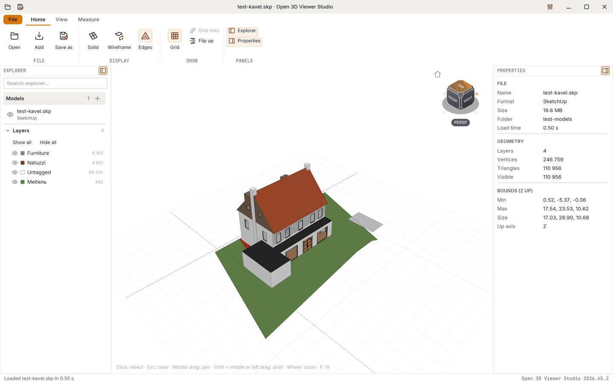
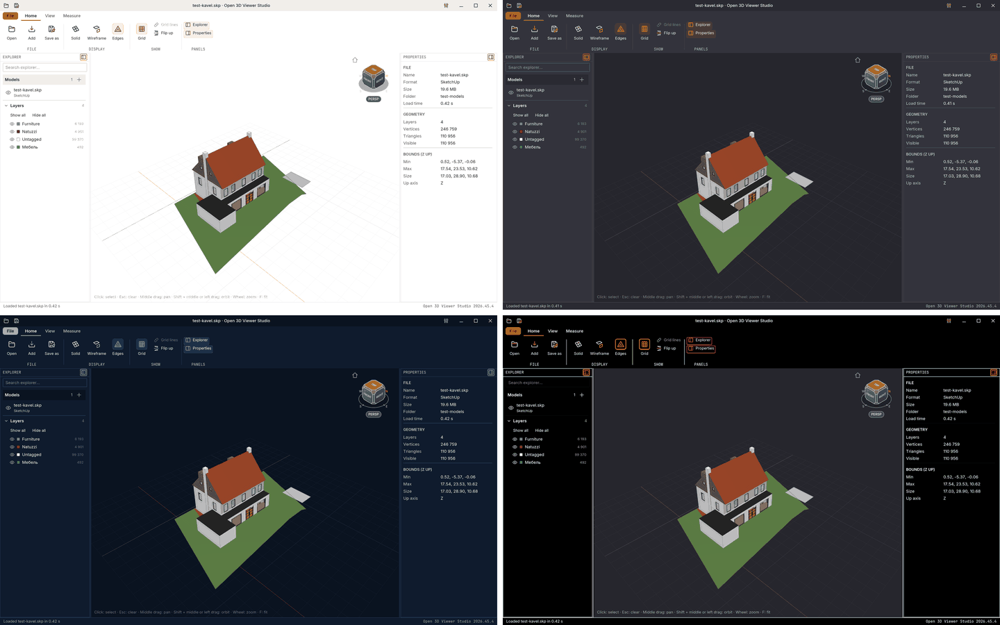
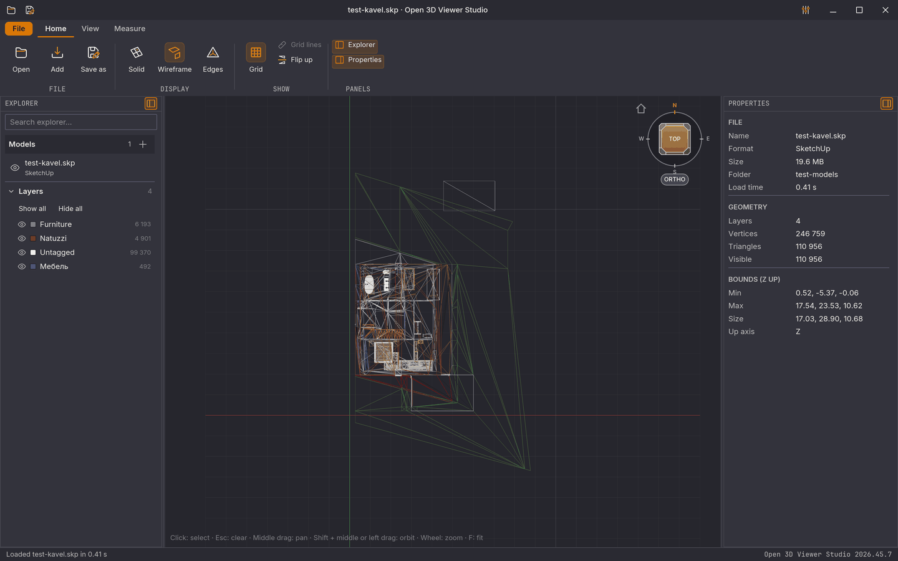
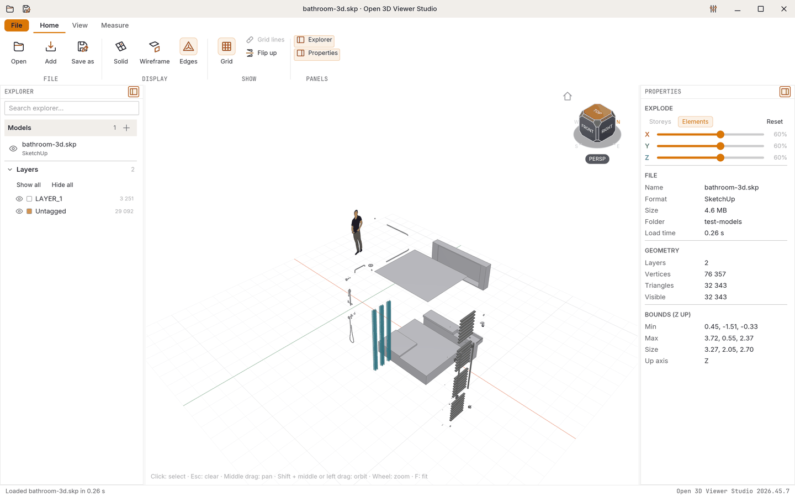
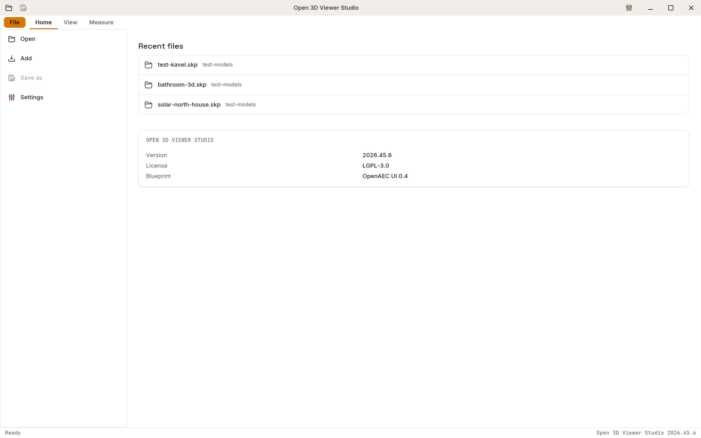
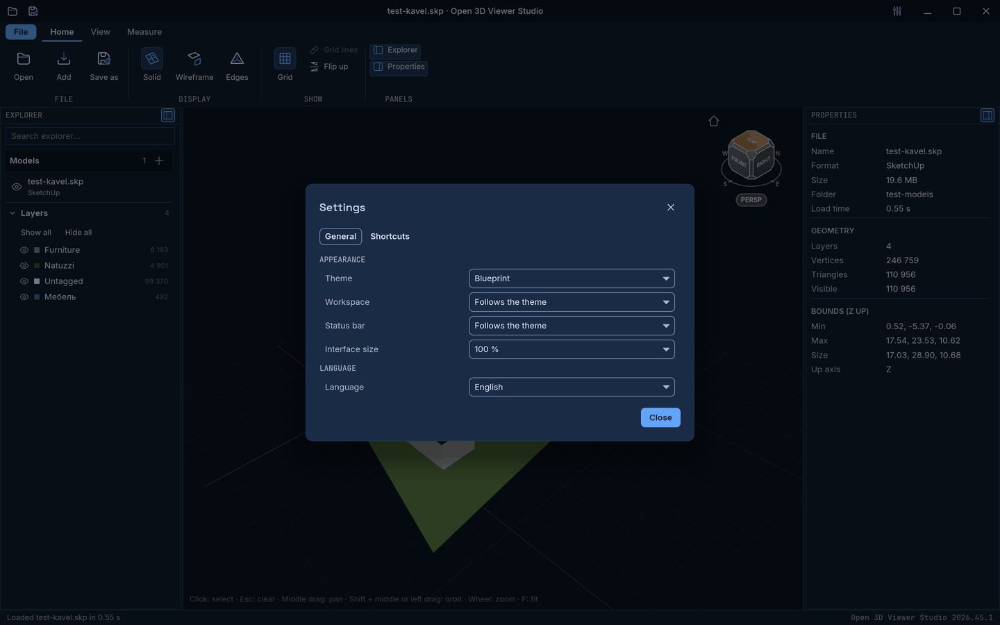
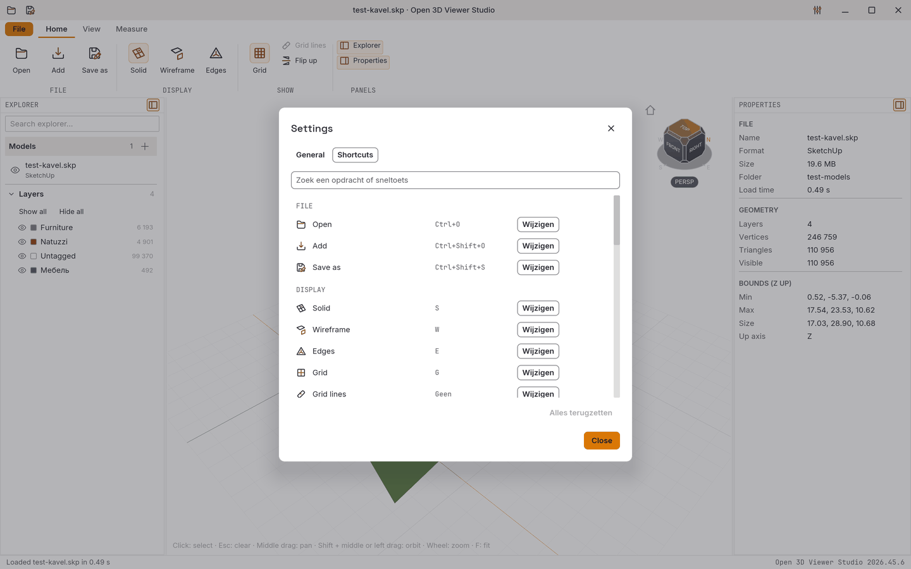
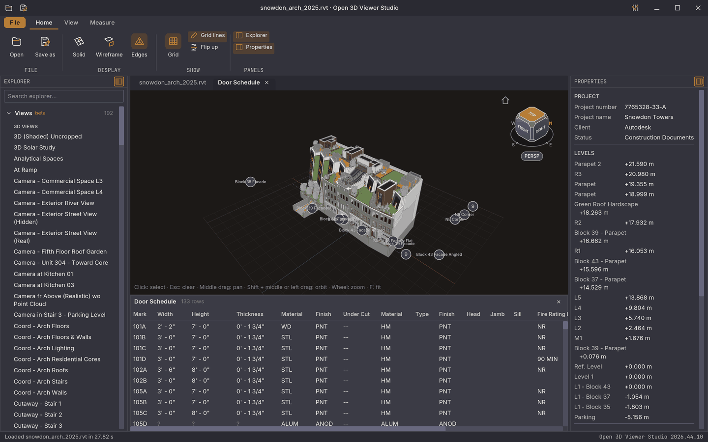

[English](README.md) · **Nederlands**

<div align="center">

# Open BIM Suite

**Een gratis 3D-viewer voor bouwmodellen: hij opent IFC, Revit, SketchUp, Tekla, Allplan, Archicad, Inventor, Vertex BD, BTL, DWG/DXF, MicroStation DGN, STEP, IFC5 (IFCX), CityJSON, CityGML, GeoJSON, Shapefile, LandXML, glTF (ook met Draco-, meshopt- en KTX2-compressie), 3D Tiles, quantized-mesh-terrein, Smithsonian Voyager-scènes, USD, Rhino, COLLADA, 3MF, AMF, FBX, 3DS, VRML/X3D, OBJ, OFF, STL en PLY, modellen in OpenDRIVE, URDF, MagicaVoxel, DICOM-bestanden, constructieve rekenmodellen (sam-json) en puntenwolken in LAS, LAZ (ook cloud-optimised COPC), E57, PTS, PTX, PCD en ASCII-XYZ, en Gaussian-splatscènes (splat-PLY, SPZ, glTF), meet en doorsnijdt ze, slaat ze op als IFC, en exporteert hun plattegronden, doorsneden en bladen als DWG, DXF, IFCCAD, PDF, PNG en SVG, op de desktop en in de browser.**

[](https://github.com/OpenAEC-Foundation/open-bim-suite/releases/latest)
[](https://github.com/OpenAEC-Foundation/open-bim-suite/actions/workflows/build.yml)
[](https://github.com/OpenAEC-Foundation/open-bim-suite/actions/workflows/release.yml)
[](#licentie)

### [Probeer in je browser](https://open-3d-viewer.open-aec.com) &nbsp;·&nbsp; [Download](https://github.com/OpenAEC-Foundation/open-bim-suite/releases/latest) &nbsp;·&nbsp; [Bekijk de video](https://www.youtube.com/watch?v=cxHO8M8W2Ow)

[](https://www.youtube.com/watch?v=cxHO8M8W2Ow)

*▶ De productvideo (73 s, Engels) op het [kanaal van de OpenAEC Foundation](https://www.youtube.com/@OpenAECFoundation).*

</div>

**Open BIM Suite** is de 3D-viewer van de [OpenAEC Foundation](https://github.com/OpenAEC-Foundation). Architecten, constructeurs en bouwers sturen elkaar modellen in allerlei formaten; met deze viewer open je ze allemaal zonder het programma waarmee ze gemaakt zijn. Je loopt om het model heen, klikt een element aan en leest zijn eigenschappen, meet, snijdt het open, trekt het uit elkaar per verdieping of per element, en slaat het op als IFC.

Eén Rust-codebasis levert drie dingen: de **desktopapp** voor Windows, macOS en Linux, de **browserversie** op [open-3d-viewer.open-aec.com](https://open-3d-viewer.open-aec.com), en de **MCP-server** waarmee AI-agents de desktopapp bedienen. Daarnaast staat hier wat van die code ondertekende installers en een live website maakt.



## Probeer het

**[Open de browserversie](https://open-3d-viewer.open-aec.com)**. Sleep een model op de pagina of kies **Openen**, en draai dan met de linkermuisknop, verschuif met de middelste knop en zoom met het wiel. Je hebt een browser met WebGPU nodig: een recente Chrome, Edge, Firefox of Safari. Je bestand blijft op je computer; er wordt niets geüpload. Wil je eerst zien wat hij doet, bekijk dan de [productvideo](https://www.youtube.com/watch?v=cxHO8M8W2Ow) (73 s).

## Download

Elke release staat op de [releasepagina](https://github.com/OpenAEC-Foundation/open-bim-suite/releases/latest). Het makkelijkst is de [OpenAEC Installer](https://github.com/OpenAEC-Foundation/openaec-installer): die installeert, werkt bij en start elke OpenAEC-tool.

| Platform | Bestanden |
|----------|-----------|
| **Windows** | `.exe`-installer (x64, zonder beheerdersrechten) of `.zip` |
| **macOS** | `.dmg` (universeel: Apple silicon en Intel) |
| **Linux** | `.deb`, `.rpm`, `.AppImage` of `.tar.gz`, voor x86_64 en arm64 |

Als de OpenAEC Installer een nieuwere versie heeft, meldt de titelbalk van de viewer dat, en **Bijwerken** geeft het over aan de installer. Elk bestand is ondertekend: Windows met Authenticode, macOS met een Developer ID en genotariseerd door Apple, Linux met de OpenPGP-sleutel van OpenAEC (een `.asc` naast elk pakket en naast `SHA256SUMS`), en alles met een build-attestatie van GitHub. De release notes zeggen per platform of het ondertekend is; een release waar een handtekening ontbreekt, staat als pre-release.

Zelf een download controleren:

```bash
sha256sum -c SHA256SUMS --ignore-missing
gpg --import docs/openaec-releases.asc   # OpenAEC Foundation Releases, vingerafdruk 13F6 D414 ADEE 4ED4 CD09 AC60 601D 86C9 3C50 4D29
gpg --verify SHA256SUMS.asc SHA256SUMS
gh attestation verify open-3d-viewer_2026.45.11_amd64.deb --repo OpenAEC-Foundation/open-bim-suite
```

## Android

De viewer draait op Android-telefoons en -tablets: het is de browserversie, geïnstalleerd als app.

- **Installeren vanuit de browser (aanbevolen).** Open [open-3d-viewer.open-aec.com](https://open-3d-viewer.open-aec.com) in Chrome en tik op **Install** in de balk die verschijnt, of kies **App installeren** (of **Toevoegen aan startscherm**) in het menu van Chrome. De app krijgt een eigen pictogram, opent schermvullend zonder adresbalk, en start zonder netwerk zodra hij een keer geopend is. Hij werkt zichzelf bij met de website.
- **APK.** Elke run van [`android.yml`](.github/workflows/android.yml) op `main` ([de lijst van die runs](https://github.com/OpenAEC-Foundation/open-bim-suite/actions/workflows/android.yml?query=branch%3Amain+event%3Apush)) bewaart een `open-3d-viewer-android-*.apk` onder *Artifacts* op de pagina van de run (je moet bij GitHub ingelogd zijn; de download is een `.zip` met de APK erin). Zet hem op de telefoon, open hem en sta installeren vanaf die bron toe. De APK is een [Trusted Web Activity](https://developer.chrome.com/docs/android/trusted-web-activity): dezelfde webapp, door Chrome geopend als eigen app. Het is een debug-build met een wegwerpsleutel, dus Android kan ervoor waarschuwen, voor een nieuwere moet je de oude eerst verwijderen, en Chrome toont bovenin een smalle adresbalk tot de site de releasesleutel van de app noemt in `/.well-known/assetlinks.json`. Hij staat niet in de Play Store.

Op een touchscreen **draait één vinger**, **zoomen twee vingers door te knijpen** en **verschuiven ze samen**, **tikken selecteert** een element (of zet een meetpunt), **lang drukken zonder slepen opent het menu** van de selectie, en **lang drukken en dan slepen verschuift** (zoals de rechtermuisknop). Op telefoonbreedte is het venster compact: het lint schuift opzij onder je vinger en klapt weg als je op **Start** tikt, en de twee paneelknoppen rechtsboven wisselen de 3D-weergave voor de verkenner of de eigenschappen.

Wat wel en niet werkt op Android:

- Elk formaat van de browserversie opent via **Openen** (de bestandskiezer van Android) of een `?file=`-link. Revit, Vertex BD en BTL niet, zoals in elke browser; zo'n bestand openen meldt dat in de statusbalk en opent een venster waarvan de knop **Downloaden** de downloadpagina van de desktop-app opent.
- De 3D-weergave heeft WebGPU of WebGL2 nodig; een recente Chrome heeft een van beide op de meeste telefoons van de laatste jaren.
- Een groot model laadt langzaam en de app wacht zolang; een telefoon heeft minder geheugen dan een computer, dus een heel groot model kan het tabblad laten stoppen.
- Typen in het zoekveld van de verkenner haalt het schermtoetsenbord niet op (iced ondersteunt in de browser nog geen schermtoetsenbord).
- Er is geen native Android-build: iced 0.14, de interfacebibliotheek, kan niet zelf op Android starten, dus de app is de webversie, geïnstalleerd vanuit Chrome of verpakt in de APK.

## Waarom gebruiken?

- **Vrij en open.** LGPL-3.0. Geen licentiekosten, geen account, geen upload.
- **Opent wat je toegestuurd krijgt.** Revit, Vertex BD (`.vxz`) en BTL-machinebestanden voor houtbouw op de desktop; IFC (ook gezipt), SketchUp (versie 3 en later), Tekla Structures (19.0, 20.0, 2020, 2021 en 2026, met zijn bouten, moeren en ringen, zijn items (ankers, inserts) in hun eigen vorm, zijn stramienen als niveaus en stramienlijnen, zijn opgeslagen modelweergaven, en zijn tekeningen als bladen), Allplan, Archicad (wanden met hun ramen en deuren, vloeren, kolommen, liggers, daken, bibliotheekobjecten als blok, terreinmeshes, zones, morphs, trappen en leuningen), Inventor-onderdelen en -samenstellingen, DWG/DXF, MicroStation DGN (V7 en V8), STEP (AP203, AP214, AP242), IFC5 (IFCX, alfa), CityJSON, CityGML, GeoJSON, Shapefile, LandXML, glTF (ook gecomprimeerd), 3D Tiles, quantized-mesh-terrein, Voyager-scènes, USD, Rhino (versie 2 t/m 9), COLLADA, 3MF, AMF, FBX, 3DS, VRML/X3D, OBJ, OFF, STL en PLY, STL- en OBJ-modellen in OpenDRIVE, URDF, MagicaVoxel, DICOM-bestanden, constructieve rekenmodellen in sam-json (`.samjson`), VTK-netten en simulatieresultaten met hun velden, FEM-invoerdecks (`.inp`), FEM-bulkdata (`.bdf`), eindige-elementennetten (`.msh`), tekstrekenmodellen (`.s2k`) en SAF (`.xlsx`), en puntenwolken in LAS, LAZ (ook cloud-optimised COPC), E57, PTS, PTX, PCD en ASCII-XYZ, en Gaussian-splatscènes (splat-PLY, SPZ en glTF met `KHR_gaussian_splatting`), op de desktop en in de browser.
- **Meerdere modellen tegelijk.** **Openen** zet een bestand in een eigen tabblad naast het open model (meerdere bestanden tegelijk erin slepen laadt ze naast elkaar, elk in een tabblad), **Toevoegen** zet een ander bestand in dezelfde weergave (een IFCX-bestand legt zich juist over een geopend IFCX-model), en elk model heeft een eigen zichtbaarheidsknop.
- **Slaat op als IFCX en IFC.** **Opslaan als** schrijft IFCX (IFC5), tenzij je een ander type kiest: het eigen projectbestand van de viewer, met het model per element, de niveaus, en de plattegronden, doorsneden, aanzichten, bladen en maten, die terugkomen als het bestand weer wordt geopend. Elk model dat de viewer opent, kan ook als IFC 4 worden opgeslagen, met verdiepingen, klassen, eigenschappen en materialen, of met **Exporteren als IFC 4x3** op de pagina Bestand als IFC 4x3 (IFC4X3_ADD2, de huidige ISO 16739-1). De viewer schrijft IFC zelf, zonder IFC-bibliotheek.
- **Slaat een project op.** **Project opslaan** op de pagina Bestand schrijft een klein projectbestand (`naam.project.ifcx`) dat de bestanden noemt die samen open staan, waarheen elk is verplaatst, welke zichtbaar zijn, de camera en het doorsnedevlak. Het kopieert geen model: elk bestand blijft waar het staat, genoemd met zijn pad vanaf het projectbestand, zodat een projectmap als geheel te delen is. Het project openen opent zijn bestanden en zet de opstelling terug; een bestand dat weg is wordt genoemd en de rest opent.
- **Dezelfde app in de browser en op de desktop.** Eén codebasis; de browserversie hoef je niet te installeren.
- **Werkt vanuit Docs in een OpenAEC SuperCloud-omgeving.** Daar opent de browserversie het model uit Docs en bewaart **Opslaan als** het ernaast; **Renderen met Blender** laat de Blender van de omgeving het bewaarde model renderen en zet de afbeelding ernaast.
- **Meten en doorsnijden.** Afstanden, hoeken, oppervlakten en polygonen, een doorsnedekader en een doorsnedevlak met gevulde snedes, en een uit-elkaar-weergave.
- **AI-agents kunnen hem besturen.** Via een MCP-server openen Claude en andere agents bestanden, kijken rond, selecteren en meten, in het venster dat jij ziet.

## Schermafbeeldingen

De schermafbeeldingen tonen de Engelse interface; in **Instellingen** zet je de taal op Nederlands.

| | |
|---|---|
|  **Licht, Donker, Blueprint en High contrast donker** |  **Bovenaanzicht, draadmodel en orthografisch** |
|  **Uit elkaar per element** |  **De Bestand-pagina met recente bestanden** |
|  **Instellingen, thema Blueprint** |  **Eigen sneltoetsen voor elke opdracht** |

## Bekijken en navigeren

- **Draaien, verschuiven en zoomen.** Slepen met links draait, slepen met de middelste knop verschuift, het wiel zoomt naar de cursor. De kijkkubus draait het model naar een zijde; **F** past het model in beeld.
- **Standaardaanzichten.** Iso, boven, voor en rechts (`0`, `1`, `2`, `3`), perspectief of orthografisch (`P`, `O`), en de opgeslagen aanzichten van een Revit-model.
- **Weergaven.** Volledig, draadmodel en volledig met randen (`S`, `W`, `E`), het grondraster (`G`) en **Z-as omdraaien** voor bestanden met de andere as omhoog.
- **Modellen, lagen en eigenschappen.** De verkenner toont de geopende modellen. Het rechterpaneel heeft twee tabbladen. **Lagen** toont de lagen (IFC-presentatielagen of -klassen, Revit-categorieën, SketchUp-tags, Tekla-klassen, Allplan-elementcategorieën, Archicad-wanden, -vloeren, -kolommen, -liggers, -daken, -sparingen, -objecten, -terrein, -zones, -morphs, -trappen en -leuningen, Inventor-lichamen, IFCX-klassen, STEP-presentatielagen of -producten, CAD-lagen, Rhino-lagen) met hun kleur en aantal, en zet ze aan of uit in alleen de getoonde weergave. Elke plattegrond, doorsnede en elk aanzicht houdt zijn eigen lagen, bewaart ze in de IFCX en wordt er op elk blad waar hij op staat mee getekend; de 3D-weergave houdt de zijne. Op een blad schakelt Lagen de weergave die je daar kiest. **Eigenschappen** noemt de getoonde weergave (de soort, bij een plattegrond het niveau, bij een doorsnede de lengte, hoeveel elementen hij verbergt) en laat je zijn naam typen, bij een plattegrond de snijhoogte en de kijkdiepte, bij een doorsnede de diepte: de weergave wordt terwijl je typt opnieuw getekend, in zijn tab en op elk blad waar hij op staat. Het toont ook de eigenschappen van een element waarop je klikt. IFC-ruimtes en sparingsvolumes beginnen verborgen in eigen lagen; de sparingen blijven uit hun wanden en vloeren gesneden.
- **Niveaus.** Het tabblad **Niveaus** van de verkenner toont de niveaus van het gebouw, van hoog naar laag met hun hoogte: de niveaus van een Revit-, Archicad- of Allplan-model en de bouwlagen van een IFC- of IFCX-bestand. **Niveau toevoegen** voegt er een toe die het model mist (een naam en een hoogte in meters), en het kruisje naast een toegevoegd niveau haalt het weer weg. De viewer houdt de niveaus bij als IfcX-bouwlagen (IFC5) en slaat ze op met **Opslaan als** IFCX; IFC schrijft de toegevoegde niveaus als bouwlagen naast die van het model. De stramienen van een Revit- of IFC-model staan in de 3D-weergave op het niveau dat het dichtst bij het peil van het gebouw ligt, met hun naam aan beide uiteinden; **Stramien** zet ze uit en aan. Een plattegrond tekent ze net boven zijn snijhoogte, over de vloer waar hij op kijkt; een doorsnede of aanzicht tekent de stramienen die hij kruist rechtop, met hun bol boven en onder, en de niveaus dwars erdoor, elk met zijn naam en hoogte aan beide uiteinden (een niveau dat te dicht onder een benoemd niveau ligt, houdt alleen zijn markering tot je inzoomt). Een klik op een stramienlijn of zijn bol selecteert hem (de lijn waar er niets voor staat, de bol altijd): hij wordt in de accentkleur getekend en de eigenschappen tonen zijn naam, lengte, richting, hoogte en uiteinden; Escape of een klik op iets anders laat hem los. **Onderlegger** naast een niveau legt er een DWG-, DXF-, IFCCAD- of PDF-tekening op (van een PDF de eerste pagina: zijn paden, met de tekeningen die hij plaatst, op 1:100, wat de schaal naast de naam verandert): de lijnen (lijnen, polylijnen met hun bogen, bogen, cirkels, ellipsen en de ingevoegde blokken, in meters volgens de eenheden van de tekening; teksten en arceringen worden weggelaten en geteld) staan in de 3D-weergave en de plattegronden op de hoogte van het niveau, in blauw. Een tekening ver van het model (in RD-coördinaten bijvoorbeeld) wordt midden op het model gelegd. Onder het niveau zet een klik op de naam hem uit en aan, en het kruisje haalt hem weg.
- **Weergaven, bladen en maatvoering.** Het tabblad **Weergaven** van de verkenner toont de weergaven per soort: plattegronden, constructieve plattegronden, plafondplannen, 3D-weergaven, doorsneden, aanzichten en bladen (de IFCX bewaart de soort van elke weergave). **Nieuw** naast een soort plattegrond toont de niveaus om er een van te maken; die opent in een tabblad naast de 3D-weergave, net als doorsneden, aanzichten en bladen. Een plattegrond is van bovenaf gezien en afgesneden op 1,20 m boven zijn niveau. Een constructieve plattegrond is afgesneden als een plattegrond, kijkt 1 m onder zijn niveau zodat de balken onder de vloer te zien zijn, en laat weg wat niets draagt: volgens de eigenschap `LoadBearing` van het element, anders zijn IFC-klasse of zijn Revit-, Tekla- of Archicad-categorie (wanden, vloeren, kolommen, balken, staven, platen, funderingen, palen, daken, trappen en hellingbanen blijven; elementen waarvan niets bekend is ook). Een plafondplan is afgesneden op 2,30 m boven zijn niveau en van onderaf gezien, tot het volgende niveau; op een blad wordt hij getekend zoals de plattegrond ligt (gespiegeld plafondplan). **Nieuw** naast de 3D-weergaven legt vast wat het tabblad 3D toont, met zijn camera, doorsnedekader, lagen en verborgen elementen, als 3D-weergave met een eigen naam (`3D-weergave 1`, ..., te wijzigen in het tabblad Eigenschappen); zijn tabblad draait zoals de 3D-weergave, en hij houdt hoe hij verlaten is, ook in het IFCX-bestand. Elke plattegrond, doorsnede en elk aanzicht heeft een eigen camera; slepen verschuift hem in plaats van hem te draaien, en de selectie is in beide richtingen gedeeld door alle weergaven. Boven het tabblad van een weergave staat een balk: **Maatvoering** (twee klikken, die naar de uiteinden van de lijnen springen), **Tekst** (een klik plaatst hem; een geselecteerde tekst sleep je naar een andere plek of pas je aan in de balk), op een plattegrond **Doorsnede** (twee klikken tekenen een doorsnede die links van zijn lijn kijkt; hij opent in zijn tabblad, en de plattegrond toont zijn lijn en letter) en **Standaard maatvoering** (de buitenmaten buiten de tekening, met een maatketting langs de stramienen, en in een doorsnede langs de niveaus, en de totaalmaat een meter verder naar buiten). Een geselecteerde maat zet **Andere kant** aan de andere kant, en Delete haalt weg wat geselecteerd is. Maten en teksten horen bij de weergave, dus elk blad waar hij op staat, toont ze. **Vier aanzichten** maak je met één klik, en de tool **Doorsnede** van het blad tekent een doorsnede met twee klikken op een plattegrond (hij kijkt naar links van de lijn; de plattegrond toont zijn lijn en letter). **Nieuw blad** maakt een blad in een eigen tabblad (A4 tot A0): sleep er plattegronden, doorsneden en aanzichten op vanuit de lijst **Weergaven** (of plaats ze vanuit de balk), getekend als lijnen (de snede dik, wat erachter ligt dun; doorsneden en aanzichten zonder verborgen lijnen), sleep ze over het papier, en klik met **Maatvoering** twee punten van een weergave aan (ze springen naar de uiteinden van de lijnen) voor een maat in millimeters, of zet er met **Tekst** een tekst op, die overal staat waar de weergave geplaatst is. Een klik selecteert een geplaatste weergave, een maat of een tekst: een weergave krijgt haar schaal (1:20 tot 1:1000), een plattegrond zijn snijhoogte, slepen aan een zijde van het kader snijdt hem bij (het tabblad van de plattegrond volgt), en Delete haalt weg wat geselecteerd is. **Indelen** in de balk van een blad geeft zijn weergaven één schaal, de grootste waarop ze allemaal passen, en zet ze in rijen, gecentreerd, met ruimte voor hun naam en de titel van het blad; **Losse weergaven op bladen zetten** in de lijst Weergaven zet elke plattegrond, doorsnede en elk aanzicht dat nog op geen blad staat op nieuwe A3-bladen, de plattegronden van het laagste niveau omhoog, met één schaal per soort en zoveel per blad als passen. Alles blijft in het IfcX-document en wordt opgeslagen met **Opslaan als** IFCX. **Weergaven in 3D** (tab Beeld) zet elke weergave in de 3D-weergave op haar eigen vlak: een plattegrond op zijn snijhoogte met de lijnen van zijn snede, een doorsnede of aanzicht rechtop op zijn lijn, elk in een oranje kader met de naam; de weergaven uit een Revit-model tonen hun kader (een plattegrond op zijn snijhoogte boven het model, een doorsnede aan de voorkant van zijn uitsnede). Ze volgen als een weergave gemaakt, bijgesneden of opnieuw gesneden wordt.
- **Exporteert tekeningen.** **Exporteren** in de balk boven het tabblad van een weergave of blad schrijft wat het tabblad toont als DWG, DXF, IFCCAD (het open 2D-tekenprofiel op IFCX), PDF, PNG (200 dpi) of SVG: de snijlijnen dik en wat erachter ligt dun, de maten en teksten, en op een blad de rand, de titel, de doorsnedemarkeringen en de naam en schaal van elke weergave. Een plattegrond of doorsnede neemt de stramienen en niveaus mee die zijn tabblad toont: een stramien met een bol en zijn naam aan beide uiteinden, een niveau met zijn naam en hoogte. CAD-bestanden zijn in millimeters, een weergave op 1:1 en een blad op papiergrootte, met een laag per soort lijn (`O3V-Cut`, `O3V-Beyond`, `O3V-Dimensions`, `O3V-Text`, `O3V-Frame`, `O3V-Grids`) die zijn lijndikte draagt. In de browser gaat het bestand naar de downloads.
- **Het tabblad IFC.** **IFCX** op de schakelaar rechtsboven laat in plaats van de weergaven zien hoe het IFCX-bestand van het project is opgebouwd (een IFC-bestand in STEP-vorm, IFC2x3, IFC4 of IFC4x3, wordt zelf getoond en op dezelfde manier uit elkaar gehaald: elementen, typen en materialen als nodes, de relaties als de koppelingen ertussen, en de eigenschappensets en hoeveelheden als nodes onder hun element, met elke waarde), in welk product er ook aan gewerkt wordt; **IFC-structuur** in het lint opent hetzelfde onder de 3D-weergave als een tabblad dat laat zien hoe het IFCX-bestand van het model is opgebouwd: het IFCX-bestand waaruit het model geopend is, of de IFCX die **Opslaan als** voor elk ander model schrijft. **Tekst** toont het hele bestand, elk onderdeel op een eigen regel in de volgorde van het bestand en een lijst getallen op één regel; **Nodes** de boom vanaf de wortels langs children en inherits, met de klasse, naam en attributen van elke node; **Tabel** de `data`-items in de volgorde van het bestand met hun pad, klasse, naam, children, inherits en attributen; **Relaties** de verbanden tussen de nodes, genoemd naar de IFC-relatie waar ze voor staan (samenstelling, plaats in een bouwlaag, sparingen, vullingen, type en materiaal), met een filter per relatie. Het zoekveld vindt wat een woord bevat, in hoofd- of kleine letters: de tekst markeert de regels en springt van de een naar de volgende (Enter of de pijlen), de boom toont de gevonden nodes met de boom ernaartoe opengeklapt, en de tabel en de relaties tonen alleen hun rijen. Een node die je in het tabblad kiest, selecteert zijn elementen in het model (een bouwlaag alles wat erin staat), en een element dat je in het model selecteert, wordt in het tabblad gekozen, met de boom ernaartoe opengeklapt. Een bestand van 4 MB met 15.000 regels opent in een tiende seconde en scrolt soepel, omdat alleen de regels in beeld getekend worden.
- **Selecteren, verbergen en isoleren.** Ctrl-klik voegt een element toe of haalt het weg, Ctrl en slepen trekt een kader (naar rechts neemt het wat erin ligt, naar links wat het raakt), **Laag selecteren** voegt de rest van hun lagen toe, en de knop naast een eigenschap selecteert elk element met die waarde. **Verbergen** (`H`), **Isoleren** (`I`) en **Alles tonen** (`Ctrl+Shift+H`) werken per element, ook op constructieve knopen en staven, en vanuit het **rechtermuismenu** in de 3D-weergave (een rechtsklik op iets dat niet geselecteerd is, selecteert het eerst). In een plattegrond, doorsnede, aanzicht of 3D-weergave van het document werken ze alleen in die weergave: hij houdt de elementen die hij verbergt, bewaart ze in de IFCX (met de eigen knopen van die elementen in het bestand) en wordt op elk blad waar hij op staat zonder ze getekend; de 3D-weergave houdt de zijne. `Ctrl+Z` en `Ctrl+Y` maken ongedaan en opnieuw wat er getoond wordt, in de getoonde weergave.
- **Sneltoetsen.** Elke opdracht staat één keer in één lijst, die het lint, de titelbalk en het toetsenbord gebruiken. In **Instellingen** geef je elke opdracht je eigen toets.

## Meten, doorsnijden en uit elkaar halen

- **Meet** afstanden, hoeken, polygonen en oppervlakten door in het model te klikken, of tussen twee elementen. Voor je klikt licht het punt, de rand of het vlak onder de cursor op, en de cursor springt binnen een paar pixels naar hoekpunten, middens van randen en randen. Metingen blijven in beeld tot je ze wist.
- **Doorsnedekader en doorsnedevlak** snijden het model open, met gevulde snedes. Het kader kan zich aanpassen aan de selectie.
- **Uit elkaar** trekt het model per verdieping of per element uit elkaar, met een percentage per as.

## Viewer, Modeller en BIM Validator

Eén codebase, één app, drie producten. De schakelaar rechtsboven in het venster wisselt ertussen; elk heeft een eigen lint, eigen panelen en een eigen startscherm over hetzelfde open project. Op de schakelaar staan korte namen (**View**, **IFCX**, **Collab**, **PointCloud**, **Struct**, **Modeller**, **Docs**); een product dat nog in alfa is, is daar grijs, en de tooltip zegt dat erbij:

- **Viewer**: openen, bekijken, meten en doorsnijden, zoals hierboven.
- **Modeller**: het tabblad **Modelleren** met de basiselementen (hieronder), en een tabblad **Beeld** met de weergave, camera, doorsnede en meten van de Viewer.
- **BIM Validator** (een opzet): de modellen van het project samen, met issues (BCF), controleren tegen een IDS, opmerkingen en delen die nog komen. Het lint toont die opdrachten al, nog niet werkend, en het paneel zegt wat elk gaat bevatten.

**Extensies.** Elk product is een extensie: Instellingen, tabblad Extensies, toont ze, en wat uit staat verdwijnt van de schakelaar tot het weer aan gaat. De Viewer is de suite zelf en blijft. Onder elke extensie staan de tools die erop draaien, de groepen van zijn lint, elk aan of uit te zetten.

Het venster opent in het product dat het laatst gebruikt is; `--product viewer|modeller|validator` op de opdrachtregel en `?product=modeller` in de browser kiezen er een. Welke modules elk product gebruikt, en hoe elk gebouwd wordt: [`docs/architecture/products.md`](docs/architecture/products.md).

## Docs

Een project is meer dan zijn modellen. **Docs** is een eigen product op de schakelaar bovenin het venster. Het toont de projectmap: de mappen in het linkerpaneel en de bestanden ernaast, met de titel, de status en de versie die van elk document zijn vastgelegd.

- **Geen server en geen account.** Het project is een map die je team al deelt: Dropbox, SharePoint (via OneDrive), Synology Drive, een GitHub-repository die je gekloond hebt, of een netwerkmap. Wie bij de map kan, doet mee.
- **Het ziet wat de synctool doet.** Een bestand dat alleen online staat is gemarkeerd, en wordt niet opgehaald door het in de lijst te tonen. Een conflictkopie, ontstaan toen twee mensen een bestand tegelijk wijzigden, is ook gemarkeerd.
- **Versies.** Leg het bestand zoals het nu is vast als versie (een code zoals P01, een opmerking). Docs bewaart er een kopie van naast het register en zegt daarna wanneer het bestand sindsdien gewijzigd is, aan de hand van grootte en tijd. Een eerdere versie opent naast het huidige bestand, of gaat terug op zijn plek (na een tweede druk; het bestand zoals het was wordt eerst apart gezet).
- **Uitchecken.** Check een document uit terwijl je eraan werkt: de lijst en het rechterpaneel laten de anderen zien wie het heeft.
- **Delen.** Via de dienst die de map bijhoudt: de pagina van het bestand op GitHub, SharePoint of Teams, of Dropbox (waar delen met anderen en hun eigen versiegeschiedenis zitten), de link of het pad op het klembord, of een nieuwe mail met de link.
- **Status.** In bewerking, gedeeld, gepubliceerd of gearchiveerd.
- **Gekoppeld aan het model.** Koppel een document aan de geselecteerde elementen; een koppeling selecteert haar element weer. De eigenschappen van een geselecteerd element noemen de documenten die erover gaan, en een klik op een document opent het in Docs.
- **IFCX.** Wat over een document gezegd is, is één klein IFCX-bestand per document, in `_openaec/docs` van de projectmap, zodat twee mensen die aan verschillende documenten werken nooit hetzelfde bestand schrijven. Een gekoppeld element van een IFCX-model draagt zijn documenten als dat bestand als laag over het model ligt.
- **Als een verkenner.** Een pad om op te klikken boven de lijst, een pictogram per soort bestand, de mappen van een map boven de bestanden, kolommen die met een klik sorteren, en zoeken door de hele projectmap. Een dubbelklik (of Enter) opent een bestand: een model of een puntenwolk in de suite, elk ander bestand in het programma waarmee je computer het opent. De pijltjestoetsen lopen door de bestanden en Backspace gaat een map omhoog.
- **Opslaan.** Het open model wordt in de projectmap opgeslagen: waar het vandaan kwam als dat een formaat is dat de suite schrijft, anders als nieuw IFCX-bestand in de map die getoond wordt, nooit over een bestaand bestand heen.
- **GitHub.** Een projectmap die een Git-checkout is (gekloond van GitHub of een andere Git-server) werkt op dezelfde manier. Het gekozen bestand toont de versies die Git ervan bewaart (wie, wanneer, waarom) en of het sindsdien gewijzigd is; een oudere versie opent naast het huidige model of gaat terug op zijn plek. Daar worden geen kopieën bewaard: Git bewaart de versies. Docs commit of pusht nooit: dat blijft bij je eigen Git-programma.

Docs werkt in de desktop-app; een browser heeft geen gesynchroniseerde mappen. Het schrijft nooit iets tenzij jij iets doet, en verplaatst, hernoemt of verwijdert nooit een projectbestand; de enige projectbestanden die het schrijft zijn het model dat je opslaat en een eerdere versie die je terugzet. Het ontwerp: [`docs/superpowers/specs/2026-11-17-docs-design.md`](docs/superpowers/specs/2026-11-17-docs-design.md).

## Library

**Library** is een product op de schakelaar bovenin het venster (alfa). Het is ingedeeld als een bibliotheekverkenner:

- **Links**: een zoekveld, de bron, en een boom met wat die bron bevat, per soort object: materialen; **vlakvormige elementen** (wanden, vloeren, daken, plafonds); **staafvormige elementen** (kolommen, balken, palen en de andere rollen, met de staaltabel); **systemen** per groep; de **tekenstandaard** (tekeningsoorten, schalen, lijnstijlen, lijndiktes, tekststijlen); de **arceringen** (de tekens van NEN 47, de eigen gekleurde van de suite, en waarmee elke materiaalsoort getekend wordt); de huisstijl van een bedrijf. Elke regel zegt hoeveel er zijn.
- **Midden**: de objecten van de gekozen categorie als tegels, elk met een voorbeeld: de arcering en kleur van een materiaal, de doorsnede van een opbouw, de omtrek van een profiel, het aanzicht van een systeem, een lijn zoals een pen en een lijnstijl die tekenen, een arcering zoals een tekening haar toont. De laatste tegel van een categorie van het project maakt een nieuwe. Naast **Tegels** staan nog twee tabjes: **3D** toont het gekozen object in 3D, **IFCX** de objecten zoals een bestand ze bewaart.
- **Rechts**: een klik op een tegel van het project opent de editor. Een klik op een tegel van een andere bibliotheek toont die daar, met een knop die er een kopie van maakt in het project om te bewerken. Een klik op een tegel van de tekenstandaard toont de velden.

De bronnen, te kiezen in het linkerpaneel of op het lint:

- **Algemeen.** Waar elk project mee begint: de eigen arceringen van de suite, en de startbibliotheek met materialen, wanden, vloeren, daken, plafonds, lijntypen, systemen en de staaltabel.
- **Land.** De inhoud van een land: de arceringen van de tekennorm (Nederland NEN 47, Duitsland DIN 1356, Verenigd Koninkrijk ISO 128 / BS 1192, Verenigde Staten ANSI), en voor Nederland de tekens van NEN 47, de gekleurde arceringen van de suite en de types van de Nederlandse template, waaronder haar twee funderingspalen (geheid, vierkant, 220 mm; de template geeft ze geen materiaal, hier zijn ze van prefab beton).
- **Bedrijf.** De huisstijl van een bedrijf: wie het is, zijn kleuren en lettertypen, zijn bladformaten, zijn titelblok en hoe het maten schrijft, in te stellen in het rechterpaneel onder een voorbeeldblad. Hij begint als die van de suite zelf, om er die van een bureau van te maken.
- **Project.** De bibliotheek van het open project, zoals het tabblad Bibliotheek van de Modeller die toont.

**De tekenstandaard (Nederland).** De boom heeft de tekenstandaard onder Land, Nederland, en onder Project, en elk onderdeel daarvan is in te stellen:

- **Tekeningsoorten**: 20 om mee te beginnen (plattegrond, funderingsplattegrond, BVO-plattegrond, aanzicht, doorsnede, detail, constructieve plattegrond, palenplan, renvooi, situatie, dakplan, plafondplan, wapeningstekening en meer). Elke soort heeft een naam, de code die ze in een tekeningnaam heeft, een nummerreeks, een discipline (ALG, BWK, CON, INS), een aanzicht, de schalen waarop ze getekend wordt met de gebruikelijke voorop, de pen voor wat doorgesneden is en voor wat daarachter ligt, de lijnstijl voor wat verborgen is, een tekststijl en of doorgesneden materiaal gearceerd wordt. Je kunt een eigen soort toevoegen en een soort verwijderen.
- **Instellingen waar de soorten uit kiezen**: de schalen, de lijnstijlen (strepen en tussenruimtes in lijndiktes), de lijndiktes (pennen) en de tekststijlen.
- **Waar het vandaan komt.** De soorten, aanzichten, schalen en bladnummers van de eerste twaalf zijn die van de tekeningen in de INB-template; de andere zijn gebruikelijk in de Nederlandse praktijk en zeggen dat erbij, en hun schalen zijn een voorstel. De lijnstijlen zijn de basislijntypen van ISO 128-2, de lijndiktes en teksthoogtes de ISO-reeksen; wat doorgesneden is, wordt twee keer zo dik getekend als wat daarachter ligt.
- **Bewaard in IFCX.** De standaard gaat mee in het IFCX-bestand van het project, een node per instelling, zodat een latere laag één pen of schaal kan wijzigen. Een wijziging wordt alleen overgenomen als de standaard dan nog klopt (elke schaal, pen en stijl van een soort bestaat).

Klik op de tegel van een soort of een instelling; de velden staan in het rechterpaneel. De tegel van een soort toont hoe die tekent wat doorgesneden is, wat daarachter ligt en wat verborgen is. Een schaal, een lijnstijl, een lijndikte en een tekststijl kun je toevoegen, en verwijderen zolang geen tekeningsoort ze gebruikt.

**De standaard stuurt de tekeningen aan.** Een plattegrond, een doorsnede of een aanzicht is een tekeningsoort uit de standaard: een plattegrond de soort "plattegrond", een constructieve plattegrond "constructieve plattegrond", een plafondplan "plafondplan", een doorsnede "doorsnede", een aanzicht "aanzicht", totdat je er een andere aan geeft. De soort bepaalt hoe er getekend wordt: hoe dik wat doorgesneden is en wat daarachter ligt, de strepen van wat verborgen is, hoe hoog teksten en maten zijn, of doorgesneden materiaal gearceerd wordt, en welke schalen worden aangeboden. Het blad op het scherm en elke geëxporteerde tekening (PDF, SVG, PNG, DXF, DWG, IFCCAD) volgen de soort zoals die op dat moment is: wijzig een pen van een soort en de tekeningen veranderen mee.

In het deel Aanzicht van het rechterpaneel kies je de soort en de schaal van het aanzicht, en **Soort bewerken** opent daar de velden van de soort zelf; wat je daar instelt, geldt voor elke tekening van die soort. Een nieuw aanzicht krijgt de gebruikelijke schaal van zijn soort, en een aanzicht dat je op een blad zet, begint op zijn eigen schaal en krijgt de schalen van zijn soort aangeboden. In DXF en DWG komen lijnen met een andere dikte dan hun pen op een eigen laag, genoemd naar de pen en de dikte (`O3V-Cut-070`). De soort wordt bij het aanzicht bewaard in IFCX (`drawing`). Nog niet: op het scherm zijn de diktes relatief (0,5 mm is 1,2 pixel), een blad dat uit een bestand komt wordt getekend zoals voorheen, en een soort heeft één pennenpaar voor al zijn schalen.

**Arceringen.** Onder Arceringen staan de tekens van **NEN 47** (23: metselwerk, beton, natuursteen, naaldhout en loofhout, isolatie, maaiveld, zand, water, glas en de andere) en **OpenAEC**, de eigen arceringen van de suite (72): dezelfde tekens op een kleur, en onder een teken één per soort materiaal: 17 houtsoorten, acht plaatsoorten, zeven soorten isolatie, vijf soorten natuursteen, vijf soorten metselwerk, vijf soorten grond en twee soorten glas. Elke arcering is een tegel die naast zichzelf gelegd, geschaald en gedraaid wordt, overgenomen uit de arceerpatronen van de INB-template van de OpenAEC Foundation voor tekeningen op 1:50. Een klik toont haar groter, met haar teken, tegel, schaal, hoek en kleur. De zoekfunctie vindt een arcering op haar naam, haar sleutel, haar reeks en de naam van haar teken. **Per materiaalsoort** toont waarmee een materiaal van elk van de negen soorten getekend wordt volgens de norm van de bron; metselwerk volgens NEN 47 met dubbele lijnen, zoals het teken ze heeft, op de pagina en in elke tekening. Nog niet: een materiaal wordt nog getekend met de arcering van zijn soort, het kan er dus geen uit deze lijst kiezen en de tekeningen tekenen ze niet; eigen arceringen maken kan niet; en de arceringen voor grondsoorten (NEN 5104) staan niet in de template, die zijn er dus niet.

**3D.** Het tabje **3D** toont wat gekozen is als volumes: een stuk wand, vloer, dak of plafond met een plaat per laag van de opbouw (een spouw blijft open); een lengte van een staaftype of van een profiel uit de staaltabel (een kolom en een paal staand, de rest liggend); en een systeem zoals het gegenereerd wordt, ongeveer 2,4 m ervan met zijn staven, zijn platen en zijn lagen, een systeem met raveling met een raam erin. Slepen draait het. **Uit elkaar** zet de lagen een stukje van elkaar, zodat je ziet hoe het in elkaar zit. Het rechterpaneel blijft de editor: wat je daar wijzigt, zie je in de weergave. Het is een blik op een type die de suite zelf tekent, zonder grafische kaart: inzoomen en doorsnijden kan niet, en het is niet de viewport van het model. Een materiaal, een arcering en een instelling van de tekenstandaard hebben geen 3D-weergave.

**IFCX.** Het tabje **IFCX** toont de objecten van de categorie zoals een IFCX-bestand ze bewaart: een materiaal, een opbouw, een staaftype, een systeemtype, een tekeningsoort of een instelling van de standaard, en een arcering, elk als zijn node, met een lijst getallen op één regel. **Kopieer** zet een node op het klembord. Een klik op de naam van een node kiest het object zoals een klik op zijn tegel, en het gekozen object staat bovenaan. De staaltabel, de arcering per materiaalsoort en een huisstijl zijn geen nodes van een bestand; het tabje zegt dat.

**Materialen.** Onder Materialen staan de materialen van het project als tegels, elk met zijn arcering en zijn kleur. Klik er een aan en het rechterpaneel is de editor: de naam in het Nederlands, Engels, Duits en Frans, de kleur in het 3D-model (getypt als zes hexadecimale cijfers, of ingesteld met een schuif per kanaal), en de arcering waarmee een doorsnede erdoor wordt getekend, gekozen uit de getekende arceringen. Het paneel toont de arcering van een doorsnede en de kleur van het 3D-model naast elkaar, en zegt hoeveel opbouwen, staaftypen en systemen van het materiaal gemaakt zijn. Een materiaal kun je toevoegen, dupliceren en verwijderen; een materiaal waar een type van gemaakt is, wordt niet verwijderd. De sleutel blijft wat hij is: lagen, types en bestanden verwijzen ernaar. In een bestand is een materiaal `IfcMaterial`, zoals het was.

**Wanden, vloeren, daken en plafonds.** Ze staan bij elkaar in de boom als vlakvormige elementen; elke opbouw is een tegel met zijn doorsnede, zijn dikte en het aantal lagen. Klik er een aan en het rechterpaneel is de editor: de doorsnede getekend met de arceringen, en de lagen van buiten (of van boven) naar binnen. Elke laag heeft een materiaal en een dikte in millimeters; een laag kun je verplaatsen, toevoegen en verwijderen. De naam volgt de lagen, tenzij je een eigen naam typt. Een opbouw kun je toevoegen, dupliceren en verwijderen. Een wijziging wordt alleen overgenomen als de opbouw dan nog klopt (een bekend materiaal, minstens 0,1 mm, minstens één laag).

**Kolommen, balken en andere staaftypen.** Onder Staafvormige elementen heeft de boom de rollen (kolom, balk, staaf, stijl, plint, leiding, kanaal, kabelgoot, paal); elk type is een tegel met de omtrek van zijn profiel en zijn IFC-definitie. Klik er een aan en het rechterpaneel is de profieleditor. Een profiel is een van de parametrische profieldefinities van IFC (`IfcRectangleProfileDef`, `IfcCircleProfileDef`, `IfcIShapeProfileDef`, `IfcUShapeProfileDef`, `IfcLShapeProfileDef`, `IfcTShapeProfileDef`, `IfcRectangleHollowProfileDef`, `IfcCircleHollowProfileDef`), en je stelt het in met de attributen van die definitie onder hun IFC-naam (`OverallDepth`, `WebThickness`, `FilletRadius`), in millimeters; een helling in graden. De omtrek staat erboven getekend; de oppervlakte en de traagheidsmomenten staan eronder. De rol geeft het type zijn IFC-klasse (`IfcColumnType`, `IfcBeamType`). Kies je een andere definitie, dan begint die met een profiel van ongeveer dezelfde maat. Een type kun je toevoegen, dupliceren en verwijderen, en een eigen naam geven. Een wijziging wordt alleen overgenomen als het type dan nog klopt (een bekend materiaal, een profiel dat te maken is). Het bestand (een IFCX-bibliotheek, of het project) bewaart het profiel bij zijn type zoals IFC het heeft, onder `openaec::profile`: de klasse van de definitie, `ProfileType`, `ProfileName` bij een profiel uit de staaltabel, en de attributen onder hun IFC-naam, in meters. Het wordt daaruit teruggelezen, dus een ander programma kan een profiel wijzigen via zijn IFC-attributen; bestanden van eerder lezen zoals voorheen.

**Staalprofielen.** Onder Staafvormige elementen heeft de boom de staaltabel (1050 profielen: de Europese reeksen, en uit Project Ocondat de lichte en brede H-profielen, UAP, koudgevormde kokers, strippen en rondstaal, de oude Differdinger-balken en meer maten van de rest). Typ om er een te vinden ("hea 2") of kies een serie, en elk gevonden profiel staat er als tegel met zijn omtrek en zijn maat. Klik een tegel aan en het gekozen type neemt dat profiel over; is er geen type gekozen, dan komt er een type van de getoonde rol van. Een profiel uit de tabel dat je wijzigt, is geen profiel uit de tabel meer.

**Systemen.** Onder Systemen heeft de boom de groepen (vliesgevels, kozijnen, houtskeletbouw, metal stud, metselwerk, gevelbekleding, vloeren, plafonds); elk type is een tegel met zijn aanzicht en zijn totale diepte. Klik er een aan en het rechterpaneel is de editor: het aanzicht zoals de kernel het maakt, een doorsnede, en de opbouw van buiten (of van boven) naar binnen: het vlak zelf en de lagen ervoor en erachter. Klik een onderdeel aan en zijn velden gaan open: de panelen (een materiaal en een dikte), het raster (breedte en hoogte hart op hart, en een verband), en de stijlen en regels: op de rasterlijnen of als raamwerk, met hun materiaal en maat, en bij een raamwerk de onder- en bovenregels, de latei en de grootste lengte van een prefab-element. Een laag kan ook alleen uit platen bestaan. Maten typ je in millimeters; Enter neemt ze over. Een laag verplaats je naar buiten of naar binnen (ook langs het vlak), voeg je toe tegen de buitenste van een zijde, en verwijder je. Lagen die op elkaar aansluiten, blijven dat doen als een dikte verandert; de afstand van een laag tot het vlak kun je ook typen, en het paneel zegt dan dat er ruimte tussen de lagen zit en biedt aan ze te laten aansluiten. De groep geeft het type zijn IFC-klasse (`IfcCurtainWallType`, `IfcWindowType`, `IfcWallType`, `IfcCoveringType`, `IfcSlabType`); een vloer of een plafond ligt op een hoogte boven zijn peil, de andere staan. De hoeken van de randprofielen zijn koud of in verstek. De naam volgt de stijlen of de panelen en typ je niet. Een type kun je toevoegen (het eerste van zijn groep uit de algemene bibliotheek), dupliceren en verwijderen. Een wijziging wordt alleen overgenomen als het type dan nog klopt (bekende materialen, rastermaten groter dan de stijlen, minstens 0,1 mm).

**Elementen volgen hun type.** Een wand, vloer, dak of plafond in het model dat van een opbouw is gemaakt, een systeem van een systeemtype, en een kolom of balk van een staaftype volgen een wijziging van dat type: wijzig het type in Library en de elementen die ervan gemaakt zijn, worden opnieuw gemaakt zoals het type nu is. Het paneel van de editor zegt hoeveel elementen in het model van het type zijn. Een kolom of balk hangt aan zijn type via de naam van het type, en neemt dus ook een nieuwe naam over. Een element dat de kernel niet kan maken zoals het type nu is (een wand waarvan alle lagen spouw zijn), blijft zoals het was, en het paneel zegt hoeveel en waarom. De wijziging van een type en van zijn elementen is één stap die je met Ctrl+Z terugneemt: beide gaan samen terug. In een bestand waarvan de elementen gemaakt zijn voordat hun type veranderde, zegt het paneel hoeveel elementen niet zijn zoals het type nu is, en **Bijwerken** maakt ze weer zo. Een materiaal met de arcering van lucht is een spouw in een wand; wanden en vloeren volgen dus als de arcering van een materiaal verandert. Een systeem houdt de ligging die het kreeg: een staand systeem volgt geen type dat liggend wordt gemaakt.

**Ongedaan maken in Library.** Elke wijziging van de bibliotheek van het project (een materiaal, een opbouw, een staaftype, een systeemtype) en van de tekenstandaard is een stap die je met Ctrl+Z terugneemt en met Ctrl+Y opnieuw doet, met of zonder open model, in de volgorde waarin de stappen samen met die van het model zijn gezet. Typen in een naamveld is één stap, en een kleur instellen met de schuiven en het veld ook. Een stap die je terugneemt, vergeet wat er getypt werd, en een editor laat een type los dat er niet meer is.

**Zoeken.** Het veld bovenin het linkerpaneel zoekt in alle bibliotheken tegelijk: materialen, wanden, vloeren, daken, plafonds, kolommen en balken, systemen, staalprofielen, tekeningsoorten en instellingen. Wat het vindt, staat als dezelfde tegels. Een klik toont het object waar het thuishoort: een object van het project in de editor, een object uit een andere bibliotheek op zijn pagina met de knop om een kopie te bewerken, een tekeningsoort of instelling in haar standaard, een staalprofiel in de staaltabel met een knop die er een balktype van maakt.

Elke soort inhoud is een kaart met het aantal en een eerste blik (kleuren of de eerste namen). Wat de suite nog niet heeft (symbolen, producten van fabrikanten) staat op zijn kaart als "volgt". De kaarten openen nog niet. Het ontwerp en de volgende stappen: [`docs/superpowers/specs/2026-11-18-library-design.md`](docs/superpowers/specs/2026-11-18-library-design.md).

## GIC: GIS, infra en civiel (een eerste stap)

Het tabblad **GIS** van het rechterpaneel zegt waar het project ligt en haalt binnen wat eromheen ligt. **GIC** (GIS, infra, civiel) is een product op de schakelaar bovenaan het venster (alfa): het lint laadt de kaart, de omgeving en het terrein, de pagina **Geotechniek** de sonderingen, en de tabbladen **GIS** en **Geo** staan in het rechterpaneel van elk product.

- **Locatie**: zoek een adres, straat, plaats of postcode, of typ coördinaten: een RD-punt (`155000 463000`) of een breedte en lengte (`52.155, 5.387`). Een model dat zegt waar het ligt (de kaartconversie van een IFC-bestand) geeft de plek zelf.
- **Kaart**: **Kaart laden** legt een kaart onder het project als eigen laag: de achtergrondkaart van Nederland, de luchtfoto, of een willekeurige kaartdienst (WMS) met zijn adres en laagnaam. De kaart ligt op het terrein als dat geladen is, anders vlak op het nulniveau; aan en uit zetten gaat in de verkenner, zoals bij elk model. Van boven in een parallelle weergave (**Boven**, **Orthografisch** op het lint) is het de kaart in 2D; draai het beeld voor 3D.
- **Modellen op de kaart**: een model zonder georeferentie zet u met de hand op zijn plek: typ de plek van zijn nulpunt als locatie, en verplaats en draai het model (rechterpaneel, het model gekozen in de verkenner: **Model verplaatst**, **Model gedraaid** in graden om zijn nulpunt) tot het op de kaart ligt zoals het staat.
- **Omgeving**: de percelen van de kadastrale kaart en de panden van de BAG binnen 100, 250 of 500 m, als modellen aan het project toegevoegd. Elk perceel en pand is aan te klikken en toont wat het register erover zegt: de kadastrale aanduiding en grootte, het bouwjaar, het gebruiksdoel en de status.
- **Op de goede plek**: bij een gegeorefereerd model liggen de gegevens op hun ware plek, gedraaid zoals het model. Zonder zo'n model is de plek van de eerste keer laden het nulpunt van het project, met het noorden boven.
- **Terrein**: **Terrein laden** haalt het maaiveld uit het Actueel Hoogtebestand Nederland rond de plek en voegt het toe als oppervlak met hoogtelijnen (om de 0,25, 0,5 of 1 m); elke hoogtelijn is aan te klikken en zegt zijn hoogte. **Oppervlak uit puntenbestand** doet hetzelfde voor een puntenbestand van een landmeter. Het oppervlak ligt waar de andere kaartlagen liggen; het nulniveau van het project is het maaiveld op de plek, of de hoogte die een gegeorefereerd model geeft. Percelen en panden die na het terrein geladen worden, liggen erop: een grens volgt het maaiveld, een pand ligt vlak op het hoogste maaiveld eronder. Een niveau dat u onder het terrein typt, geeft wat ervan boven en onder ligt (grondverzet, m³).
- **Geotechniek**: **Sonderingen laden** haalt de sonderingen het dichtst bij de plek uit de Basisregistratie Ondergrond (BRO); **GEF openen** leest ze uit GEF-bestanden. Elke sondering staat op zijn plek van maaiveld naar beneden: een kolom in de kleuren van de gemeten conusweerstand, en ernaast de weerstand als lijn tegen de diepte. Een sondering is aan te klikken en zegt zijn naam, datum, maaiveldhoogte, diepte en hoogste weerstand. Uit een sondering wordt niets afgeleid: er wordt geen grondsoort genoemd. **Boringen laden** haalt de geotechnische boringen rond de plek op (of **GEF openen** leest ze): elk een kolom waarvan de beschreven lagen blokken zijn in de kleur van hun hoofdgrondsoort (grind, zand, silt of leem, klei, veen), elk aan te klikken met naam, dieptes en hoogtes. **Ondergrondmodel** maakt een 3D-model van de ondergrond uit de geladen boringen: elke plek krijgt de lagen van de dichtstbijzijnde boring, vanaf het maaiveld van die boring. Er wordt niets tussen boringen gelegd, dus het model verspringt waar twee boringen verschillen: het toont wat geboord is en is geen bodemopbouw om op te rekenen.
- **Wat er naar buiten gaat**: een vraag noemt de plek of het vierkant dat bekeken wordt, niets van het model. Er wordt niets opgehaald zonder druk op een knop.

Voorlopig is dit voor Nederland (RD New en WGS 84; gegevens van het Kadaster via de open diensten van PDOK) en voor de desktopversies. De omrekening van het stelsel blijft binnen een halve meter van de officiële: genoeg om een gebouw op de kaart te zetten, niet om uit te zetten. Wat hierna komt (objectlagen van een willekeurige dienst, meer coördinatenstelsels, lagen tussen boringen, tegels voor gebieden zonder eind) staat in [`docs/superpowers/specs/2026-11-17-gis-design.md`](docs/superpowers/specs/2026-11-17-gis-design.md). Het terrein is de eerste stap van civiel ontwerp (assen, profielen, corridors, leidingen): [`docs/superpowers/specs/2026-11-18-civil-design.md`](docs/superpowers/specs/2026-11-18-civil-design.md).

## Modelleren (bèta)

De **Modeller** is een BIM-modeller in dezelfde app. Elk element is opgebouwd uit vijf basiselementen: **vlak** (wand, vloer), **lijnvormig** (kolom, balk), **systeem** (vliesgevel), **puntvormig** (object) en **verbinding** (stomp of verstek tussen twee geselecteerde balken of kolommen, of een uitsparing: het eerst geselecteerde element snijdt zijn lichaam uit het tweede, zoals een balk door een wand). Een verbinding is een element op zich: een stalen **kopplaat** laat de ligger een plaatdikte voor de kolom stoppen, schroeft een plaat tegen de kolom en boort de kolom; de soort (verstek, stomp, kopplaat) en de maten van plaat en bouten staan in de eigenschappen. Verbindingen ontstaan vanzelf waar het eind van een staaf een andere staaf raakt: verstek tussen twee gelijke profielen in een hoek, anders stomp waarbij de andere (of grotere) doorloopt, en ze verdwijnen als de staven uit elkaar gaan; een ruitje markeert elke verbinding, en een klik erop selecteert hem.

- **Het lint** heeft na Bestand de tabbladen **Modelleren** (de vijf basiselementen, **Deur** en **Raam**, verbindingen en wijzigen), **Tekenen** (wat op de getoonde plattegrond, doorsnede of het getoonde blad wordt getekend, in de volgorde van het eerste tabblad van Open 2D Studio: selecteren; de tools **Lijn**, **Polylijn**, **Rechthoek**, **Cirkel**, **Boog** en **Ellips** op de toetsen LI, PL, RC, CI, AR en EL; maten en teksten; wijzigen van wat geselecteerd is: **Verplaatsen**, **Kopiëren**, **Roteren** en **Spiegelen** pakken ook de lijn of vorm die op een plattegrond is aangeklikt, **Offset** zet er een kopie naast op een getypte afstand aan de aangeklikte kant **Exploderen** maakt van een vorm losse lijnen, en **Trimmen**, **Verlengen**, **Afronden** en **Afschuinen** nemen twee lijnen die na elkaar worden aangeklikt, met een straal of afstand die rechts wordt getypt), **Project** (niveaus, plattegronden, constructie- en plafondplannen, doorsneden, bladen, de bibliotheek) en **Beeld** (`docs/superpowers/specs/2026-11-10-modeller-ribbon-design.md`, `docs/superpowers/specs/2026-11-18-modeller-draw-tab-design.md`). Een getekende rechthoek, cirkel, boog, ellips of polylijn is één vorm: een klik op een van zijn lijnen pakt hem helemaal, en het bestand bewaart welke lijnen samen een vorm zijn (`shapes` van een weergave in IFCX) naast de lijnen zelf. **Deur** en **Raam** zetten een opening in de aangeklikte wand, gecentreerd op de klik, en tonen hem daar al voor de klik.
- **De plaatsingsstrook** boven de weergave, zolang een tool aan staat, bevat het type en de maten van het volgende element, zoals de Options Bar van Revit en de Info Box van Archicad: de opbouw van een wand of vloer en het systeemtype van een vliesgevel uit de bibliotheek, het staalprofiel van een kolom of balk uit de catalogus, of geen type met eigen maten; de dikte, hoogte (leeg: tot het volgende niveau) en basis van een wand, zijn **locatielijn** (hartlijn, buiten- of binnenzijde) en **Ketting**; de maat en borstwering van een deur of raam. Wanden die na elkaar op een zijde getekend worden sluiten in hun hoeken toch op elkaar aan, en de preview toont wat de strook zegt.
- **Nieuw** op de Bestand-pagina (`Ctrl+N`, ook in de titelbalk, en op het startscherm) opent een leeg project met een eerste niveau, in een eigen tabblad als er al een model open is. Een tool plaatst zijn element met één of twee klikken op het werkvlak: het niveau van de getoonde plattegrond, anders het niveau het dichtst bij 0. Klikken springen naar de uiteinden van elementen, worden recht als ze bijna in lijn liggen, en wanden en balken gaan verder vanaf het laatste eind. Tijdens het plaatsen staat het element op ware grootte tussen de laatste klik en de cursor, verspringend zoals de klik zal doen. **Esc** stopt, **Delete** verwijdert, met de verbindingen.
- **Het eigenschappenpaneel** toont de definitie van een geselecteerd element om in te typen (hoogte, dikte en basis van een wand, profiel en rol van een staaf, dikte en bovenkant van een vloer, maat en draaiing van een object, raster, stijlen en panelen van een vliesgevel), en de deuren en ramen van een wand: toevoegen, intypen en verwijderen. Een waarde wordt gebruikt zodra de kernel het element ermee kan maken.
- **Grips**: een geselecteerde wand of vliesgevel heeft een sleeppunt aan elk eind en in het midden, zoals in Revit. Een eind slepen verplaatst dat eind, het midden slepen verplaatst de hele wand, en de wanden die erop aansluiten volgen: een hoek gaat mee, en een wand die erop eindigt schuift langs zijn eigen lijn tot hij er weer op aansluit.
- **Wanden van een Revit-bestand** hebben ook sleeppunten, in de Modeller (niet in de Viewer): een rechte wand die het bestand met een dikte en een hoogte vastlegt. Er een slepen neemt hem over: een bewerkbare wand met de as, basis, hoogte, dikte en het niveau uit het bestand, en de deuren en ramen als sparingen, neemt de plaats van zijn mesh in, en het project wordt een IFCX-bestand met de naam van het Revit-bestand, in dezelfde map. De rest van het bestand blijft mesh tot er een wand van gesleept wordt. De sparing van een deur of raam komt uit de breedte en hoogte van zijn type rond zijn invoegpunt, anders uit zijn box. De lagen van het type worden nog niet overgenomen: de wand houdt zijn totale dikte.
- **Tab** op een geselecteerd element opent de bewerkmodus, zoals in Blender: de punten verschijnen (de uiteinden van een balk, de aseinden van een wand, de hoeken van een vloer). Sleep een punt om het te verplaatsen; **G** pakt de gekozen punten en **X**, **Y** of **Z** houdt ze op een as; **A** kiest alles; **Delete** verwijdert gekozen hoeken van een vloer; **Tab** gaat terug. Elke wijziging gaat door de kernel, en een weigering laat het element zoals het was.
- **De kernel** (`crates/bim-core`) bewaart elk element als definitie in een tegelframe: f64-coördinaten vanaf een tegeloorsprong op hele meters, zodat een model ver van zijn oorsprong zijn precisie houdt. Beslissingen over kanten en kruisingen gebruiken exacte predicaten, en een constructie die niet kan wordt geweigerd met de reden, getoond in de weergave, nooit verkeerd getekend. Wanden met deuren en ramen worden direct opgebouwd, zonder booleans: een sparing mag tot de voet, de bovenkant of een eind van een wand reiken, en een sparing over de hele hoogte deelt de wand in stukken. Wanden die met hun einden op elkaar aansluiten krijgen een nette hoek, ook bij twee diktes en per laag, en een wand die op een andere eindigt stopt bij zijn vlak; een uitsparing is een boolean (vereniging, verschil en doorsnede van vlakke solids), waarvan de kanten exact worden beslist en waarvan het resultaat gesloten moet zijn voordat het gebruikt wordt.
- **Opgeslagen als IFCX** houdt elk element zijn definitie (`openaec::element`) naast zijn mesh, en het bestand openen geeft bewerkbare elementen terug.
- **Bibliotheken** (`crates/bim-library`), in het tabblad **Bibliotheek** van de verkenner: de materialen van Open BIM Studio, elk met zijn kleur en zijn arcering per tekennorm (NEN 47, DIN 1356, ISO 128, ANSI), zijn laagopbouwen van wanden, vloeren, daken en plafonds, zijn lijntypen met hun profielen, en zijn systeemtypen: de recepten waarmee een systeem gegenereerd wordt, een vlak dat als een vliesgevel in vakken en rijen verdeeld is (gestapeld of in halfsteensverband), stijlen en regels op de lijnen, panelen in de vakken en meer lagen eroverheen, voor vliesgevels, kozijnen, houtskeletbouw zoals de catalogus van bouwsystemen van Open BIM Studio die opbouwt (stijlen 38×140, 184 of 235 h.o.h. 600 of 610, van een dampopen folie buiten via multiplex, een dampremmende folie en een installatiezone tot gipsplaat, en een binnenwand), metselwerk en kalkzandsteenelementen, zinken, houten en HPL-gevelbekleding, kanaalplaatvloeren en een systeemplafond (26, met een naam volgens de regel: "Vliesgevel aluminium 50×150 h.o.h. 1500", "Metselwerk 100 220×62.5 halfsteensverband"). Een opbouw krijgt zijn naam volgens de regel uit zijn lagen, in het Nederlands, Engels, Duits en Frans: "Metselwerk-spouw-isolatie PIR-kalkzandsteen 360". De Europese staalprofielen zijn een catalogus van 323: IPE, IPN, HEA, HEB, HEM, UPN, UPE, hoekstaal, T, SHS, RHS en CHS (EN 10365, EN 10056-1, EN 10055, EN 10210), met hun afrondingen, tapse flenzen en oppervlakten. De Nederlandse bibliotheek heeft de **109 materialen van Project Ocondat** (beton, staal en betonstaal met hun kwaliteiten, de metalen, hout en zijn soorten, plaatmateriaal, metselwerk, mortels, isolatie, natuursteen, grond en glas; LGPL-3.0, `data/ocondat-materials.json`), elk met zijn kleur, en de **typen van één materiaal** van Ocondat: de Nederlandse houtmaten in vuren (HB 71x196, SLS 38x140), betonnen balken en kolommen, en wanden en vloeren van één laag, naast die van het INB-sjabloon; samen 159 materialen en typen die het sjabloon niet had. Een bibliotheek heeft **objecttypen** (`bim_library::object`): deuren en ramen, trappen, balustrades, sanitair en keukens, meubilair en apparaten, en de toestellen en eindpunten van de installaties (radiatoren en warmtepompen, ventilatie-units en ventielen, kranen en putten, groepenkasten, wandcontactdozen, verlichting, zonnepanelen, melders, liften), in 21 groepen en acht vakgebieden, elk met zijn maat, zijn montagehoogte, zijn IFC-klasse, zijn NL-SfB-code en zijn **uitwerkingsniveau**. Elk type heeft een niveau, LOD 200 tot LOD 400 (`bim_library::lod`): een type van het algemene materiaal is LOD 200, een van echte materialen LOD 300, een systeem met zijn stijlen en regels LOD 350, een raamwerk uitgewerkt tot zijn lagen LOD 400; de bibliotheek heeft een categorie per niveau. **Niet alles zit in het programma**: de bibliotheek toont op verzoek de bibliotheken van de [Open BIM Library](https://github.com/octaafpc/open-bim-library) uit haar index en voegt er met een klik een aan het project toe (747 algemene objecten en 362 staaftypen van gebruikelijke Nederlandse maten, op LOD 200 en LOD 300); `cargo run -p bim-library --example build_library` bouwt die bestanden. Een bibliotheek heeft **weergavesjablonen** (`bim_library::template`): wat een tekening van een soort toont in een ontwerpfase en op een schaal, per klasse van element of het getoond wordt, in welk detail, gearceerd of niet en met welke pennen. Twintig om mee te beginnen: plattegronden, doorsneden en aanzichten van structuurontwerp tot uitvoeringsgereed ontwerp en voor de vergunning, en details op 1:5, op de schalen die de standaardtaakbeschrijving (DNR-STB 2014) en de Omgevingsregeling noemen; waar dat vandaan komt staat in [`docs/standards/drawing-rules-per-phase.md`](docs/standards/drawing-rules-per-phase.md). Een bibliotheek heeft **tekeningsets** (`bim_library::annotate`): voor een tekeningsoort de labeltypen (wat een label van zijn element leest, zijn tekststijl, zijn kader) en de regels, elk een filter op IFC-klasse, NL-SfB-code, type of eigenschap en het label of de maat die zijn elementen krijgen. Vier om mee te beginnen: een bouwkundige plattegrond op 1:100 en op 1:50, een constructieve plattegrond en een doorsnede. Onder Annotatie toont de bibliotheek ze, met een voorbeeld van wat voorbeeldelementen krijgen; ze worden bewaard in IFCX als `openaec::drawingset`. De **huisstijl** van een bureau is een eigen object (`bim_library::house`): wie het bureau is, zijn logo, kleuren en lettertypen, zijn bladformaten met hun marges, zijn titelblok als rijen velden en hoe het maten schrijft. Onder Bedrijf toont de bibliotheek zijn kleuren, lettertypen en bladformaten als tegels en stelt hem in het rechterpaneel in onder een voorbeeldblad; hij wordt bewaard in het IFCX-bestand van het project (`openaec::housestyle`), is een eigen bestand om naar een ander project mee te nemen, en een wijziging ervan is een stap om terug te nemen. De Nederlandse bibliotheek heeft ook **28 gebruikelijke gelaagde opbouwen** van de suite zelf (spouwmuren van baksteen met minerale wol, PIR of EPS, gevels in houtskeletbouw en CLT, een woningscheidende wand, metalstud- en houten scheidingswanden, begane-grond- en verdiepingsvloeren, warme platte daken en een hellend dak): een begin om aan te passen, geen bestek. Een materiaal heeft een **kwaliteit** (C24, S355, C20/25); een sterkteklasse van hout uit Ocondat (C14 tot C35, D30 tot D70, GL24h tot GL36h) zegt wat het draagt en hoe stijf het is. Een materiaal heeft een **eigen arcering** uit de arceringencatalogus waar die er een voor zijn soort heeft (vuren, PIR, hardsteen), te kiezen in de materiaaleditor; een wand, vloer of staaf wordt ermee doorgesneden in plattegronden, doorsneden en de 3D-doorsnede, en een gelaagde laag voor laag: de baksteen, de isolatie en het binnenblad van een spouwmuur elk met hun eigen arcering. Elk type heeft een **NL-SfB-code**: die van zijn groep volgens regel (een wand met spouw of isolatie 21, een andere 22, een vloer 23, een dak 27, een plafond 45, een kolom of balk 28, een paal 17), of een eigen code gekozen uit de codes van de bibliotheek, die een bureau aanvult (21.22) en één keer benoemt; de node van een type in IFCX heeft haar als `nlsfb::class`. Een element dat van een type gemaakt is heeft de code van dat type: bij zijn eigenschappen, op zijn node in een IFCX-bestand als `nlsfb::class`, en in een IFC-bestand als classificatieverwijzing (`IfcClassificationReference` van de classificatie NL-SfB). Daarnaast staan 727 profielen uit Project Ocondat (LGPL-3.0; `data/ocondat-steel.json`, gemaakt door `tools/ocondat-steel/extract.py`): HEAA, HD, UAP, koudgevormde kokers (EN 10219), strippen en rondstaal, de oude Differdinger-balken, en meer maten hoekstaal, T-staal, kokers en buizen; elk zegt dat het daarvandaan komt. Een bibliotheek is een IFCX-bestand met alleen typen; importeren voegt de typen toe die een project mist, herkend aan rol en lagen, en verandert er geen die het heeft. Het tabblad tekent de arcering van een gekozen materiaal, een opbouw als doorsnede door zijn lagen, en de omtrek van een profiel met zijn maten, oppervlakte en traagheidsmomenten; **Importeren…** en **Exporteren…** lezen en schrijven bibliotheekbestanden. **Toewijzen aan selectie** geeft de geselecteerde wanden (of vloeren) een gekozen opbouw: de kernel maakt dan een solid per laag, een spouw geen, elk in de kleur van zijn materiaal, met de buitenzijde rechts van de wand; de dikte volgt de lagen en het type en zijn lagen staan bij de eigenschappen. Balken en kolommen kunnen een staalprofiel uit de catalogus krijgen op zijn benaming (`ProfileDef::steel`); de tools kiezen hun type in de plaatsingsstrook. Het tabblad tekent het vlak van een systeemtype zoals de kernel het genereert (een paar vakken en rijen) en een doorsnede door zijn lagen; **Toewijzen aan selectie** geeft de geselecteerde systemen (die van de tool Vliesgevel) het gekozen type, en de tool tekent er direct een zodra het type in de plaatsingsstrook gekozen is, die elk staand type bij naam noemt (houtskeletbouw, metselwerk of gevelbekleding die zo getekend is heet naar wat het is): zijn raster, het halfsteensverband van metselwerk en gevelbekleding, bij houtskeletbouw de onder- en bovenregel over de hele lengte met de stijlen ertussen h.o.h. vanaf het begin en klossen onder elke naad van de platen, die heel vanaf het begin liggen met de laatste op maat, en elke stijl, regel en elk paneel in de kleur van zijn materiaal. Houtskeletbouw krijgt deuren en ramen in het rechterpaneel, zoals een wand: elke sparing krijgt doorgaande stijlen, oplegstijlen, een latei, onder een raam een onderdorpel en kortstijlen, de onderregel stopt bij een deur, en isolatie, platen en folies worden eromheen gesneden. Een wand langer dan 3,3 m wordt gemaakt in prefab-elementen, zo gelijk als de stijllijnen en de sparingen toelaten, elk met eigen regels en eindstijlen, geen plaat over een naad; het rechterpaneel noemt ze. Twee houtskeletwanden die haaks op één punt eindigen vormen een hoek: de langste loopt door en de andere stopt ertegen, hun lagen sluiten om de hoek op elkaar aan zonder kier of overlap, een hoekstijl en een extra regel dragen de platen aan de binnenzijde, en het rechterpaneel zegt welke van de twee doorloopt. Een houtskeletwand die haaks tegen de zijkant van een andere eindigt vormt een T-aansluiting: de andere loopt door met een heel stijl- en regelwerk, krijgt een extra stijl aan weerszijden van de wand die ertegen staat, en zijn platen, regels en folie stoppen aan die zijde; de wand die ertegen staat loopt door tot het stijl- en regelwerk en sluit zijn lagen op die van de andere aan, er valt geen naad tussen prefab-elementen op de aansluiting, en het rechterpaneel zegt aan welk eind een wand tegen een andere staat en hoeveel er tegen zijn eigen zijkant staan. De stijlen en regels sluiten aan via de verbindingsgeometrie van de kernel, zoals verbindingselementen: een stijl loopt door en een regel stopt ertegen, de stootvoegen van een verband stoppen tegen de lintvoegen, en de hoeken van een aluminium of kunststof kozijn staan in verstek. Liggende typen (kanaalplaatvloeren, het plafond) en de raamindelingen kunnen nog niet geplaatst worden.

## Revit

De desktopapp opent Revit-bestanden (`.rvt`, `.rfa`) via de Revit-bibliotheek [`revit-dll`](https://github.com/OpenAEC-Foundation/revit-dll) van OpenAEC. Hij toont de niveaus, stramienen, ruimtes, opgeslagen aanzichten en staten van het bestand. Een staat opent in een eigen tabblad als tabel onder de 3D-weergave, en een rij selecteert de bijbehorende elementen. Revit bewaart van een staat alleen de definitie, dus de viewer rekent de rijen uit de elementen uit; cellen die hij nog niet kan bepalen, tonen `?`.



De beelden op deze pagina maakt [`scripts/build_readme_images.py`](scripts/build_readme_images.py), dat het echte venster rendert met `open-3d-viewer --screenshot`. Het beeld van de staat gebruikt het Autodesk-voorbeeld `snowdon_arch_2025.rvt`.

## Grafische kaart

Het venster tekent met wgpu. Op Windows gebruikt het DirectX 12 als de grafische kaart van Intel is, omdat de Vulkan-driver van Intel het hele venster wit kan laten flitsen terwijl je draait ([#28](https://github.com/OpenAEC-Foundation/open-bim-suite/issues/28)), en OpenGL op Intel-chips die te oud zijn voor DirectX 12 in wgpu (Haswell, Broadwell); andere kaarten houden de keuze van wgpu. Bij elke start schrijft het venster wat het kreeg (kaart, driver, backend, oppervlakformaat) naar `gpu.log` in de instellingenmap: `%APPDATA%\OpenAEC\Open BIM Suite` op Windows, `~/.config/OpenAEC/Open BIM Suite` op Linux en macOS.

Flikkert het venster, blijft het zwart of is het traag, probeer dan een andere backend of presentatiemodus, en meld in een issue welke helpt, samen met `gpu.log`:

- **Eenmalig:** `open-3d-viewer.exe --gpu-backend vulkan` (of `dx12`, `gl`) en `--present-mode mailbox` (of `fifo`, `vsync`, `no_vsync`). Mailbox werkt met DirectX 12 en Vulkan, niet met OpenGL.
- **Altijd:** zet de gebruikersvariabele `WGPU_BACKEND` of `ICED_PRESENT_MODE` op een van deze waarden, bijvoorbeeld `setx WGPU_BACKEND vulkan` in een opdrachtprompt, en start de viewer opnieuw.

## OpenAEC Linux (SuperCloud)

De Linux-release draait ook in **OpenAEC Linux**, de omgeving van de OpenAEC SuperCloud waarin de tools van elke gebruiker als gewone Linux-programma's op de server draaien, gestreamd naar de browser ([OpenAEC-Blueprint#61](https://github.com/OpenAEC-Foundation/OpenAEC-Blueprint/issues/61)). De SuperCloud bouwt dat ene image uit de AppImage van een release; deze repository publiceert dus geen eigen Docker-image. De viewer volgt het SuperCloud-contract voor een desktop-app in een gestreamde desktop (route B van [`docs/supercloud-koppeling.md`](https://github.com/OpenAEC-Foundation/OpenAEC-Blueprint/blob/main/docs/supercloud-koppeling.md)): bestanden uit Docs openen via een pad in de werkmap, en de assistent van de SuperCloud bedient de viewer via zijn MCP-server.

- **x86_64 en arm64:** de AppImage, `.deb`, `.rpm` en `.tar.gz` komen voor allebei (de servers van de SuperCloud zijn ARM); de lezer voor Vertex BD en BTL (`libvertex.so`) bestaat alleen voor x86_64.
- **Zonder FUSE:** `./open-3d-viewer_<versie>_amd64.AppImage --appimage-extract` (of `_arm64.AppImage`), dan `squashfs-root/AppRun [BESTAND]`. Een relatief `BESTAND` wordt in de werkmap gezocht als het niet in de huidige map staat.
- **Zonder GPU:** het 3D-beeld tekent met de software-renderers van Mesa, lavapipe (Vulkan, `mesa-vulkan-drivers`) of llvmpipe (OpenGL, `libegl-mesa0`). Zonder een van beide opent het venster, maar blijft het 3D-beeld leeg.
- **Onder Wayland**, met een kleine compositor zoals labwc, en zonder systeemvak, notificatiedienst, keyring of D-Bus-sessie.
- **Stoppen:** op `SIGTERM` maakt de viewer een opslag die bezig is eerst af (hoogstens 8 seconden, binnen de 10 seconden van Docker); lukt dat niet, dan haalt hij het halve tijdelijke bestand (`.part`) weg, zodat er niets half in de werkmap blijft. Dan stopt hij. Ander onbewaard werk is er niet: de viewer verandert geen modellen, en wat hij toont (camera, doorsnedes, metingen) wordt niet tussen sessies bewaard.

| Variabele | Wat hij doet |
|-----------|--------------|
| `OPENAEC_BEHEERD=1` | Beheerde modus: geen updatemelding (de SuperCloud ververst het image), en de viewer draait in de werkmap. De viewer downloadt zelf nooit updates. |
| `OPENAEC_MAP` | De werkmap (`/openaec` in de SuperCloud): de dialogen voor openen en opslaan beginnen daar, en de MCP-tools nemen paden relatief daaraan. In beheerde modus, en altijd met de MCP-server over HTTP, komen ze niet bij bestanden daarbuiten (ook niet via koppelingen, of via bestanden waar een glTF of OBJ in de werkmap naar verwijst); zonder werkmap komen ze bij geen enkel bestand. |
| `OPENAEC_TAAL` | De taal van de gebruiker: `nl`, `en`, `de` of `fr` (andere talen krijgen Engels). `--language` gaat voor. |
| `OPENAEC_THEMA` | Het thema: `light`, `dark`, `blueprint`, `high-contrast-dark` of `high-contrast-light`. `--theme` gaat voor. |
| `OPENAEC_OPEN` | Een bestand om bij de start te openen als de opdrachtregel er geen noemt. |
| `OPENAEC_MCP_POORT`, `OPENAEC_MCP_GEHEIM` | De MCP-server over HTTP voor de assistent van de SuperCloud, zie [MCP](#mcp). |
| `XDG_CONFIG_HOME` | Instellingen (voorkeuren, eigen sneltoetsen, de MCP-koppeling) in `$XDG_CONFIG_HOME/OpenAEC/Open BIM Suite`, standaard onder `~/.config`. |
| `O3V_REMOTE=0` | Geen bedieningspoort voor de MCP-server (en geen MCP over HTTP). `O3V_REMOTE_PORT` legt de poort vast (anders een vrije). |
| `WGPU_BACKEND` | `vulkan` of `gl` om de grafische backend te kiezen; standaard de eerste die werkt. |

Een bestand om te openen gaat op de opdrachtregel, net als `--theme light|dark|blueprint|high-contrast-dark|high-contrast-light` en `--language en|nl|de|fr`.

**Netwerk:** de viewer maakt geen uitgaande verbindingen en heeft geen telemetrie. Hij luistert op `127.0.0.1` voor zijn eigen MCP-server (zie [MCP](#mcp)) en, alleen met `OPENAEC_MCP_POORT` en `OPENAEC_MCP_GEHEIM`, op die poort voor de assistent van de SuperCloud. De bestandsdialogen gaan via de XDG desktop portal, of via `zenity` als die er niet is.

Elke pull request en elke release start de Linux-build zo op GitHub Actions, op x86_64 en arm64 ([`packaging/linux/headless-test.sh`](packaging/linux/headless-test.sh)): de release pakt de AppImage uit, start hem onder labwc zonder scherm of GPU, controleert dat het venster en een model in het 3D-beeld tekenen, bedient hem via MCP zoals de assistent van de SuperCloud dat doet (een bestand openen via zijn pad in de werkmap, de IFC ernaast opslaan, een model buiten de werkmap geweigerd zien) en stopt hem met `SIGTERM` terwijl hij opslaat, bewaart de schermafbeeldingen en zet het geheugengebruik zonder geopend bestand in de releasenotes.

## Wat hier staat

| Map | Wat erin staat |
|-----|----------------|
| [`src/`](src/) | De viewer: het venster ([`shell.rs`](src/shell.rs)), de app-toestand ([`app.rs`](src/app.rs)), de 3D-weergave ([`viewport/`](src/viewport/)), meten, doorsnedes, uit elkaar halen, en de afstandsbediening voor de MCP-server |
| [`src/loaders/`](src/loaders/) | Eén adapter per bestandsformaat; [`src/export/`](src/export/) schrijft IFC 4, IFC 4x3 en IFCX |
| [`src/bin/open-3d-viewer-mcp.rs`](src/bin/open-3d-viewer-mcp.rs) | De MCP-server voor AI-agents |
| [`vendor/openaec-ui/`](vendor/openaec-ui/), [`assets/b2/`](assets/b2/) | De gedeelde OpenAEC-vensterschil en iconen, overgenomen uit [OpenAEC Blueprint](https://github.com/OpenAEC-Foundation/OpenAEC-Blueprint) 2026.44.1 |
| [`packaging/`](packaging/) | De Windows-installer, de macOS-appbundel, de Linux-pakketten en de Android-app ([`packaging/android/`](packaging/android/)) |
| [`web/`](web/) | Wat van de browserversie een installeerbare app maakt: het webappmanifest, de service worker en de iconen |
| [`.github/workflows/`](.github/workflows/) | `build.yml` test elke wijziging, `release.yml` bouwt en ondertekent een release, `live.yml` publiceert de browserversie, `android.yml` bouwt de Android-APK |
| [`scripts/`](scripts/) | De README-beelden, de kopie van de B2-iconen en de productvideo, allemaal met een script gemaakt |
| [`test-models/`](test-models/) | De modellen die de tests openen |
| [`docs/architecture/`](docs/architecture/) | Hoe één codebase drie producten is: de Viewer, de Modeller en de BIM Validator |

De lezers voor SketchUp, Tekla, PLY, Gaussian splats, Rhino en SolidWorks, en de Revit- en Inventor-bibliotheken, staan in eigen OpenAEC-repositories ([`sketchup-dll`](https://github.com/OpenAEC-Foundation/sketchup-dll), [`tekla-dll`](https://github.com/OpenAEC-Foundation/tekla-dll), [`ply-dll`](https://github.com/OpenAEC-Foundation/ply-dll), [`splat-dll`](https://github.com/OpenAEC-Foundation/splat-dll), [`rhino-dll`](https://github.com/OpenAEC-Foundation/rhino-dll), [`solidworks-dll`](https://github.com/OpenAEC-Foundation/solidworks-dll), [`revit-dll`](https://github.com/OpenAEC-Foundation/revit-dll), [`inventor-dll`](https://github.com/OpenAEC-Foundation/inventor-dll)). Deze repository legt elk vast op een vaste commit.

## Uitwisseling

| Formaat | Openen | Opslaan |
|---------|--------|---------|
| **IFC 4** (`.ifc`, gezipt `.ifczip`) | Ja; grote bestanden zijn trager in de browser | Ja |
| **Revit** (`.rvt`, `.rfa`) | Desktop | Nee |
| **IFC5 / IFCX** (`.ifcx`, alfa) | Ja | Ja |
| **SketchUp** (`.skp`, versie 3 en later) | Ja | Nee |
| **Tekla Structures** (`.db1`, bèta) | Ja | Nee |
| **Allplan** (`.ndw`-tekenbestanden, `.prj`-projectmappen, bèta) | Ja, 3D-lichamen, macro's en 2D-lijnen; projectmappen op de desktop | Nee |
| **Archicad** (`.pln`, `.pla`, Archicad 24 t/m 29, bèta) | Ja, wanden met sparingen, vloeren, kolommen, liggers, daken, bibliotheekobjecten als blok, terreinmeshes, zones, morphs, trappen, leuningen | Nee |
| **Vertex BD** (`.vxz`-projecten, `.vxm`-modellen, bèta) | Desktop, houtskelet- en gebouwvolumes met bibliotheeksymbolen en materialen | Nee |
| **BTL** (`.btl`, Hundegger BTL 10, zoals Vertex BD ze exporteert) | Desktop, houtdelen met hun bewerkingen eruit gesneden, lagen per paneel | Nee |
| **Inventor** (`.ipt`-onderdelen, `.iam`-samenstellingen, bèta) | Ja, onderdelen uit hun B-rep (vlakken, cilinders, kegels), samenstellingen uit hun weergavecache, iProperties | Nee |
| **DWG / DXF** (`.dwg`, `.dxf`) | Ja, polygoongeometrie | Nee |
| **MicroStation DGN** (`.dgn`, V7 en V8) | Ja | Nee |
| **STEP** (`.stp`, `.step`, `.stpz`; AP203, AP214, AP242) | Ja | Nee |
| **CityJSON** (`.json`, `.cityjson`, `.jsonl`) | Ja | Nee |
| **CityGML** (`.gml`, `.citygml`, 1.0 tot 3.0) | Ja | Nee |
| **GeoJSON** (`.geojson`, polygonen en lijnen) | Ja | Nee |
| **Shapefile** (`.shp`, met de `.dbf`-attributen op de desktop) | Ja | Nee |
| **LandXML** (`.xml`, `.landxml`, TIN-oppervlakken) | Ja | Nee |
| **glTF** (`.gltf`, `.glb`, ook puntprimitieven; met Draco-, meshopt-, kwantisatie- en KTX2/Basis-compressie) | Ja | Nee |
| **3D Tiles** (`tileset.json` 1.0 en 1.1, een map of `.zip` met zo'n bestand, of één tegel `.b3dm`, `.i3dm`, `.pnts`, `.cmpt`; impliciete tegels) | Ja, op het detailniveau dat past bij een weergave van de hele tileset, geplaatst in een lokaal oost-noord-op-stelsel op zijn georeferentie; tegels op een server worden niet gelezen | Nee |
| **Quantized-mesh-terrein** (`layer.json`, `<niveau>/<x>/<y>.terrain`) | Ja, het fijnste niveau met hoogstens 256 tegels op schijf | Nee |
| **Smithsonian Voyager-scène** (`.svx.json`) | Desktop (de glTF-modellen staan ernaast), de modellen geplaatst met hun eenheden, en de annotaties als markeringen met hun titel en tekst | Nee |
| **USD** (`.usd`, `.usda`, `.usdc`, `.usdz`) | Ja | Nee |
| **Rhino** (`.3dm`, Rhino 1 t/m 9) | Ja, meshes, polysurfaces en extrusies (hun bewaarde rendermeshes, of door de viewer gemesht als het bestand die niet heeft), SubD, curves, teksten, arceringen, maatvoering, leaders, blokken, puntenwolken | Nee |
| **Vectorworks** (`.vwx`-documenten, `.sta`-sjablonen; Vectorworks 2027, bèta) | Ja, wanden met hun deuren en ramen, vloeren, trappen en andere volumes, extrusies, sweeps, NURBS-oppervlakken, meshes, symbolen, 2D-vormen en lijnen; lagen en klassen met hun zichtbaarheid, records en IFC-gegevens, opgeslagen aanzichten, bladen | Nee |
| **SolidWorks** (`.sldprt`-onderdelen, `.sldasm`-samenstellingen; compound-bestanden, zoals SolidWorks ze tot ten minste 2016 schreef; bèta) | Ja, de displaylijst die SolidWorks bij het model bewaart: de getesselleerde vlakken in de kleuren van vlakken en lichamen, en de geplaatste onderdelen van een samenstelling, elk met zijn componentpad, onderdeel, bestand en configuratie. Niet gelezen: de exacte geometrie, andere configuraties dan die waarin het bestand is opgeslagen, texturen, de featureboom, en bestanden in de nieuwere SolidWorks-container | Nee |
| **Solid Edge** (`.par`-onderdelen, `.psm`-plaatwerk, `.asm`-samenstellingen; bèta) | Ja, het model zoals Solid Edge het voor weergave in driehoeken heeft opgeslagen, in de kleuren van zijn vlakstijlen; samenstellingen uit de bestanden van hun onderdelen op de desktop, of uit de voorvertoning die nieuwere samenstellingen bevatten | Nee |
| **Constructief rekenmodel** (`.samjson`, sam-json v1) | Ja, knopen, staven, oppervlakken, opleggingen, scharnieren, profielen, belastingen en resultaten als modelgegevens (tekenen volgt) | Nee |
| **VTK** (`.vtk`, `.vtu`, `.vtp`, `.vts`, `.vtr`, `.vti`, de parallelle `.pvtu`, `.pvtp`, `.pvts`, `.pvtr`, `.pvti`, multiblock `.vtm`, tijdreeks `.pvd`) | Ja, de buitenvlakken van de cellen gekleurd naar een veld in de punten of cellen met een legenda, en de tijdstappen van een reeks; parallelle, multiblock- en reeksbestanden met de bestanden ernaast, op de desktop | Nee |
| **FEM-invoerdeck** (`.inp`) | Ja, balken en staven als staven, schalen als platen met hun dikte, volume-elementen als net; profielen, materialen, opleggingen, puntlasten, drukken en zwaartekracht per stap | Nee |
| **FEM-bulkdata** (`.bdf`, `.nas`, `.dat`) | Ja, staven, balken, platen met hun dikte en volume-elementen; profielen, materialen, opleggingen, belastingen en combinaties | Nee |
| **Eindige-elementennet** (`.msh`, versie 2 en 4, ASCII en binair) | Ja, het net per fysieke groep, met de velden in knopen en elementen | Nee |
| **Tekstrekenmodel** (`.s2k`, `.$2k`) | Ja, knopen, staven, vlakken, profielen, materialen, opleggingen, scharnieren, belastingen en combinaties | Nee |
| **SAF** (`.xlsx`, Structural Analysis Format) | Ja, knopen, staven, 2D-elementen, profielen, materialen, opleggingen, scharnieren, belastinggevallen, belastingen en combinaties | Nee |
| **COLLADA** (`.dae`) | Ja | Nee |
| **VRML / X3D** (`.wrl`, `.x3d`, `.x3dv`, ook gezipt) | Ja | Nee |
| **Wavefront OBJ** (`.obj`, ook puntenwolken) | Ja | Nee |
| **STL** (`.stl`, ASCII en binair) | Ja | Nee |
| **PLY** (`.ply`, meshes en puntenwolken) | Ja | Nee |
| **3MF** (`.3mf`, ook slicerprojecten en `.gcode.3mf`) | Ja | Nee |
| **AMF** (`.amf`, ook gezipt) | Ja | Nee |
| **FBX** (`.fbx`, binair en ASCII) | Ja | Nee |
| **3D Studio** (`.3ds`) | Ja | Nee |
| **OFF** (`.off`, ASCII) | Ja | Nee |
| **DICOM** met een ingebed model (`.dcm`, Encapsulated STL en OBJ) | Ja; beeldseries worden niet getoond | Nee |
| **LAS / LAZ**-puntenwolken (`.las`, `.laz`, cloud-optimised `.copc.laz`) | Ja | Nee |
| **ASAM OpenDRIVE**-wegennetten (`.xodr`, 1.7) | Ja, de rijstroken als wegoppervlak | Nee |
| **URDF**-robotbeschrijvingen (`.urdf`) | Ja, de zichtbare geometrie van de links; meshbestanden op de desktop | Nee |
| **MagicaVoxel** (`.vox`) | Ja | Nee |
| **E57**-puntenwolken (`.e57`) | Ja | Nee |
| **ASCII-XYZ**-puntenwolken (`.xyz`, `.txt`, `.csv`, `.asc`) | Ja | Nee |
| **ESRI ASCII grid**-hoogtemodellen (`.asc`) | Ja | Nee |
| **Leica PTS / PTX**-puntenwolken (`.pts`, `.ptx`) | Ja | Nee |
| **Gaussian splats** (`.ply` van 3D Gaussian splatting, `.spz` versie 1 t/m 4, `.gltf`/`.glb` met `KHR_gaussian_splatting`) | Ja | Nee |
| **PCD**-puntenwolken (`.pcd`, Point Cloud Library) | Ja | Nee |

Wat niet meekomt:

- **IFC-export** schrijft elk element als driehoeken (`IfcTriangulatedFaceSet`), niet als parametrische geometrie. Klassen komen uit de Revit-categorie, het Tekla-object (kolommen `IfcColumn`, liggers `IfcBeam` of, als verband, `IfcMember`, platen en plaatstrippen `IfcPlate`, betonvloeren `IfcSlab`, poeren en strokenfunderingen `IfcFooting`, lassen `IfcFastener`; Tekla-onderdelen houden de GlobalId van hun GUID, zoals in Tekla's eigen IFC-export) of het Archicad-element (wand, vloer, kolom, ligger, dakvlak als dakplaat), anders `IfcBuildingElementProxy`; Archicad-sparingen zijn al uit hun wanden gesneden en worden niet geschreven, Archicad-bibliotheekobjecten worden `IfcBuildingElementProxy`, meshes `IfcGeographicElement`, zones `IfcSpace`, morphs `IfcBuildingElementProxy`, trappen `IfcStair` en leuningen `IfcRailing`; elementen uit een geopend IFC-bestand houden hun klasse nog niet. De bouwlagen zijn de niveaus van het tabblad **Niveaus**, ook de daar toegevoegde. Gecontroleerd met IfcOpenShell 0.8 op Revit-, SketchUp-, OBJ-, STL- en glTF-modellen.
- **DWG en DXF** tonen de polygoongeometrie van de modelruimte. ACIS-volumes, annotaties, curves en externe verwijzingen vallen weg en worden geteld.
- **MicroStation DGN** opent ontwerpbestanden van versie 7 en V8 (MicroStation V8, V8i en CONNECT). Lijnen, bogen en curves worden dunne linten zo breed als hun lijndikte, tekst wordt het kader van de tekst met de tekens in de elementeigenschappen; vlakken, kegels, geëxtrudeerde volumes en B-splinevlakken van 3D-bestanden worden vlakken. Levels worden lagen, in V8-bestanden met hun naam; cellen en gedeelde cellen zijn elk één element; lineaire 2D-maten van V8-bestanden worden lijnen, met de gemeten waarden in de elementeigenschappen. Andere maten, multilines, tags, lijnstijlen en referentiebestanden, en in V8-bestanden oppervlakken, volumes, kegels, B-splinevlakken, meshes en andere modellen dan het eerste, vallen weg en worden geteld. De V7-lezer is geschreven uit de openbare ISFF-beschrijving van Intergraph en een clean-room-analyse, de V8-lezer alleen uit de clean-room-specificatie.
- **LandXML** toont TIN-oppervlakken; meetpunten en alignementen worden geen oppervlak. **CityJSON** toont per object het hoogste detailniveau.
- **CityGML** toont de polygonen van elk stadsobject op zijn hoogste detailniveau (LoD1-blokken of LoD2-vlakken), één laag per vlaktype (wanden, daken, grondvlak, ramen, deuren, ..) of anders per objecttype, één element per stadsobject met zijn attributen en generieke attributen; coördinaten worden naar een lokale oorsprong verschoven, niet geprojecteerd. Texturen en kleuren (appearances), impliciete geometrie (geplaatste bibliotheekobjecten), geometrie waarnaar vanuit andere objecten verwezen wordt en curves worden niet gelezen.
- **GeoJSON** toont polygonen als vlakke vlakken (met hun gaten) en lijnen als linten van 0,3 m breed, één element per feature met zijn eigenschappen; een polygoon met een `height`, `building:height` of `building:levels` (3 m per bouwlaag, met `min_height` voor de onderkant) wordt een blok. Lengte- en breedtegraden worden geprojecteerd naar lokale meters rond de eerste coördinaat (equirectangulair, goed voor een wijk, niet voor een land); geprojecteerde coördinaten worden als meters gelezen. Punten worden niet getekend. Een polygoon die niet vlak ligt (een wand) wordt in zijn eigen vlak getrianguleerd.
- **Shapefile** toont polygonen (2D, Z en M) als vlakken met hun gaten, geëxtrudeerd tot een blok als een record een hoogte-attribuut heeft (zoals bij GeoJSON, in hoofd- of kleine letters), lijnen als linten van 0,3 m breed, MultiPatch-strips, -waaiers en -ringen als vlakken in een laag `Buildings`, en punten als stippen. Elk record is een aanklikbaar element met de attributen uit de `.dbf` naast het bestand, in zijn codepagina (`.cpg` of de kop van de `.dbf`); de `.prj` noemt het coördinatenstelsel. Lengte- en breedtegraden worden naar lokale meters geprojecteerd; geprojecteerde coördinaten worden naar een lokale oorsprong verschoven, niet herprojecteerd. In de browser wordt alleen de `.shp` gelezen, dus zonder attributen. M-waarden, `.shx`-indexen en gezipte shapefiles worden niet gelezen. De lezer is de pure-Rust-crate `shapefile`.
- **Texturen** van glTF (KTX2/Basis eerst omgezet), OBJ en SketchUp worden hun gemiddelde kleur; zachte randen in SketchUp worden niet gladgemaakt.
- **COLLADA** toont de driehoeken en polygonen van de visuele scène, één laag per SketchUp-tag of anders per materiaal, in de diffuse kleur van het materiaal; texturen, lijnen, polygonen met gaten en animaties vallen weg. **3MF** toont elk build-item als laag, met zijn componenten (ook uit andere modeldelen), hoek voor hoek gekleurd door basismaterialen, kleurgroepen, samengestelde materialen, multi-eigenschappen en texturen (op de hoeken bemonsterd); beam lattices worden als staven met hun kappen en bollen getekend, en slices als hun contourlijnen. Projectbestanden van slicers tonen hun objecten met de namen uit de slicer, in de kleur van het filament waarmee elk object en onderdeel geprint wordt, met de plaat waarop het staat in de eigenschappen; hun printinstellingen worden niet gelezen, en een gesliced bestand met alleen G-code zegt dat. Kleuren die in een slicer op losse driehoeken geschilderd zijn, worden niet gelezen. De lezer is [`3mf-dll`](https://github.com/OpenAEC-Foundation/3mf-dll). **AMF** plaatst zijn objecten volgens hun constellaties (anders elk één keer), één laag per materiaal in zijn kleur, elk geplaatst object een aanklikbaar element; kleuren van driehoeken, hoekpunten, volumes en objecten blijven behouden. Kleurformules, gebogen driehoekranden, texturen en samengestelde materialen worden niet gelezen.
- **VRML / X3D** (VRML 2.0 / VRML97, X3D in XML- en klassieke codering, ook gezipt) vlakt de scènegraaf af (`Transform`, `Group`, `Switch`, `LOD`, `DEF`/`USE`) en toont `IndexedFaceSet` en de andere driehoek- en vierhoeksets, `ElevationGrid`, en `Box`, `Sphere`, `Cylinder` en `Cone` als driehoeken, één laag per materiaal in zijn diffuse kleur, elke `Shape` een aanklikbaar element met de naam van zijn `DEF`; `PointSet` als stippen. VRML 1.0, texturen, `Extrusion`, lijnen, tekst, `Inline`-bestanden, `PROTO`-instanties, scripts en animaties worden niet gelezen. De lezer is voor deze viewer geschreven vanuit de ISO-specificaties.
- **STEP** (`.stp`, `.step`, met gzip gecomprimeerd of gezipt `.stpz`; AP203, AP214 en AP242) toont de solids en vlakken van CAD-, installatie- en staalonderdelen: elk vlak wordt getrianguleerd uit zijn exacte geometrie (vlakken, cilinders, kegels, bollen, torussen, NURBS, getrimd en met gaten), en getesselleerde AP242-vormen worden getekend waar een onderdeel geen exacte geometrie heeft. Elk geplaatst onderdeel van de assemblage is een aanklikbaar element met zijn productnaam, onderdeelnummer, omschrijving en assemblagepad, geplaatst met de transformaties van zijn assemblage; één laag per presentatielaag van het bestand, of anders per product, in de kleuren van de gestileerde vlakken en solids; millimeters (of de eenheid van het bestand) worden meters. PMI en tekeningen, draadmodellen en punten, texturen, verborgen items en verwijzingen naar andere STEP-bestanden vallen weg; een vlak waarvan de geometrie niet getrianguleerd kan worden, wordt overgeslagen en geteld in de projectinformatie. De lezer is de pure-Rust STEP-codec en tesselator van `cadmpeg`. Een IFC-bestand dat als `.stp` is opgeslagen, wordt geweigerd: open het als `.ifc`.
- **IFC5 / IFCX** (`.ifcx`, het JSON-formaat van buildingSMART, nog alfa) stelt de knopen van het bestand samen zoals de referentieviewer dat doet: knopen met hetzelfde pad leggen zich over elkaar, children en inherits halen andere knopen binnen (een exemplaar krijgt de kinderen en attributen van zijn type en materiaal), `null` haalt een kind weg. **Toevoegen** van een `.ifcx`-bestand aan een geopend IFCX-model legt het daaroverheen (het latere bestand wint), zodat een aanvulling zoals een brandwerendheid op zijn model verschijnt; op de desktop wordt een relatief `.ifcx`-bestand in `imports` ook gelezen. Elke geclassificeerde knoop is een aanklikbaar element met zijn naam, klasse, pad en attributen, één laag per klasse; ruimtes en sparingen beginnen verborgen. Meshes worden geplaatst met hun `usd::xformop`-transformaties en gekleurd volgens `bsi::ifc::presentation` (kleur en doorzichtigheid) of een glTF-basiskleur; puntenwolken in `points::array` en `points::base64` worden getekend. Knopen van klasse `IfcBuildingStorey` zijn de niveaus van het model, op hun `bsi::ifc::prop::Elevation` of anders op de hoogte waar hun transformaties ze plaatsen. Curves (alignementen, assen), `pcd`-puntenwolken, texturen, georeferentie en imports van het web (de schemabestanden op ifcx.dev) vallen weg; het formaat verandert nog, dus nieuwere bestanden openen misschien niet.
- **USD** toont de meshes van de samengestelde stage (sublagen, referenties, payloads, varianten en instanties), elke mesh een aanklikbaar element met zijn naam en pad, geplaatst met zijn transformaties, één laag per gekoppeld materiaal in de diffuse kleur van de `UsdPreviewSurface`, of anders in zijn `displayColor`; de bovenas en eenheden komen uit de stage. Texturen, subdivision surfaces, impliciete vormen (kubus, bol, ..), curves, punten, skinning en animatie (de standaardtijd wordt getekend) vallen weg. In de browser wordt alleen het bestand zelf gelezen, dus verwijzingen naar andere bestanden ontbreken (een `.usdz` bevat ze zelf). De lezer is de pure-Rust-crate `openusd`.
- **Rhino** (`.3dm`, Rhino 1 t/m 9) toont meshes en de rendermeshes die Rhino bij polysurfaces, oppervlakken en extrusies bewaart (de analysemeshes als die er niet zijn). Een bestand zonder die meshes (opgeslagen door een script of ander programma, of met `SaveSmall`) opent zoals in Rhino: de viewer mesht de exacte geometrie zelf, NURBS-, vlakke, omwentelings- en somoppervlakken getrimd door hun lussen (gaten inbegrepen, ook oppervlakken die als los object zijn opgeslagen), en extrusies met hun kappen en schuine (verstek)uiteinden; de bestandseigenschappen tellen de objecten die hij meshte. SubD-objecten (Rhino 7 en later), waarvan Rhino geen mesh bewaart, tonen hun limietoppervlak zoals in Rhino: met vouwen, hoeken, darts en halfscherpe randen. Curves worden lijnen in hun lijntype (gestreept, gestippeld, streep-punt, per object of per laag), teksten staan in het lettertype van de viewer op de hoogte waarop Rhino ze tekent (de teksthoogte van hun maatstijl maal de schaal in modelruimte), en arceringen zijn gevuld of in de lijnen van hun patroon getekend. Maatvoering (lineair, uitgelijnd, hoek, straal, diameter, ordinaat), middelpuntkruisen en leaders worden getekend zoals Rhino ze tekent: maatlijnen en -bogen, hulplijnen, pijlpunten van de soort uit hun maatstijl en de waarde opgemaakt zoals hun maatstijl zegt. Hij toont ook blokinstanties met hun geneste blokken, en puntenwolken en punten als stippen. Elke Rhino-laag is een laag, met zijn volledige pad (`Ouder::Kind`), in zijn kleur, en staat eerst uit als hij of een ouderlaag uit staat; een blokinstantie op een laag die uit staat, staat als geheel uit. Elk object, en elke blokinstantie als geheel, is een element met zijn naam, objecttype, laag, id, materiaal en gebruikerstekst. Objecten met een materiaal krijgen de diffuse kleur en transparantie daarvan (een fysiek gebaseerd materiaal zijn basiskleur en dekking), andere hun weergavekleur (per laag, object of ouder); zwart, de kleur van Rhino's standaardlaag, wordt het grijs van de viewer; kleuren van losse polysurfacevlakken (Rhino 7 en later) en hoekkleuren van meshes blijven behouden. Eenheden worden omgerekend naar meters, en een model ver van nul (landmeetkundige coördinaten) wordt naar een lokale oorsprong verplaatst, te zien in de bestandseigenschappen. Het earth anchor point is de georeferentie: in Nederland een kaartconversie naar RD New van de oorsprong van de scène (x, y, hoogte, rotatie), waarmee het tabblad GIS het model plaatst en die de IFC-export als IfcMapConversion schrijft. Teksten, maatvoering en leaders staan in het lettertype dat het bestand noemt als het systeem dat heeft (de desktop-app), anders in het lettertype van de viewer. Teksten, maatvoering en leaders uit Rhino 4- en 5-bestanden worden getekend zoals Rhino 9 ze tekent. Rhino 1-bestanden tonen hun meshes, curves, punten en getrimde oppervlakken en shells (door de viewer gemesht), op hun lagen. Tekstpunten worden getekend zoals Rhino ze tekent: hun tekst op een label in hun kleur op hun punt, even groot op het scherm op elke afstand, aan of uit met hun laag; de tekst staat ook in de eigenschappen. Clipping planes worden als hun rechthoek getekend, met de views die ze snijden als eigenschap; het vlak dat de perspectiefweergave snijdt wordt de doorsnede waarmee het model opent, zoals Rhino het toont (niet een vlak dat alleen tot een diepte of alleen sommige objecten snijdt). Lampen worden getekend waar ze staan, als een klein kruis en de lijn waarlangs ze schijnen (of hun lijn of rechthoek), met hun soort, sterkte, kleur en spothoek als eigenschappen; omgevingslicht en lampen die met de camera meebewegen hebben geen plek en worden geteld. Verborgen objecten worden ingelezen op eigen verborgen lagen, zodat ze getoond kunnen worden; views die op naam zijn opgeslagen openen als opgeslagen views met hun camera. Layouts worden bladen, op hun papier, met wat erop ligt en elk detailvenster als viewport die het model toont zoals zijn view ernaar kijkt, op zijn schaal; texturen worden door de lezer gelezen maar niet getekend. Opgeslagen als IFC zijn Rhino-objecten IfcBuildingElementProxy met hun Rhino-objecttype, id en eigenschappen; curves, teksten, arceringen, maatvoering, leaders en clipping planes zijn IfcAnnotation, hun lijnen als polylijnen. De lezer, [`rhino-dll`](https://github.com/OpenAEC-Foundation/rhino-dll), is geschreven vanuit de openNURBS-broncode van McNeel, die McNeel publiceert om 3dm-bestanden te lezen en te schrijven; er wordt geen openNURBS-code meegecompileerd.
- **Vectorworks** (`.vwx`, `.sta`, bèta) toont het model zoals Vectorworks het bewaart: wanden en andere volumes uit hun exacte lichamen (vlakken, cilinders, kegels, bollen, tori, NURBS-, veeg-, omwentelings- en offsetoppervlakken, afrondingen), extrusies, meervoudige extrusies, sweeps, primitieven, NURBS-oppervlakken binnen hun randen, meshes, 3D-polygonen, geplaatste symbolen, gevulde 2D-vormen, en lijnen, bogen en de omtrekken van vormen zonder vulling als lijnwerk. Eén laag per Vectorworks-laag en -klasse; wat op een onzichtbare laag of in een onzichtbare klasse staat begint uitgeschakeld. Zijn presentatielagen zijn bladen, met hun nummer en titel en de lijnen en teksten die erop getekend zijn (het titelblok, notities) en hun viewports: elk met zijn naam, zijn plek en schaal op het blad en het aanzicht van het model dat hij toont, zonder de objecten op de lagen en in de klassen die de viewport weglaat. Een doorsnede-viewport toont de tekening die Vectorworks van zijn snede bewaart: de contouren van wat gesneden wordt, gevuld, en de lijnen daarachter; een gevel ook de contour van wat hij toont. De annotaties van een viewport (labels, maten, notities) staan met hun teksten op het blad. Een deur of raam in een wand is een eigen object. De eigenschappen van een object bevatten wat het is (deur, raam, vloer, ruimte, trap), de waarden van zijn records, en de IFC-entiteit en eigenschappensets die Vectorworks ervoor bewaart; de IFC-export gebruikt die voor de klasse. De opgeslagen aanzichten van het document staan bij de aanzichten. Een bestand zonder iets op zijn lagen (een symbolenbibliotheek) toont zijn symbolen naast elkaar. Arceringen, tegelvullingen en onderbroken lijntypen worden als lijnwerk getoond, loci als kruismarkeringen. Verlopen gebruiken een gemiddelde kleur; afbeeldingsvullingen en complexe lijntypen met herhaalde geometrie zijn vereenvoudigd. Maatvoering toont zijn lijnen; modelteksten worden voor 2D-tekeningen gelezen en niet in 3D getekend.
- **Solid Edge** (`.par`, `.psm`, `.asm`, bèta) toont wat Solid Edge voor weergave heeft opgeslagen: de driehoeken van de weergavecache van het model, in het fijnste detailniveau dat in het bestand zit, elk vlak in de diffuse kleur en doorzichtigheid van zijn stijl of in de stijl van het onderdeel. Eén laag per onderdeel; elk geplaatst onderdeel van een samenstelling is een aanklikbaar element met naam, componentpad, onderdeel, bestand en stijl. Een samenstelling bevat geen geometrie van haar onderdelen: op de desktop worden die uit hun bestanden gelezen, op naam gezocht in de map van de samenstelling, de mappen daarin, de map erboven en de mappen daarin (een naam die alleen in spaties of leestekens verschilt telt ook, want bestanden worden hernoemd), en deelsamenstellingen worden gevolgd. Ontbreken er bestanden, en in de browser, dan wordt een samenstelling uit een nieuwere versie getekend uit de voorvertoning die ze bevat: al haar onderdelen, grover in driehoeken verdeeld, en een onderdeel met een eigen stijl en vlakken in meerdere andere stijlen kan in het standaardgrijs verschijnen. Een oudere samenstelling zonder haar onderdeelbestanden opent niet, en onderdelen die niet gevonden zijn staan in de projectinformatie. Niet gelezen: de exacte geometrie (de Parasolid-lichamen), dus niets fijner dan Solid Edge het in driehoeken verdeelde; constructielichamen en -oppervlakken en de uitslag van plaatwerk (welk lichaam het model is volgt uit het nummer van zijn cache); verborgen en onderdrukte onderdelen (alles wat een samenstelling plaatst wordt getekend) en kleuren die een samenstelling aan een geplaatst onderdeel geeft; texturen; de featureboom, schetsen, maten, eigenschappen, tekeningen (`.dft`) en lasconstructies (`.pwd`). Een onderdeel met alleen schetsen heeft niets te tonen. Andere programma's gebruiken `.par` en `.asm` ook: een bestand dat geen Solid Edge-document is wordt geweigerd met een melding die dat zegt. Gecontroleerd op 257 openbare bestanden: alle 208 onderdelen met een model en 39 van de 40 samenstellingen openen (de laatste plaatst geen onderdelen).
- **Constructieve rekenmodellen** (`.samjson`, het open uitwisselformaat sam-json v1 van `crates/bim-structural`, beschreven in `crates/bim-structural/docs/sam-json-v1.md`) openen op de desktop en in de browser, ook een bestand met alleen knopen. Knopen, staven, oppervlakken, lijnopleggingen, profielen, materialen, belastinggevallen, combinaties, belastingen en resultaatsets zijn elementen met vaste id's: `get_element`, `find_elements` en de constructieve MCP-tools vinden ze en tonen hun eigenschappen (coördinaten, profiel, invoegpunt en excentriciteiten, scharnieren en opleggingen als vrijheidsgradencode zoals `111000`), opgebouwd uit het model wanneer erom gevraagd wordt. De oorsprong van het bestand blijft in f64 bewaard: **Toevoegen** van een tweede model waarvan de oorsprong binnen 10 km ligt, verschuift het naar het assenstelsel van het eerste (binnen een millimeter); een model dat verder weg ligt, blijft in zijn eigen coördinaten, met een opmerking. Wat de maker van het bestand niet kon omzetten, en oplegging- of scharniertypen die uit een naam zijn afgeleid, staan als modelopmerkingen in de bestandseigenschappen. Knopen, assen en symbolen worden nog niet getekend: deze versie leest het model; tekenen volgt.
- **VTK** (legacy `.vtk` en de XML-bestanden, gelezen door de crate `vtkio` achter de lezer `fem-dll`) toont de buitenvlakken van de cellen, een laag per stuk of blok, gekleurd naar het veld dat in de sectie Veld van het rechterpaneel gekozen is: een scalar, of de lengte of een component van een vector, over zijn bereik in alle tijdstappen, met de legenda eronder; de knoppen Velden in het lint stappen door de velden en tijdstappen. Kwadratische cellen tonen hun hoeken; veelvlakken, cellen van hogere orde en met xz gecomprimeerde data blijven weg. Een rooster in drie dimensies (beelddata, gestructureerde en rechtlijnige roosters) toont alleen zijn buitenvlakken, elk in de waarde van de cel erachter. Een reeks `.pvd` neemt het net van de eerste stap en de velden van elke stap; een stap met een ander net blijft weg. Parallelle, multiblock- en reeksbestanden lezen de bestanden ernaast, die de browser niet doorgeeft: die openen in de desktop-app.
- **FEM-invoerdecks, FEM-bulkdata, eindige-elementennetten, tekstrekenmodellen en SAF** worden gelezen door `fem-dll` en `saf-dll`. Staven (balken, staven, frames) en platen (schalen, vlakken, 2D-elementen) komen in het rekenmodel van Struct met hun profielen, dikten, materialen, opleggingen, scharnieren, belastinggevallen, belastingen en combinaties; volume-elementen en de elementen van een `.msh` worden een net per groep. `.inp` en `.bdf` hebben geen eenheden en worden als SI gelezen; de andere zetten hun eenheden om. Wat niet gelezen wordt (assenstelsels van een `.bdf`, gebogen staven van SAF, lijn- en vlakopleggingen) staat in de modelnotities.
- **FBX** toont de meshes van de scène, elk model een aanklikbaar element met zijn naam en gebruikerseigenschappen, geplaatst met zijn ouders en zijn volledige transformatie, één laag per materiaal in de diffuse kleur; eenheden en assen komen uit het bestand. Texturen, NURBS en curves, camera's, lampen, animaties, skinning en blend shapes vallen weg. De lezer is geschreven vanuit de openbare beschrijving van het formaat, zonder de FBX SDK. **3DS** toont elk meshobject als element, één laag per materiaal in de diffuse kleur, in de eenheden van het bestand; texturen, smoothing groups, lampen, camera's en de keyframer (animatie, instanties) worden niet gelezen. **OFF** toont één vlak gearceerde mesh met zijn hoek- of vlakkleuren; binaire OFF wordt niet gelezen. **MagicaVoxel** toont elk model van de scène als laag, geplaatst volgens zijn transformaties (het eerste sleutelbeeld; één voxel is één eenheid, Z omhoog), met zijn zichtbare voxelvlakken samengevoegd tot rechthoeken van één paletkleur, zodat een groot model licht blijft; een model dat twee keer geplaatst is, wordt één keer omgezet. Materialen (glas, metaal, emissie), animatiebeelden na het eerste en camera's worden niet gelezen. **URDF** plaatst de zichtbare geometrie van elke link via de joints vanaf de basislink, elke joint in zijn nulstand: blokken, cilinders, capsules en bollen worden als mesh gemaakt, en meshbestanden (STL, COLLADA, OBJ en de andere formaten die de viewer opent) worden gelezen uit de map van het bestand of het ROS-pakket erboven (`package://`), geschaald en gekleurd met het URDF-materiaal waar de mesh zelf geen kleur heeft. Elke visual is een aanklikbaar element met zijn link, joints en materiaal, één laag per link. In de browser wordt alleen de `.urdf` gelezen, dus ontbreken de meshbestanden (de bestandseigenschappen noemen ze). Botsingsgeometrie, jointgrenzen, andere jointstanden en `.xacro`-bestanden (die ROS nodig hebben om uit te vouwen) worden niet gelezen. **OpenDRIVE** (`.xodr`, ASAM OpenDRIVE 1.7 en de versies die het leest) volgt de referentielijn van elke weg langs zijn bovenaanzicht (rechten, bogen, clotoïdes, kubische en parametrische kubische krommen), verhoogd volgens zijn hoogteprofiel en gekanteld volgens zijn verkanting, en legt de rijstroken van elke rijstrooksectie ernaast volgens hun breedte of rand en de rijstrookverschuiving, verhoogd volgens hun hoogte (banden, trottoirs). Eén laag per rijstrooktype in een eigen kleur (rijbanen donker, voetpaden licht, fietspaden rood, middenbermen groen, ..), elke rijstrook van een sectie een aanklikbaar element met zijn weg, rijstrook, type en kruispunt; de referentielijnen worden als lijnen getekend. Het netwerk wordt via de offset in de header op een lokale oorsprong gezet, die de bestandseigenschappen tonen met de georeferentie van het bestand. Wegmarkeringen, objecten en borden (vóór het lezen weggehaald, zodat waarden die de parser niet kent een bestand niet tegenhouden), kruispuntvlakken tussen de rijstroken van hun verbindingswegen, het dwarsprofiel van een weg en wegdekken uit OpenCRG worden niet gelezen. De lezer is de crate `opendrive`. **DICOM** (`.dcm`) opent het 3D-model dat een DICOM-bestand meedraagt, de Encapsulated STL- en Encapsulated OBJ-documenten van DICOM-supplementen 205 en 208: het ingebedde bestand wordt door de STL- of OBJ-lezer gelezen, in zijn eigen assenstelsel gehouden en van millimeters naar meters omgezet; een OBJ krijgt zijn kleuren uit het Encapsulated MTL-bestand ernaast waarnaar het verwijst (op de desktop). De documenttitel, fabrikant en datum staan in de bestandseigenschappen. Beeldseries (CT, MRI en andere beelden) en andere documenten (PDF, CDA) worden niet getoond: zo'n bestand zegt wat het bevat. De lezer is `dicom-object` van dicom-rs.
- **Puntenwolken** worden getekend als stippen van een paar pixels. **LAS/LAZ** (1.0 tot 1.4, ook LASzip-gecomprimeerd) toont een laag per classificatieklasse (Ground, Building, High vegetation, ...), elk punt in zijn RGB-kleur, of anders in de kleur van zijn klasse, lichter of donkerder naar zijn intensiteit. Een cloud-optimised **COPC**-bestand (`.copc.laz`, zoals AHN6 geleverd wordt) wordt via zijn octree gelezen: de grove niveaus helemaal en het volgende uitgedund, tot de puntengrens, zodat een grote tegel snel en gelijkmatig opent zonder elk punt uit te pakken; de eigenschappen vermelden hoeveel niveaus getoond worden en hun puntafstand. **E57** toont elke scan als laag, geplaatst volgens zijn positie, in zijn kleuren of anders zijn intensiteit als grijs; afbeeldingen in het bestand worden niet gelezen. **PLY** zonder vlakken is een puntenwolk, in zijn kleuren of anders zijn intensiteit, met een laag per klasse als het een classificatie heeft. **ASCII-XYZ** (`.xyz`, `.txt`, `.csv`, `.asc`) leest X Y Z per regel met optionele kolommen voor kleur (0..255, 0..1 of 16 bits), intensiteit en classificatie, benoemd in een kopregel (ook CloudCompare's `//X,Y,Z`) of anders herkend aan hun waarden; gescheiden door spaties, tabs, komma's of puntkomma's (dan met decimale komma's). Een `.txt` of `.csv` opent alleen als de regels kolommen met getallen zijn; andere kolommen (normalen, scalaire velden) worden niet gelezen. **PTS** toont elke scan (een regel met het aantal punten) als laag, X Y Z, intensiteit, R G B. **PTX** toont elke scan als laag, verplaatst met zijn registratiematrix; punten zonder terugkaatsing vallen weg. **PCD** leest ASCII-, binaire en `binary_compressed`-data met verpakte `rgb`/`rgba` of losse kleuren, anders de intensiteit; het `VIEWPOINT` wordt getoond maar niet toegepast, en andere velden (normalen, labels) worden niet gelezen. Een **OBJ**-bestand met hoekpunten en zonder vlakken is een puntenwolk (`v x y z [r g b]`); **glTF**-puntprimitieven zijn stippen in een puntenlaag per materiaal, en driehoekstrips en -waaiers worden getekend (glTF-lijnen niet). Punten zonder kleur of intensiteit krijgen een kleur naar hun hoogte. Een **ESRI ASCII grid** (`.asc` die met `ncols` begint) wordt een terreinmesh tussen de middens van de cellen, cellen zonder data vallen weg, en van een grid van meer dan 6 miljoen cellen (2 miljoen in de browser) elke n-de rij en kolom. Van een wolk van meer dan 10 miljoen punten (4 miljoen in de browser) wordt elk n-de punt getoond; de eigenschappen vermelden hoeveel punten het bestand heeft en hoeveel er getoond worden. Coördinaten van een landmeting worden naar een lokale oorsprong verschoven, die de eigenschappen tonen (`LAS world origin`, `XYZ world origin`, ..). Punten zijn niet te selecteren, krijgen geen snijvlakvulling en blijven op hun plaats in de opengewerkte weergave; bij opslaan als IFC vallen ze weg.
- **Gaussian-splatscènes** (3D Gaussian splatting: een PLY met de eigenschappen `f_dc`, `opacity`, `scale` en `rot`, SPZ, glTF met `KHR_gaussian_splatting`) worden getekend als zachte, doorzichtige ellipsen, bij elke beweging van het beeld van ver naar dichtbij gesorteerd en gemengd, in hun kleur met het kijkrichtingafhankelijke deel tot graad 3, in elke weergavemodus en in de browser (WebGPU en WebGL2 gelijk). Een splatscène opent naast een model in hetzelfde beeld, achter en voor zijn vlakken, telt mee bij het passend maken van het beeld en wordt per splat door de doorsnedebox en het snijvlak afgesneden. Meten pakt ze niet (het meet op vlakken en lijnen), ze zijn niet te selecteren en bij opslaan als IFC vallen ze weg. Van een scène van meer dan 10 miljoen splats (4 miljoen in de browser, en ongeveer 1,4 miljoen op WebGL2, met zijn kleinere texturen) wordt elke n-de getoond; de kijkrichtingafhankelijke kleur gaat een graad omlaag als hij meer dan 1 GB (256 MB in de browser) zou kosten. Getrainde PLY-scènes worden als y-omlaag gelezen (het camerastelsel waarin ze getraind zijn), SPZ en glTF als y-omhoog. Gecomprimeerde PLY-splats, SPZ in glTF en graad 4 van SPZ 4 worden niet gelezen.
- **Tekla**-profielen zijn benaderingen; de lezer is geschreven vanuit een cleanroom-specificatie. Een Tekla-tekening verschijnt zoals Tekla haar het laatst opsloeg (de snapshot in de modelmap), dus een tekening die sinds het maken niet is opgeslagen toont alleen haar papier en titel; van de symbolen worden alleen de maatpijlen getekend, en logo's in het titelblok worden weggelaten; tekeningen van Tekla Structures 20 bewaren pennummers in plaats van kleuren, dus ze worden in de lijnkleur van het blad en zonder hun vullingen getekend. Tekeningen worden uit de modelmap gelezen, dus de browserversie, die alleen de `.db1` krijgt, heeft ze niet.
- **Allplan** opent een tekenbestand (`.ndw`) en toont de 3D-lichamen (wanden, vloeren, kolommen, ramen, trappen) in een laag per categorie; openingen en ruimtes beginnen verborgen in een eigen laag. Een klik op een lichaam toont de naam, het elementtype en de hoeveelheden (hoogte, dikte, lengte, oppervlakte, inhoud) van het Allplan-element. Macro's (meubels, ramen, deuren, leuningen) komen in een laag `Macros`, één element per plaatsing. Geopend vanuit de projectmap krijgt elk lichaam zijn kleur uit het project: zijn oppervlak (`design/*.surf`, een oppervlak met textuur via het gemiddelde van het voorbeeld) of anders zijn kleurnummer in `animation.cfg`; in de browser, of voor een los tekenbestand, houden de lagen een vaste kleur per categorie. Op de desktop opent een hele projectmap (`*.prj`, op het venster gesleept) als één model: de tekenbestanden uit de bouwwerkstructuur, één laag per verdieping (de categorie wordt een eigenschap), en alleen het eerste gebouw uit de structuur zichtbaar. 2D-lijnen en -polylijnen die niet bij een 3D-element horen (situatie, assen, details in de plattegrond) komen als dunne donkere lijnen net boven hun verdieping, in een laag `2D lines`. Texturen, teksten, arceringen, bogen en lay-outs (`.npl`) worden nog niet gelezen. De lezer is geschreven vanuit een cleanroom-specificatie.
- **Archicad** toont wanden, vloeren en kolommen als geëxtrudeerde plattegronden op hun verdieping, liggers langs hun as, ook schuine (kolommen en liggers met een eigen profiel als dat profiel, met zijn bogen), en elk dakvlak tussen zijn schuine onder- en bovenkant, met verticale randen. Bogen in omtrekken worden als korte rechte stukken getekend; daken met dikte 0 (hulplichamen voor bewerkingen met volume-elementen) worden weggelaten. Ramen en deuren worden als sparingen uit hun wanden gesneden; de sparingen beginnen verborgen in een eigen laag. Bibliotheekobjecten (meubels, keukens, sanitair, 3D-tekst) worden getekend als blok van hun maat, 1 m hoog als de hoogte in de eigen code van het bibliotheekdeel staat. Meshes worden gesloten terreinlichamen (hun getrianguleerde bovenvlak, een vlakke onderkant en zijkanten), en zones prisma's die verborgen en half doorzichtig in een eigen laag beginnen. Morphs worden vlak voor vlak uit hun opgeslagen lichaam getekend, zonder materialen. Trappen worden een blok per trede uit het trapschema in de plattegrond, leuningen een half doorzichtige band met een regel erop en palen aan de segmenteinden; de echte vorm van treden, trapbomen, palen en balusters (bibliotheekcode) wordt niet gelezen. Kozijnen, glas en bladen van ramen en deuren, de echte vorm van bibliotheekobjecten, gebogen daken en schalen, zones die door daken worden afgesneden (heel getekend), en projecten van vóór Archicad 24 worden nog niet gelezen. Wandhoogtes volgen de verdieping waaraan de bovenkant van een wand gekoppeld is, of de eigen hoogte van de wand. De lezer is geschreven vanuit een cleanroom-specificatie.
- **Vertex BD** opent een projectarchief (`.vxz`) en toont de volumes van het houtskeletmodel (`FRAMING.vxm`) en het gebouwmodel (`MODEL.vxm`) in hun materiaalkleur, een laag per model, met de geplaatste bibliotheeksymbolen (palen, lateien, dakplaten, ramen en deuren). Klik op een volume voor het element-id en het materiaal (zoals PIECE.VUREN of WIN.GLASS). Elementsoorten (stijl, bovenregel) staan niet in de modelbestanden en worden niet getoond. **BTL** toont elk onderdeel met zijn bewerkingen eruit gesneden (afkortingen, zaagsneden, lassen en groeven, boringen, zwaluwstaartpennen en -gaten). De verkenner groepeert de lagen per paneel: een paneel zet je in één keer aan of uit, en daarbinnen heeft elke soort onderdeel (stijl, bovenregel, gevelbeplating) en elke soort bewerking een eigen laag, zodat je de beplating kunt uitzetten of alleen de boringen kunt tonen. Een bewerking staat in een eigen kleur als het materiaal dat ze wegneemt; klik erop voor de parameters en wat ze betekenen. Klik op een onderdeel voor de maat, sterkteklasse en bewerkingen. Beide lezers zitten in `vertex.dll` (`libvertex.so`, `libvertex.dylib`), een OpenAEC-bibliotheek geschreven vanuit reverse-engineerde voorbeeldbestanden: de installers zetten hem naast het programma, dat hem bij het draaien laadt (`vendor/vertex/`, bijgewerkt met `scripts/update-vertex.sh`).
- **Inventor** toont een onderdeel (`.ipt`) als zijn volumelichamen, getrianguleerd uit de exacte geometrie: vlakken op platte vlakken, cilinders en kegels; vlakken op bollen, torussen en vrije-vormvlakken (splines), en vlakken met vrije-vormranden, vallen weg en worden geteld in de projectinformatie (`Inventor warnings`). Een samenstelling (`.iam`) wordt getoond uit de weergavecache die Inventor in het bestand bewaart, al op zijn plaats; samenstellingen zonder die cache (oudere bestanden) worden voorlopig geweigerd, met de verwezen onderdeelbestanden erbij. De iProperties (onderdeelnummer, omschrijving, materiaal, uiterlijk, auteur, ..) zijn de elementeigenschappen en de projectinformatie. Kleuren, materialen, uitslagen van plaatwerk, tekeningen (`.idw`) en presentaties (`.ipn`) worden nog niet gelezen. De lezer is geschreven vanuit een cleanroom-specificatie.
- **In de browser** openen Revit, Vertex BD en BTL niet (het startscherm noemt alleen wat de browser opent, en zo'n bestand verwijst naar de desktop-app), moeten `.gltf`-bestanden hun buffers ingebed hebben, en worden OBJ-materialen niet gelezen. IFC opent wel, maar op de eigen thread van de pagina: de pagina wacht tijdens het omzetten, ongeveer 3 tot 5 keer zo lang als één desktopthread (een bestand van 14 MB duurt ongeveer 5 s), en een bestand van meer dan ongeveer 100 tot 200 MB kan het geheugen van de browser opmaken.

Nieuwe formaten: implementeer `loaders::Loader` en voeg hem toe aan `loaders::registry()`; nieuwe schrijvers implementeren `export::Writer` en gaan in `export::registry()`.

## MCP

`open-3d-viewer-mcp` is een [MCP](https://modelcontextprotocol.io)-server waarmee een AI-agent (Claude Code, Claude Desktop of een andere MCP-client) de desktopviewer bedient zoals een mens dat doet: bestanden openen, schermafbeeldingen maken, de camera en de standaard- en opgeslagen aanzichten instellen, lagen en elementen tonen, verbergen en isoleren, elementen zoeken op eigenschap, selecteren, eigenschappen lezen, een doorsnedekader of -vlak zetten, het model uit elkaar trekken, de weergave wisselen, Revit-staten lezen, meten, constructieve rekenmodellen lezen (`list_structural`, `get_structural_issues`, `get_structural_element`, `find_structural`), ongedaan maken en opnieuw doen wat er getoond wordt, en het model als IFC opslaan.

- **Je ziet wat hij doet.** Opdrachten gaan langs dezelfde weg als jouw klikken, in het venster op je scherm. Metingen blijven in beeld.
- **Het blijft op je computer.** Het venster luistert alleen op `127.0.0.1`, met een willekeurig token in `%APPDATA%\OpenAEC\Open BIM Suite\remote.json`. `--no-remote` of `O3V_REMOTE=0` zet het uit.
- **Installeren:** zet `open-3d-viewer-mcp` naast de viewer (de installers doen dat) en registreer hem, bijvoorbeeld `claude mcp add open-3d-viewer -- "C:\pad\naar\open-3d-viewer-mcp.exe"`. `open-3d-viewer-mcp --print-config` geeft de JSON voor andere clients, en `--list-tools` de definities van de tools.
- **In de OpenAEC SuperCloud** gebruikt de assistent dezelfde tools, met het voorvoegsel `viewer3d_` zodat ze niet botsen met die van andere tools (contract: [`docs/supercloud-koppeling.md`](https://github.com/OpenAEC-Foundation/OpenAEC-Blueprint/blob/main/docs/supercloud-koppeling.md), route B). `viewer3d_open` opent een bestand via zijn pad in de werkmap (waar de SuperCloud het bestand uit Docs neerzet), `viewer3d_opslaan` slaat het model ernaast op als IFCX, of als IFC met een `.ifc`-pad (de SuperCloud bewaart het als nieuwe versie in Docs; een bestaand bestand wordt alleen vervangen met `overwrite: true`, ook niet een dat tijdens het opslaan verscheen; een geopende IFCX wordt niet door de export van de viewer vervangen maar komt ernaast als `<naam>-viewer.ifcx`), en `viewer3d_stand` zegt wat er open is; de andere zijn `viewer3d_` plus de namen hierboven. Met `OPENAEC_MCP_POORT` en `OPENAEC_MCP_GEHEIM` (16 tekens of meer) serveert de viewer ze zelf over HTTP op `http://<OPENAEC_MCP_ADRES>:<poort>/mcp` (adres `0.0.0.0` in beheerde modus, anders `127.0.0.1`): elk verzoek stuurt `Authorization: Bearer <geheim>` (in constante tijd vergeleken), verzoeken met een `Origin`-kop worden geweigerd, hoogstens 32 verbindingen tegelijk met 30 seconden voor een verzoek, en het geheim gaat bij de start uit de omgeving van de viewer. `open-3d-viewer-mcp --prefixed` (of `OPENAEC_BEHEERD=1`) geeft dezelfde namen over stdio. Aanroepen onder de namen zonder voorvoegsel blijven overal werken.

## Testen en betrouwbaarheid

- **1248 unittests** in `src/` (1224 draaien; 24 staan standaard uit: ze vragen lokale voorbeelden of een GPU, schrijven voorbeeld- of beeldbestanden, of bevragen een live dienst), plus 58 voor de vensterbibliotheek in `vendor/openaec-ui` en 123 voor de BIM-kernel in `crates/bim-core` (verbindingen die staven afsnijden, aanvullen en uitsparen, wandhoeken en T-aansluitingen, van één of twee diktes en per laag, systemen volgens hun type met halfsteensverband, lagen en materialen, hun stijlen en regels verbonden en hun hoeken dicht of in verstek, houtskeletbouw met regels, stijlen en klossen onder elke plaatnaad, deuren en ramen omraamd en de platen eromheen gesneden, prefab-elementen naast de sparingen, de hoeken waar twee wanden elkaar ontmoeten met hun lagen in elkaar, de T-aansluitingen waar een wand tegen de zijkant van een andere staat, tegelframes, exacte predicaten, profielen, solids, booleans met gelijkliggende, rakende en gedraaide snijders en een wand met twaalf openingen, de vijf basiselementen, hun verbindingen en uitsparingen, gelaagde wanden en vloeren, elk staalprofiel uit de catalogus, op 500 km) en 88 voor de bibliotheken in `crates/bim-library` (materialen en arceringen, objecttypen met hun groepen, klassen en codes, uitwerkingsniveaus volgens regel, de index van een plek die bibliotheekbestanden bewaart, weergavesjablonen per fase met het detail dat een schaal toont en wat een fase toevoegt, tekeningsets met hun filters, labels en regels en wat een element ervan krijgt, een huisstijl die klopt, uit zijn bestand terugkomt en weigert wat niet klopt, de gebruikelijke Nederlandse gelaagde opbouwen, de sterkteklassen van hout en de kwaliteit van een materiaal, de typen van één materiaal van Ocondat als bibliotheek en wat het Nederlandse sjabloon daarvan overneemt, de materialen van Ocondat elk met de arcering van hun soort, de lijnen van een arcering als de rijen waarmee een tekening arceert, NL-SfB-codes volgens regel en van een type zelf, een code als node van IFCX en gelezen van de node van een type, de arceringencatalogus met haar twee reeksen, een arcering als tegel die naast zichzelf ligt en op een rechthoek is afgesneden, een arcering als node van IFCX, opbouwen en hun namen, de staaltabel tegen gepubliceerde oppervlakten, de profielen van Ocondat ernaast, een profiel als IFC-profieldefinitie en terug, zo naar IFCX geschreven en daaruit gelezen, staaftypen, systeemtypen en hun lagen die op elkaar aansluiten, verplaatst en toegevoegd, importeren, IFCX) en 39 voor Docs in `crates/bim-docs` (een Git-checkout, waar hij vandaan komt en de versies van een bestand, de kopieën van versies en het terugzetten ervan, uitchecken, de pagina's van een bestand op GitHub, SharePoint en Dropbox, een mail, een projectmap lezen zonder een bestand te openen, de synctool die hem bijhoudt, conflictkopieën en bestanden die alleen online staan, registervermeldingen als IFCX, versies, en twee vermeldingen van één document die als één gelezen worden) en 26 voor GIS in `crates/bim-gis` (de omrekening van het stelsel tegen bekende punten, getypte coördinaten, hoe het stelsel in een project ligt, de vragen aan de diensten en hun antwoorden, de hoogterasters) en 23 voor civiel ontwerp in `crates/bim-civil` (puntenbestanden, oppervlakken met breuklijnen en een grens, hoogtelijnen, volumes) en 3 voor DICOM in `crates/dcm-read` (de ingebedde STL zonder opvulling, een OBJ en de bibliotheek waarnaar het verwijst, een beeld geweigerd met een reden), draaien bij elke pull request en voor elke release: 6 voor de drie producten, hun linten en builds, 24 voor de modeller, 6 voor het tabblad Bibliotheek, de bewerkmodus en de getypte definitie, 5 voor de interfacetalen (elke interfacetekst heeft een Duitse en een Franse vertaling), 367 voor de lezers, 131 voor de app, 2 voor de velden van simulatiebestanden, 7 voor het tabblad GIS (een plek getypt of gevonden, de omgeving geplaatst met en zonder gegeorefereerd model), 4 voor het terrein (uit een hoogteraster en uit een puntenbestand), 4 voor het indelen van bladen, 9 voor het uit elkaar halen van een IFCX- of IFC-bestand voor het tabblad IFC, 74 voor Library (wat elke bron bevat per soort object, de objecten van een bibliotheek per groep en het gekozen object, een object naar het project gehaald en verwijderd, elk type op één uitwerkingsniveau, een bibliotheek uit een online index aan het project toegevoegd en gemeld wat niet terugkomt, de weergave van een sjabloon in één regel gelezen, zijn pagina en paneel, een tekeningset in regels gelezen met een voorbeeld op voorbeeldelementen, zijn pagina en paneel, een element met de NL-SfB-code van zijn type in zijn eigenschappen en in zijn bestand, de huisstijl veld voor veld getypt en overgenomen als hij klopt, zijn kleuren ingesteld, toegevoegd en verwijderd, zijn pagina en paneel met een voorbeeldblad, de huisstijl bewaard bij het project en teruggenomen, een gelaagde wand laag voor laag doorgesneden met elk de arcering van zijn materiaal, de kwaliteit van een materiaal en wat een sterkteklasse van hout erover zegt, de Nederlandse bibliotheek met haar gebruikelijke gelaagde opbouwen, een materiaal dat een eigen arcering uit de catalogus neemt, de Nederlandse bibliotheek met de materialen van Ocondat, een wand van één materiaal doorgesneden met de eigen arcering van dat materiaal, de NL-SfB-codes van een bibliotheek met de typen die elke code hebben, een code een cijfer dieper toegevoegd, gewijzigd met haar typen en niet verwijderd zolang typen haar hebben, de code van een type gekozen uit die van de bibliotheek, de tegels van een categorie en een klik die bewerkt of toont, de pagina en het paneel, het zoeken, de tekenstandaard veld voor veld ingesteld, instellingen toegevoegd en verwijderd, de standaard bewaard bij het project, een opbouw laag voor laag bewerkt en een opbouw uit een andere bibliotheek als kopie bewerkt, een profiel ingesteld met de attributen van zijn IFC-definitie, een profiel uit de staaltabel gevonden en overgenomen, een staaftype uit een andere bibliotheek als kopie bewerkt, een materiaal benoemd, gekleurd en gearceerd, een materiaal in gebruik niet verwijderd, een materiaal uit een andere bibliotheek overgenomen onder zijn sleutel, een systeem ingesteld met zijn raster, zijn stijlen en zijn panelen, een raamwerk met zijn regels, zijn latei en zijn prefab-elementen, de lagen van een systeem gewijzigd, verplaatst, toegevoegd en verwijderd, een vloer of een plafond dat ligt, een systeem uit een andere bibliotheek als kopie bewerkt, wanden die hun opbouw volgen en een stap die het type met hen terugneemt, systemen die hun type volgen, kolommen die hun staaftype volgen via de naam, een spouw door de arcering van een materiaal, een element dat de kernel weigert gemeld, een wijziging van de bibliotheek teruggenomen met of zonder model, typen in een veld als één stap, de tekenstandaard teruggenomen, een stap van de bibliotheek tussen twee stappen van het model, de tekeningsoort van een aanzicht en de soorten die het kan zijn, de gebruikelijke schaal van zijn soort voor een nieuw en een geplaatst aanzicht, een tekening getekend volgens de regels van haar soort die een wijziging daarvan volgt, de soort gekozen en bewerkt in de eigenschappen van het aanzicht, het tabje IFCX met de node van elk object van een categorie, de arceringen van NEN 47 en van de suite zelf als tegels en als code, een node als tekst met zijn lijsten op één regel, metselwerk gearceerd met dubbele lijnen in een tekening, het tabje 3D met een gekozen object dat uit elkaar gaat, een opbouw als platen en een systeem als zijn onderdelen in 3D, een beeld dat toont wat het dichtst bij het oog ligt), 21 voor Docs (de pagina, het pad boven de lijst, zoeken, sorteren, de toetsen, een versie terugzetten, uitchecken, delen, mappen en openen met een tweede klik, het model opslaan, de versies uit Git, een versie vastleggen, titel en status, koppelingen aan elementen, de documenten van een geselecteerd element, de opdrachtregel), 17 voor meten, 29 voor de vensterschil (met de schakelaar tussen de producten), 7 voor de doorsnedes, 17 voor IFC- en IFCX-export, 18 voor het exporteren van tekeningen (DWG, DXF, IFCCAD, PDF, PNG, SVG), 9 voor het inlezen van onderleggers (lijnen, polylijnen met bogen, cirkels, blokken, eenheden, plaatsing, PDF-paden en hun schaal), 4 voor weergaven in 3D (plattegronden, doorsneden, Revit-weergaven), 14 voor de afstandsbediening, 28 voor constructieve rekenmodellen, 8 voor de MCP-tools en hun HTTP-aanspreekpunt (ook in `open-3d-viewer-mcp`), 21 voor het projectdocument (niveaus, plattegronden, constructieve plattegronden en plafondplannen, doorsneden en aanzichten, 3D-weergaven, bladen, maten, teksten, de eigen lagen van weergaven in IfcX-vorm en hun getypte namen en diepten), 15 voor de tekeningen van plattegronden, plafondplannen, doorsneden en bladen, 1 voor het herkennen van de constructie aan de klasse van een element, en meer voor de 3D-weergave, kijkkubus, selectie, ongedaan maken, het model en de uit-elkaar-weergave.
- **De vensterschil wordt getest zonder scherm.** Eén test legt elke weergave op en faalt als een bedieningselement geen naam heeft voor een schermlezer; andere controleren dat geen twee opdrachten dezelfde sneltoets hebben en dat elke opdracht in het lint en de titelbalk bestaat.
- **Gegenereerde bestanden worden gecontroleerd.** `python scripts/build_readme_images.py --check` faalt als een beeld ontbreekt, ongebruikt is of groter is dan 150 kB; `python scripts/b2_icons.py --check` faalt als een icoon afwijkt van de OpenAEC Blueprint-release die in `assets/b2/blueprint.sha256` staat, zonder kopie van de Blueprint.
- **IFC-export** is gecontroleerd met IfcOpenShell 0.8 (schema en where-regels, ruimtelijke indeling, unieke GlobalIds, geometrie) op Revit-voorbeelden van 456 en 6773 elementen, 11 SketchUp-testmodellen, OBJ, STL en glTF.
- **De Linux-build start zonder GPU.** Bij elke pull request en release draait hij onder labwc zonder scherm, met software-rendering, en moet hij een model tekenen (zie [OpenAEC Linux](#openaec-linux-supercloud)).
- **Een release wordt pas gebouwd als de tests slagen**, en de release notes zeggen per platform of de bestanden ondertekend zijn.

Bron van de getallen: `cargo test --release` en `cargo test --release -p openaec-ui --lib`; de release draait dezelfde controles in [`release.yml`](.github/workflows/release.yml).

## Huidige beperkingen

- **Revit, Vertex BD en BTL openen alleen op de desktop.** De browserversie heeft die lezers niet. IFC opent in beide, maar grote IFC-bestanden zijn traag in de browser en heel grote passen niet in het geheugen ervan.
- **IGES-bestanden openen niet.** STEP-bestanden wel; IGES wordt nog niet gelezen.
- **Ongedaan maken geldt alleen voor zichtbaarheid.** Metingen en de doorsnede wis je met de hand.
- **Op Android** is de app de browserversie (geïnstalleerd vanuit Chrome, of de APK daaromheen), met dezelfde grenzen; zie [Android](#android).
- **De browserversie blokkeert tijdens het laden** van een groot model (nog geen worker-threads) en onthoudt je instellingen niet tussen bezoeken.
- **Vijf iconen zijn tijdelijk.** De OpenAEC-iconenset heeft nog geen iconen voor volledig, draadmodel, randen, perspectief en orthografisch; de viewer gebruikt de dichtstbijzijnde.
- **Geen loopmodus of verborgen-lijnenweergave.**

Iets gevonden? [Maak een issue](https://github.com/OpenAEC-Foundation/open-bim-suite/issues).

## Onder de motorkap

De viewer is geschreven in Rust. De interface is [iced](https://iced.rs) 0.14 en de 3D-weergave is een eigen wgpu-pipeline met 4x MSAA in de `shader`-widget van iced, zodat dezelfde code native draait en als WebAssembly op WebGPU, zonder webview of JavaScript-framework. Het venster volgt de OpenAEC-standaardapplicatie: schil, ontwerptokens, lettertypen en B2-iconen komen uit [OpenAEC Blueprint](https://github.com/OpenAEC-Foundation/OpenAEC-Blueprint) 2026.44.1 (`vendor/openaec-ui`, `assets/b2`). IFC wordt gelezen met [IFClite](https://github.com/LTplus-AG/ifc-lite), op de desktop en in de browser, en DWG/DXF worden gelezen, en tekeningen geschreven als DWG, DXF en IFCCAD, via het gedeelde OpenCAD-tekenmodel [opencaddocument](https://github.com/HakanSeven12/opencaddocument) met [acadrust](https://github.com/hakanaktt/acadrust) en [IFCCAD](https://github.com/OpenAEC-Foundation/ifccad); PNG-tekeningen worden getekend met [resvg](https://github.com/linebender/resvg). Op een computer met geïntegreerde AMD-grafische kaart laadt een Revit-voorbeeld van 18,8 MB in ongeveer 2,5 s en tekent het met ongeveer 110 beelden per seconde op 1920x1080 (`open-3d-viewer --bench`).

## Bijdragen

- **Probeer het op een echt project** en meld fouten of ontbrekende functies als [issue](https://github.com/OpenAEC-Foundation/open-bim-suite/issues/new). Beschrijf wat je deed, wat je verwachtte en wat er gebeurde, en voeg het bestand toe als je het mag delen.
- **Deel testbestanden.** Modellen die verkeerd openen helpen het meest; `test-models/` bevat de modellen die de tests gebruiken.
- **Schrijf code** en open een pull request. `cargo test --release` moet slagen.

## Snel aan de slag (ontwikkelaars)

```bash
git clone https://github.com/OpenAEC-Foundation/open-bim-suite.git
cd open-3d-viewer
cargo run --release -- test-models/test-kavel.skp
```

Vereist Rust 1.96 of later (met de MSVC-toolchain op Windows) en leestoegang tot de privé-formaatrepositories van OpenAEC hierboven; zet `CARGO_NET_GIT_FETCH_WITH_CLI=true` zodat Cargo je Git-inloggegevens gebruikt. De browserversie vraagt ook `rustup target add wasm32-unknown-unknown` en `cargo install --locked trunk`; daarna serveert `trunk serve --release` hem op `http://127.0.0.1:8080`. De scripts in `scripts/` vragen Python 3.

Voor werk aan de interface houdt `powershell -File scripts/dev.ps1 [-Model BESTAND]` (Windows) een debug-build open die na elke wijziging in de broncode opnieuw bouwt en herstart, meestal binnen 10–20 s. Hij opent de bestanden die open waren opnieuw, elk in zijn tabblad, en de titel noemt de branch. Een mislukte build laat de laatste viewer open, met de fouten in `target/dev/build.log`; `scripts/dev.ps1 -Stop` stopt hem.

Eén codebase bouwt drie producten ([`docs/architecture/products.md`](docs/architecture/products.md)). `cargo build --release` bouwt de Studio, `open-3d-viewer`, met alle drie en de schakelaar ertussen, en `open-bim-modeller` en `open-bim-validator`, elk één product alleen. Een build met maar één product is een build op zich: `cargo build --release --no-default-features --features modeller --bin open-bim-modeller` (net zo `viewer` met `--bin open-3d-viewer`, `validator` met `--bin open-bim-validator`). Releases leveren de Studio en de MCP-server; de productprogramma's worden nog niet verpakt.

De opdrachtregel:

```
open-3d-viewer [BESTAND] [--theme light|dark|blueprint|high-contrast-dark|high-contrast-light] [--language en|nl|de|fr]
               [--product viewer|modeller|validator]
open-3d-viewer [BESTAND] --screenshot UIT.png [--size 1440x900] [--mode solid|wireframe|edges] [--view iso|top|front|right]
               [--ortho] [--page workspace|file|settings|shortcuts] [--schedule NAAM] [--explode X,Y,Z]
open-3d-viewer BESTAND --save-as UIT.ifc
open-3d-viewer --bench BESTAND|synthetic:N|structural:N[+...] [--frames 300] [--throughput]
```

`--bench` neemt ook gegenereerde scenario's: `synthetic:N` (N blokken, elk een element), `structural:N` (een 3D-raamwerk van N staven met knopen, opleggingen en scharnieren), of meerdere verbonden met `+`, zoals `structural:100000+synthetic:100000`.

Versies volgen het OpenAEC-schema `JJJJ.W.N`: jaar, ISO-week zonder voorloopnul, en een volgnummer binnen de week dat bij 0 begint, zoals `2026.45.11`. Een tag `vJJJJ.W.N` start [`release.yml`](.github/workflows/release.yml), dat de release test, bouwt en ondertekent voor Windows, macOS en Linux en hem publiceert. Als het secret `VIEWER_STUDIO_RELEASE_TOKEN` is ingesteld, kopieert het de release ook naar [open-3d-viewer-studio](https://github.com/OpenAEC-Foundation/open-3d-viewer-studio), de repository met alleen de releases en een README.

Open BIM Suite hoort bij de familie van apps van de [OpenAEC Foundation](https://github.com/OpenAEC-Foundation).

## Licentie

De eigen broncode van de viewer is LGPL-3.0-or-later. Zie [LICENSE](LICENSE). Het lettertype Inter valt onder de SIL Open Font License (`assets/fonts/Inter-LICENSE.txt`); `vendor/openaec-ui` en zijn lettertypen en iconen staan beschreven in [`NOTICE.md`](vendor/openaec-ui/NOTICE.md). Het Pointcloud-product van de desktopapp gebruikt de puntenwolkkern van [Open Pointcloud Studio](https://github.com/OpenAEC-Foundation/open-pointcloud-studio) (`pointcloud-core`), die onder de LGPL-3.0-or-later valt; de broncode is die repository op de tag die in `Cargo.toml` staat. IFClite, acadrust, opencaddocument en ifccad vallen onder MPL-2.0; resvg onder Apache-2.0 OR MIT. De Android-APK bevat ook Google's [Android Browser Helper](https://github.com/GoogleChrome/android-browser-helper) en de AndroidX-bibliotheken die die gebruikt, onder de [Apache License 2.0](https://www.apache.org/licenses/LICENSE-2.0). De desktopapp linkt de Revit-bibliotheek `revit-dll` van OpenAEC, die haar eigen propriëtaire licentie houdt, dus de desktopbuilds zijn niet helemaal open source; de browserversie bevat haar niet. De Inventor-bibliotheek `inventor-dll` van OpenAEC, in de desktopapp en de browserversie, houdt ook haar eigen propriëtaire licentie.

## Merken

SketchUp is een merk van Trimble Inc., Revit, Inventor en DWG van Autodesk, Inc., Tekla Structures van Trimble Solutions Corporation, Allplan van ALLPLAN GmbH (Nemetschek Group), MicroStation van Bentley Systems, Inc., Archicad van Graphisoft SE, Rhinoceros en openNURBS van Robert McNeel & Associates, en Solid Edge en Parasolid van Siemens Industry Software Inc. Open BIM Suite is een onafhankelijk project en is niet aan hen verbonden, door hen goedgekeurd of gesponsord.
