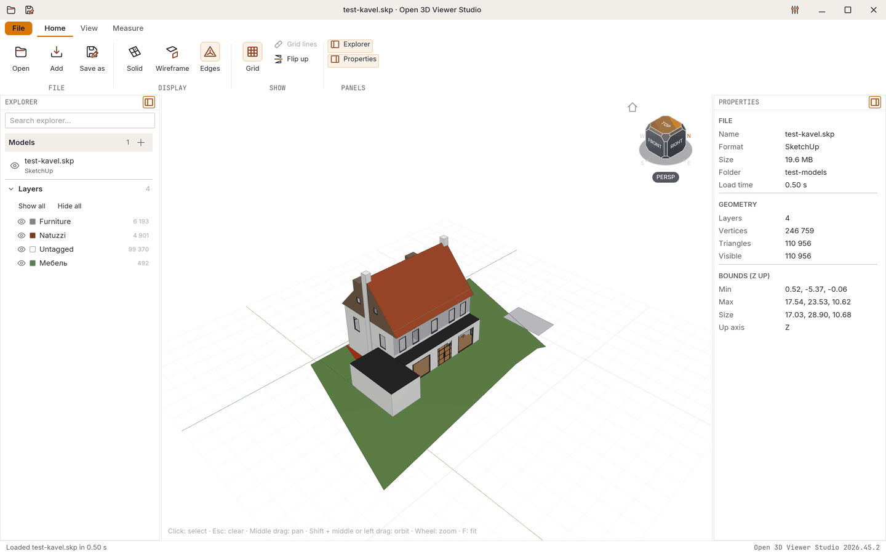
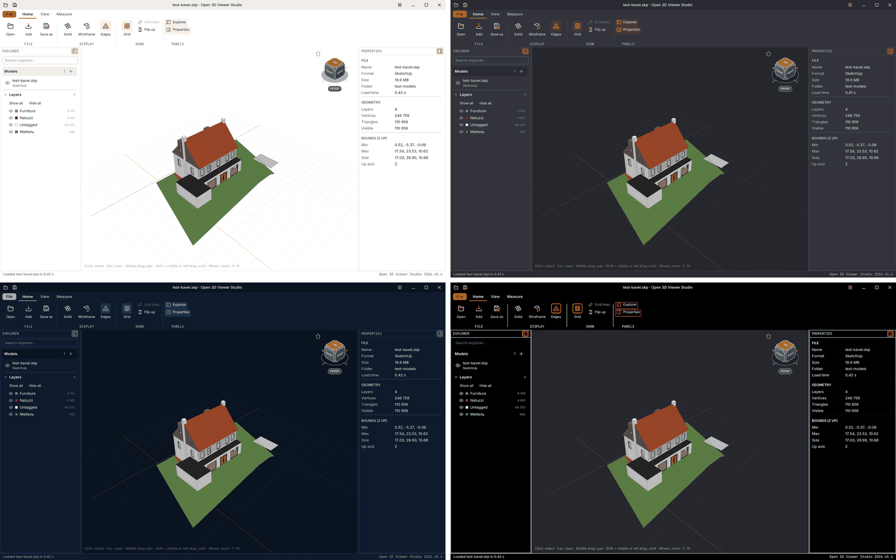
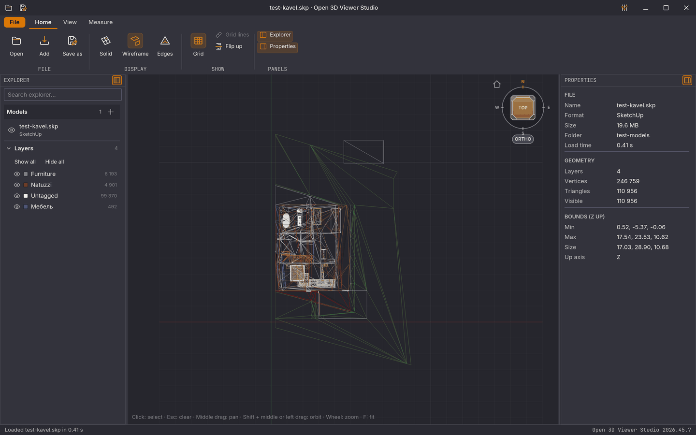
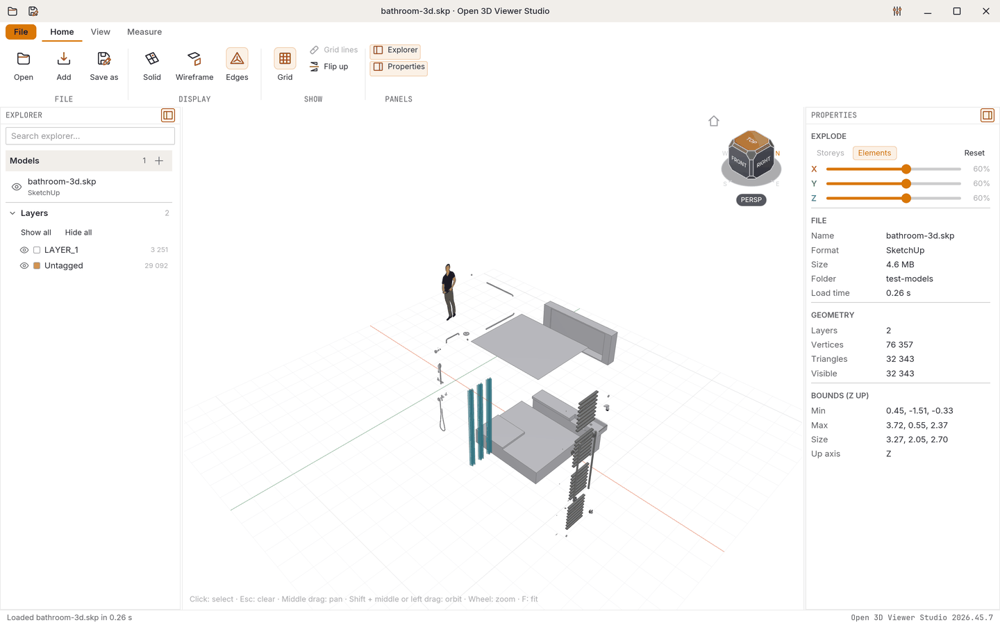
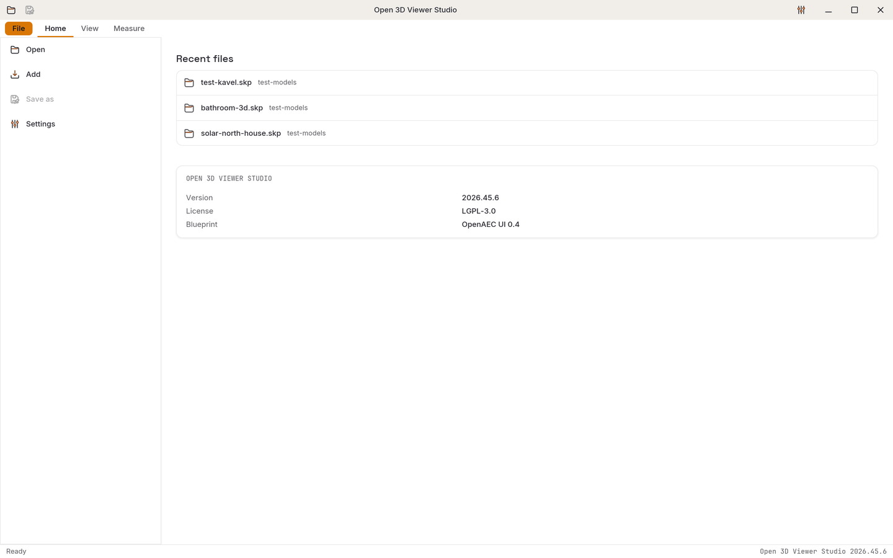
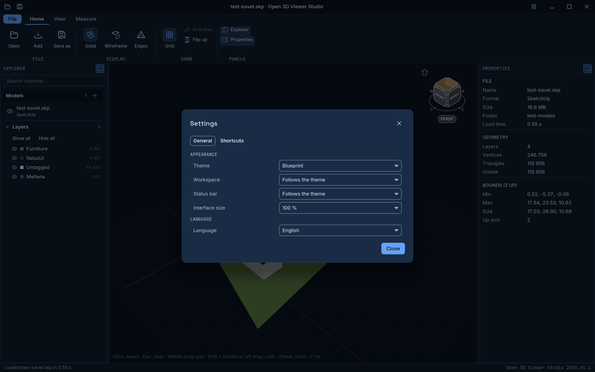
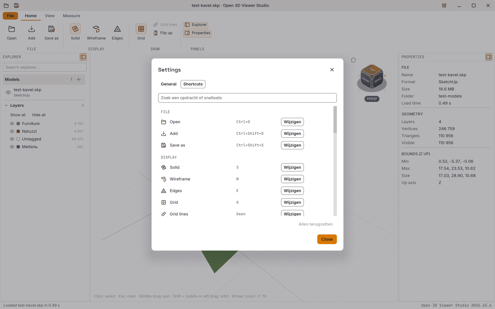
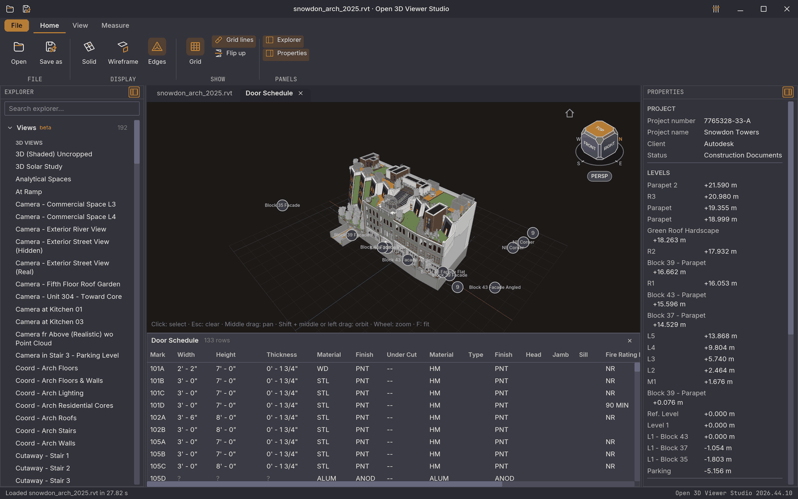

[English](README.md) · **Nederlands**

<div align="center">

# Open 3D Viewer Studio

**Een gratis 3D-viewer voor bouwmodellen: hij opent IFC, Revit, SketchUp, Tekla, Allplan, Archicad, Vertex BD, BTL, DWG/DXF, MicroStation DGN, STEP, IFC5 (IFCX), CityJSON, CityGML, GeoJSON, Shapefile, LandXML, glTF, USD, Rhino, COLLADA, 3MF, AMF, FBX, 3DS, VRML/X3D, OBJ, OFF, STL en PLY en puntenwolken in LAS, LAZ, E57, PTS, PTX, PCD en ASCII-XYZ, meet en doorsnijdt ze, en slaat ze op als IFC, op de desktop en in de browser.**

[](https://github.com/OpenAEC-Foundation/open-3d-viewer/releases/latest)
[](https://github.com/OpenAEC-Foundation/open-3d-viewer/actions/workflows/build.yml)
[](https://github.com/OpenAEC-Foundation/open-3d-viewer/actions/workflows/release.yml)
[](#licentie)

### [Probeer in je browser](https://open-3d-viewer.open-aec.com) &nbsp;·&nbsp; [Download](https://github.com/OpenAEC-Foundation/open-3d-viewer/releases/latest) &nbsp;·&nbsp; [Bekijk de video](https://www.youtube.com/watch?v=cxHO8M8W2Ow)

[](https://www.youtube.com/watch?v=cxHO8M8W2Ow)

*▶ De productvideo (73 s, Engels) op het [kanaal van de OpenAEC Foundation](https://www.youtube.com/@OpenAECFoundation).*

</div>

**Open 3D Viewer Studio** is de 3D-viewer van de [OpenAEC Foundation](https://github.com/OpenAEC-Foundation). Architecten, constructeurs en bouwers sturen elkaar modellen in allerlei formaten; met deze viewer open je ze allemaal zonder het programma waarmee ze gemaakt zijn. Je loopt om het model heen, klikt een element aan en leest zijn eigenschappen, meet, snijdt het open, trekt het uit elkaar per verdieping of per element, en slaat het op als IFC.

Eén Rust-codebasis levert drie dingen: de **desktopapp** voor Windows, macOS en Linux, de **browserversie** op [open-3d-viewer.open-aec.com](https://open-3d-viewer.open-aec.com), en de **MCP-server** waarmee AI-agents de desktopapp bedienen. Daarnaast staat hier wat van die code ondertekende installers en een live website maakt.



## Probeer het

**[Open de browserversie](https://open-3d-viewer.open-aec.com)**. Sleep een model op de pagina of kies **Openen**, en draai dan met de linkermuisknop, verschuif met de middelste knop en zoom met het wiel. Je hebt een browser met WebGPU nodig: een recente Chrome, Edge, Firefox of Safari. Je bestand blijft op je computer; er wordt niets geüpload. Wil je eerst zien wat hij doet, bekijk dan de [productvideo](https://www.youtube.com/watch?v=cxHO8M8W2Ow) (73 s).

## Download

Elke release staat op de [releasepagina](https://github.com/OpenAEC-Foundation/open-3d-viewer/releases/latest). Het makkelijkst is de [OpenAEC Installer](https://github.com/OpenAEC-Foundation/openaec-installer): die installeert, werkt bij en start elke OpenAEC-tool.

| Platform | Bestanden |
|----------|-----------|
| **Windows** | `.exe`-installer (x64, zonder beheerdersrechten) of `.zip` |
| **macOS** | `.dmg` (universeel: Apple silicon en Intel) |
| **Linux** | `.deb`, `.rpm`, `.AppImage` of `.tar.gz` |

Als de OpenAEC Installer een nieuwere versie heeft, meldt de titelbalk van de viewer dat, en **Bijwerken** geeft het over aan de installer. Elk bestand is ondertekend: Windows met Authenticode, macOS met een Developer ID en genotariseerd door Apple, Linux met de OpenPGP-sleutel van OpenAEC (een `.asc` naast elk pakket en naast `SHA256SUMS`), en alles met een build-attestatie van GitHub. De release notes zeggen per platform of het ondertekend is; een release waar een handtekening ontbreekt, staat als pre-release.

Zelf een download controleren:

```bash
sha256sum -c SHA256SUMS --ignore-missing
gpg --import docs/openaec-releases.asc   # OpenAEC Foundation Releases, vingerafdruk 13F6 D414 ADEE 4ED4 CD09 AC60 601D 86C9 3C50 4D29
gpg --verify SHA256SUMS.asc SHA256SUMS
gh attestation verify open-3d-viewer_2026.45.11_amd64.deb --repo OpenAEC-Foundation/open-3d-viewer
```

## Waarom gebruiken?

- **Vrij en open.** LGPL-3.0. Geen licentiekosten, geen account, geen upload.
- **Opent wat je toegestuurd krijgt.** IFC (ook gezipt), Revit, Vertex BD (`.vxz`) en BTL-machinebestanden voor houtbouw op de desktop; SketchUp (versie 3 en later), Tekla Structures, Allplan, Archicad (wanden met hun ramen en deuren, vloeren, kolommen, liggers, daken, bibliotheekobjecten als blok, terreinmeshes, zones, morphs, trappen en leuningen), DWG/DXF, MicroStation DGN (V7 en V8), STEP (AP203, AP214, AP242), IFC5 (IFCX, alfa), CityJSON, CityGML, GeoJSON, Shapefile, LandXML, glTF, USD, Rhino (versie 4 t/m 8), COLLADA, 3MF, AMF, FBX, 3DS, VRML/X3D, OBJ, OFF, STL en PLY, en puntenwolken in LAS, LAZ, E57, PTS, PTX, PCD en ASCII-XYZ, op de desktop en in de browser.
- **Meerdere modellen tegelijk.** **Openen** vervangt het model, **Toevoegen** zet er een ander bestand naast (een IFCX-bestand legt zich juist over een geopend IFCX-model), en elk model heeft een eigen zichtbaarheidsknop.
- **Slaat op als IFC.** Elk model dat de viewer opent, kan als IFC 4 worden opgeslagen, met verdiepingen, klassen, eigenschappen en materialen.
- **Dezelfde app in de browser en op de desktop.** Eén codebasis; de browserversie hoef je niet te installeren.
- **Meten en doorsnijden.** Afstanden, hoeken, oppervlakten en polygonen, een doorsnedekader en een doorsnedevlak met gevulde snedes, en een uit-elkaar-weergave.
- **AI-agents kunnen hem besturen.** Via een MCP-server openen Claude en andere agents bestanden, kijken rond, selecteren en meten, in het venster dat jij ziet.

## Schermafbeeldingen

De schermafbeeldingen tonen de Engelse interface; in **Instellingen** zet je de taal op Nederlands.

| | |
|---|---|
|  **Licht, Donker, Blueprint en High contrast donker** |  **Bovenaanzicht, draadmodel en orthografisch** |
|  **Uit elkaar per element** |  **De Bestand-pagina met recente bestanden** |
|  **Instellingen, thema Blueprint** |  **Eigen sneltoetsen voor elke opdracht** |

## Bekijken en navigeren

- **Draaien, verschuiven en zoomen.** Slepen met links draait, slepen met de middelste knop verschuift, het wiel zoomt naar de cursor. De kijkkubus draait het model naar een zijde; **F** past het model in beeld.
- **Standaardaanzichten.** Iso, boven, voor en rechts (`0`, `1`, `2`, `3`), perspectief of orthografisch (`P`, `O`), en de opgeslagen aanzichten van een Revit-model.
- **Weergaven.** Volledig, draadmodel en volledig met randen (`S`, `W`, `E`), het grondraster (`G`) en **Z-as omdraaien** voor bestanden met de andere as omhoog.
- **Modellen, lagen en eigenschappen.** De verkenner toont de geopende modellen en hun lagen (IFC-presentatielagen of -klassen, Revit-categorieën, SketchUp-tags, Tekla-klassen, Allplan-elementcategorieën, Archicad-wanden, -vloeren, -kolommen, -liggers, -daken, -sparingen, -objecten, -terrein, -zones, -morphs, -trappen en -leuningen, IFCX-klassen, STEP-presentatielagen of -producten, CAD-lagen, Rhino-lagen) met hun kleur en aantal; een klik op een element toont zijn eigenschappen. IFC-ruimtes en sparingsvolumes beginnen verborgen in eigen lagen; de sparingen blijven uit hun wanden en vloeren gesneden.
- **Sneltoetsen.** Elke opdracht staat één keer in één lijst, die het lint, de titelbalk en het toetsenbord gebruiken. In **Instellingen** geef je elke opdracht je eigen toets.

## Meten, doorsnijden en uit elkaar halen

- **Meet** afstanden, hoeken, polygonen en oppervlakten door in het model te klikken, of tussen twee elementen. Voor je klikt licht het punt, de rand of het vlak onder de cursor op, en de cursor springt binnen een paar pixels naar hoekpunten, middens van randen en randen. Metingen blijven in beeld tot je ze wist.
- **Doorsnedekader en doorsnedevlak** snijden het model open, met gevulde snedes. Het kader kan zich aanpassen aan de selectie.
- **Uit elkaar** trekt het model per verdieping of per element uit elkaar, met een percentage per as.

## Revit

De desktopapp opent Revit-bestanden (`.rvt`, `.rfa`) via de Revit-bibliotheek [`rvt-dll`](https://github.com/OpenAEC-Foundation/rvt-dll) van OpenAEC. Hij toont de niveaus, stramienen, ruimtes, opgeslagen aanzichten en staten van het bestand. Een staat opent in een eigen tabblad als tabel onder de 3D-weergave, en een rij selecteert de bijbehorende elementen. Revit bewaart van een staat alleen de definitie, dus de viewer rekent de rijen uit de elementen uit; cellen die hij nog niet kan bepalen, tonen `?`.



De beelden op deze pagina maakt [`scripts/build_readme_images.py`](scripts/build_readme_images.py), dat het echte venster rendert met `open-3d-viewer --screenshot`. Het beeld van de staat gebruikt het Autodesk-voorbeeld `snowdon_arch_2025.rvt`.

## Grafische kaart

Het venster tekent met wgpu. Op Windows gebruikt het DirectX 12 als de grafische kaart van Intel is, omdat de Vulkan-driver van Intel het hele venster wit kan laten flitsen terwijl je draait ([#28](https://github.com/OpenAEC-Foundation/open-3d-viewer/issues/28)), en OpenGL op Intel-chips die te oud zijn voor DirectX 12 in wgpu (Haswell, Broadwell); andere kaarten houden de keuze van wgpu. Bij elke start schrijft het venster wat het kreeg (kaart, driver, backend, oppervlakformaat) naar `gpu.log` in de instellingenmap: `%APPDATA%\OpenAEC\Open 3D Viewer Studio` op Windows, `~/.config/OpenAEC/Open 3D Viewer Studio` op Linux en macOS.

Flikkert het venster, blijft het zwart of is het traag, probeer dan een andere backend of presentatiemodus, en meld in een issue welke helpt, samen met `gpu.log`:

- **Eenmalig:** `open-3d-viewer.exe --gpu-backend vulkan` (of `dx12`, `gl`) en `--present-mode mailbox` (of `fifo`, `vsync`, `no_vsync`). Mailbox werkt met DirectX 12 en Vulkan, niet met OpenGL.
- **Altijd:** zet de gebruikersvariabele `WGPU_BACKEND` of `ICED_PRESENT_MODE` op een van deze waarden, bijvoorbeeld `setx WGPU_BACKEND vulkan` in een opdrachtprompt, en start de viewer opnieuw.

## OpenAEC Linux (SuperCloud)

De Linux-release draait ook in **OpenAEC Linux**, de omgeving van de OpenAEC SuperCloud waarin de tools van elke gebruiker als gewone Linux-programma's op de server draaien, gestreamd naar de browser ([OpenAEC-Blueprint#61](https://github.com/OpenAEC-Foundation/OpenAEC-Blueprint/issues/61)). De SuperCloud bouwt dat ene image uit de AppImage van een release; deze repository publiceert dus geen eigen Docker-image.

- **Zonder FUSE:** `./open-3d-viewer_<versie>_amd64.AppImage --appimage-extract`, dan `squashfs-root/AppRun [BESTAND]`.
- **Zonder GPU:** het 3D-beeld tekent met de software-renderers van Mesa, lavapipe (Vulkan, `mesa-vulkan-drivers`) of llvmpipe (OpenGL, `libegl-mesa0`). Zonder een van beide opent het venster, maar blijft het 3D-beeld leeg.
- **Onder Wayland**, met een kleine compositor zoals labwc, en zonder systeemvak, notificatiedienst, keyring of D-Bus-sessie.
- **Stoppen:** de viewer leest alleen modellen en schrijft exports, dus er is geen onbewaard werk; op `SIGTERM` stopt hij.

| Variabele | Wat hij doet |
|-----------|--------------|
| `OPENAEC_BEHEERD=1` | Beheerde modus: geen updatemelding (de SuperCloud ververst het image). De viewer downloadt zelf nooit updates. |
| `OPENAEC_MAP` | De werkmap (`/openaec` in de SuperCloud): de dialogen voor openen en opslaan beginnen daar. |
| `XDG_CONFIG_HOME` | Instellingen (voorkeuren, eigen sneltoetsen, de MCP-koppeling) in `$XDG_CONFIG_HOME/OpenAEC/Open 3D Viewer Studio`, standaard onder `~/.config`. |
| `O3V_REMOTE=0` | Geen bedieningspoort voor de MCP-server. `O3V_REMOTE_PORT` legt de poort vast (anders een vrije). |
| `WGPU_BACKEND` | `vulkan` of `gl` om de grafische backend te kiezen; standaard de eerste die werkt. |

Een bestand om te openen gaat op de opdrachtregel, net als `--theme light|dark|blueprint|high-contrast-dark|high-contrast-light` en `--language en|nl`.

**Netwerk:** de viewer maakt geen uitgaande verbindingen en heeft geen telemetrie. Hij luistert alleen op `127.0.0.1`, voor zijn eigen MCP-server (zie [MCP](#mcp)). De bestandsdialogen gaan via de XDG desktop portal, of via `zenity` als die er niet is.

Elke pull request en elke release start de Linux-build zo op GitHub Actions ([`packaging/linux/headless-test.sh`](packaging/linux/headless-test.sh)): de release pakt de AppImage uit, start hem onder labwc zonder scherm of GPU, controleert dat het venster en een model in het 3D-beeld tekenen, bewaart de schermafbeeldingen en zet het geheugengebruik zonder geopend bestand in de releasenotes.

## Wat hier staat

| Map | Wat erin staat |
|-----|----------------|
| [`src/`](src/) | De viewer: het venster ([`shell.rs`](src/shell.rs)), de app-toestand ([`app.rs`](src/app.rs)), de 3D-weergave ([`viewport/`](src/viewport/)), meten, doorsnedes, uit elkaar halen, en de afstandsbediening voor de MCP-server |
| [`src/loaders/`](src/loaders/) | Eén adapter per bestandsformaat; [`src/export/`](src/export/) schrijft IFC 4 |
| [`src/bin/open-3d-viewer-mcp.rs`](src/bin/open-3d-viewer-mcp.rs) | De MCP-server voor AI-agents |
| [`vendor/openaec-ui/`](vendor/openaec-ui/), [`assets/b2/`](assets/b2/) | De gedeelde OpenAEC-vensterschil en iconen, overgenomen uit [OpenAEC Blueprint](https://github.com/OpenAEC-Foundation/OpenAEC-Blueprint) 2026.44.1 |
| [`packaging/`](packaging/) | De Windows-installer, de macOS-appbundel en de Linux-pakketten |
| [`.github/workflows/`](.github/workflows/) | `build.yml` test elke wijziging, `release.yml` bouwt en ondertekent een release, `live.yml` publiceert de browserversie |
| [`scripts/`](scripts/) | De README-beelden, de kopie van de B2-iconen en de productvideo, allemaal met een script gemaakt |
| [`test-models/`](test-models/) | De modellen die de tests openen |

De lezers voor SketchUp, Tekla en PLY, en de Revit-bibliotheek, staan in eigen OpenAEC-repositories ([`skp-reader`](https://github.com/OpenAEC-Foundation/skp-reader), [`tekla-reader`](https://github.com/OpenAEC-Foundation/tekla-reader), [`ply-reader`](https://github.com/OpenAEC-Foundation/ply-reader), [`rvt-dll`](https://github.com/OpenAEC-Foundation/rvt-dll)). Deze repository legt elk vast op een vaste commit.

## Uitwisseling

| Formaat | Openen | Opslaan |
|---------|--------|---------|
| **IFC 4** (`.ifc`, gezipt `.ifczip`) | Desktop | Ja |
| **Revit** (`.rvt`, `.rfa`) | Desktop | Nee |
| **IFC5 / IFCX** (`.ifcx`, alfa) | Ja | Nee |
| **SketchUp** (`.skp`, versie 3 en later) | Ja | Nee |
| **Tekla Structures** (`.db1`, bèta) | Ja | Nee |
| **Allplan** (`.ndw`-tekenbestanden, `.prj`-projectmappen, bèta) | Ja, 3D-lichamen, macro's en 2D-lijnen; projectmappen op de desktop | Nee |
| **Archicad** (`.pln`, `.pla`, Archicad 24 t/m 29, bèta) | Ja, wanden met sparingen, vloeren, kolommen, liggers, daken, bibliotheekobjecten als blok, terreinmeshes, zones, morphs, trappen, leuningen | Nee |
| **Vertex BD** (`.vxz`-projecten, `.vxm`-modellen, bèta) | Desktop, houtskelet- en gebouwvolumes met bibliotheeksymbolen en materialen | Nee |
| **BTL** (`.btl`, Hundegger BTL 10, zoals Vertex BD ze exporteert) | Desktop, houtdelen met hun bewerkingen eruit gesneden, lagen per paneel | Nee |
| **DWG / DXF** (`.dwg`, `.dxf`) | Ja, polygoongeometrie | Nee |
| **MicroStation DGN** (`.dgn`, V7 en V8) | Ja | Nee |
| **STEP** (`.stp`, `.step`, `.stpz`; AP203, AP214, AP242) | Ja | Nee |
| **CityJSON** (`.json`, `.cityjson`, `.jsonl`) | Ja | Nee |
| **CityGML** (`.gml`, `.citygml`, 1.0 tot 3.0) | Ja | Nee |
| **GeoJSON** (`.geojson`, polygonen en lijnen) | Ja | Nee |
| **Shapefile** (`.shp`, met de `.dbf`-attributen op de desktop) | Ja | Nee |
| **LandXML** (`.xml`, `.landxml`, TIN-oppervlakken) | Ja | Nee |
| **glTF** (`.gltf`, `.glb`, ook puntprimitieven) | Ja | Nee |
| **USD** (`.usd`, `.usda`, `.usdc`, `.usdz`) | Ja | Nee |
| **Rhino** (`.3dm`, Rhino 4 t/m 8) | Ja, meshes, de bewaarde rendermeshes van polysurfaces en extrusies, blokken, puntenwolken | Nee |
| **COLLADA** (`.dae`) | Ja | Nee |
| **VRML / X3D** (`.wrl`, `.x3d`, `.x3dv`, ook gezipt) | Ja | Nee |
| **Wavefront OBJ** (`.obj`, ook puntenwolken) | Ja | Nee |
| **STL** (`.stl`, ASCII en binair) | Ja | Nee |
| **PLY** (`.ply`, meshes en puntenwolken) | Ja | Nee |
| **3MF** (`.3mf`) | Ja | Nee |
| **AMF** (`.amf`, ook gezipt) | Ja | Nee |
| **FBX** (`.fbx`, binair en ASCII) | Ja | Nee |
| **3D Studio** (`.3ds`) | Ja | Nee |
| **OFF** (`.off`, ASCII) | Ja | Nee |
| **LAS / LAZ**-puntenwolken (`.las`, `.laz`) | Ja | Nee |
| **E57**-puntenwolken (`.e57`) | Ja | Nee |
| **ASCII-XYZ**-puntenwolken (`.xyz`, `.txt`, `.csv`, `.asc`) | Ja | Nee |
| **ESRI ASCII grid**-hoogtemodellen (`.asc`) | Ja | Nee |
| **Leica PTS / PTX**-puntenwolken (`.pts`, `.ptx`) | Ja | Nee |
| **PCD**-puntenwolken (`.pcd`, Point Cloud Library) | Ja | Nee |

Wat niet meekomt:

- **IFC-export** schrijft elk element als driehoeken (`IfcTriangulatedFaceSet`), niet als parametrische geometrie. Klassen komen uit de Revit-categorie, de Tekla-onderdeelnaam of het Archicad-element (wand, vloer, kolom, ligger, dakvlak als dakplaat), anders `IfcBuildingElementProxy`; Archicad-sparingen zijn al uit hun wanden gesneden en worden niet geschreven, Archicad-bibliotheekobjecten worden `IfcBuildingElementProxy`, meshes `IfcGeographicElement`, zones `IfcSpace`, morphs `IfcBuildingElementProxy`, trappen `IfcStair` en leuningen `IfcRailing`; elementen uit een geopend IFC-bestand houden hun klasse nog niet. Gecontroleerd met IfcOpenShell 0.8 op Revit-, SketchUp-, OBJ-, STL- en glTF-modellen.
- **DWG en DXF** tonen de polygoongeometrie van de modelruimte. ACIS-volumes, annotaties, curves en externe verwijzingen vallen weg en worden geteld.
- **MicroStation DGN** opent ontwerpbestanden van versie 7 en V8 (MicroStation V8, V8i en CONNECT). Lijnen, bogen en curves worden dunne linten zo breed als hun lijndikte, tekst wordt het kader van de tekst met de tekens in de elementeigenschappen; vlakken, kegels, geëxtrudeerde volumes en B-splinevlakken van 3D-bestanden worden vlakken. Levels worden lagen, in V8-bestanden met hun naam; cellen en gedeelde cellen zijn elk één element; lineaire 2D-maten van V8-bestanden worden lijnen, met de gemeten waarden in de elementeigenschappen. Andere maten, multilines, tags, lijnstijlen en referentiebestanden, en in V8-bestanden oppervlakken, volumes, kegels, B-splinevlakken, meshes en andere modellen dan het eerste, vallen weg en worden geteld. De V7-lezer is geschreven uit de openbare ISFF-beschrijving van Intergraph en een clean-room-analyse, de V8-lezer alleen uit de clean-room-specificatie.
- **LandXML** toont TIN-oppervlakken; meetpunten en alignementen worden geen oppervlak. **CityJSON** toont per object het hoogste detailniveau.
- **CityGML** toont de polygonen van elk stadsobject op zijn hoogste detailniveau (LoD1-blokken of LoD2-vlakken), één laag per vlaktype (wanden, daken, grondvlak, ramen, deuren, ..) of anders per objecttype, één element per stadsobject met zijn attributen en generieke attributen; coördinaten worden naar een lokale oorsprong verschoven, niet geprojecteerd. Texturen en kleuren (appearances), impliciete geometrie (geplaatste bibliotheekobjecten), geometrie waarnaar vanuit andere objecten verwezen wordt en curves worden niet gelezen.
- **GeoJSON** toont polygonen als vlakke vlakken (met hun gaten) en lijnen als linten van 0,3 m breed, één element per feature met zijn eigenschappen; een polygoon met een `height`, `building:height` of `building:levels` (3 m per bouwlaag, met `min_height` voor de onderkant) wordt een blok. Lengte- en breedtegraden worden geprojecteerd naar lokale meters rond de eerste coördinaat (equirectangulair, goed voor een wijk, niet voor een land); geprojecteerde coördinaten worden als meters gelezen. Punten worden niet getekend. Een polygoon die niet vlak ligt (een wand) wordt in zijn eigen vlak getrianguleerd.
- **Shapefile** toont polygonen (2D, Z en M) als vlakken met hun gaten, geëxtrudeerd tot een blok als een record een hoogte-attribuut heeft (zoals bij GeoJSON, in hoofd- of kleine letters), lijnen als linten van 0,3 m breed, MultiPatch-strips, -waaiers en -ringen als vlakken in een laag `Buildings`, en punten als stippen. Elk record is een aanklikbaar element met de attributen uit de `.dbf` naast het bestand, in zijn codepagina (`.cpg` of de kop van de `.dbf`); de `.prj` noemt het coördinatenstelsel. Lengte- en breedtegraden worden naar lokale meters geprojecteerd; geprojecteerde coördinaten worden naar een lokale oorsprong verschoven, niet herprojecteerd. In de browser wordt alleen de `.shp` gelezen, dus zonder attributen. M-waarden, `.shx`-indexen en gezipte shapefiles worden niet gelezen. De lezer is de pure-Rust-crate `shapefile`.
- **Texturen** van glTF, OBJ en SketchUp worden hun gemiddelde kleur; zachte randen in SketchUp worden niet gladgemaakt.
- **COLLADA** toont de driehoeken en polygonen van de visuele scène, één laag per SketchUp-tag of anders per materiaal, in de diffuse kleur van het materiaal; texturen, lijnen, polygonen met gaten en animaties vallen weg. **3MF** toont elk build-item als laag, met zijn componenten, basismaterialen en kleurgroepen; texturen, beam lattices en slices worden niet gelezen. **AMF** plaatst zijn objecten volgens hun constellaties (anders elk één keer), één laag per materiaal in zijn kleur, elk geplaatst object een aanklikbaar element; kleuren van driehoeken, hoekpunten, volumes en objecten blijven behouden. Kleurformules, gebogen driehoekranden, texturen en samengestelde materialen worden niet gelezen.
- **VRML / X3D** (VRML 2.0 / VRML97, X3D in XML- en klassieke codering, ook gezipt) vlakt de scènegraaf af (`Transform`, `Group`, `Switch`, `LOD`, `DEF`/`USE`) en toont `IndexedFaceSet` en de andere driehoek- en vierhoeksets, `ElevationGrid`, en `Box`, `Sphere`, `Cylinder` en `Cone` als driehoeken, één laag per materiaal in zijn diffuse kleur, elke `Shape` een aanklikbaar element met de naam van zijn `DEF`; `PointSet` als stippen. VRML 1.0, texturen, `Extrusion`, lijnen, tekst, `Inline`-bestanden, `PROTO`-instanties, scripts en animaties worden niet gelezen. De lezer is voor deze viewer geschreven vanuit de ISO-specificaties.
- **STEP** (`.stp`, `.step`, met gzip gecomprimeerd of gezipt `.stpz`; AP203, AP214 en AP242) toont de solids en vlakken van CAD-, installatie- en staalonderdelen: elk vlak wordt getrianguleerd uit zijn exacte geometrie (vlakken, cilinders, kegels, bollen, torussen, NURBS, getrimd en met gaten), en getesselleerde AP242-vormen worden getekend waar een onderdeel geen exacte geometrie heeft. Elk geplaatst onderdeel van de assemblage is een aanklikbaar element met zijn productnaam, onderdeelnummer, omschrijving en assemblagepad, geplaatst met de transformaties van zijn assemblage; één laag per presentatielaag van het bestand, of anders per product, in de kleuren van de gestileerde vlakken en solids; millimeters (of de eenheid van het bestand) worden meters. PMI en tekeningen, draadmodellen en punten, texturen, verborgen items en verwijzingen naar andere STEP-bestanden vallen weg; een vlak waarvan de geometrie niet getrianguleerd kan worden, wordt overgeslagen en geteld in de projectinformatie. De lezer is de pure-Rust STEP-codec en tesselator van `cadmpeg`. Een IFC-bestand dat als `.stp` is opgeslagen, wordt geweigerd: open het als `.ifc`.
- **IFC5 / IFCX** (`.ifcx`, het JSON-formaat van buildingSMART, nog alfa) stelt de knopen van het bestand samen zoals de referentieviewer dat doet: knopen met hetzelfde pad leggen zich over elkaar, children en inherits halen andere knopen binnen (een exemplaar krijgt de kinderen en attributen van zijn type en materiaal), `null` haalt een kind weg. **Toevoegen** van een `.ifcx`-bestand aan een geopend IFCX-model legt het daaroverheen (het latere bestand wint), zodat een aanvulling zoals een brandwerendheid op zijn model verschijnt; op de desktop wordt een relatief `.ifcx`-bestand in `imports` ook gelezen. Elke geclassificeerde knoop is een aanklikbaar element met zijn naam, klasse, pad en attributen, één laag per klasse; ruimtes en sparingen beginnen verborgen. Meshes worden geplaatst met hun `usd::xformop`-transformaties en gekleurd volgens `bsi::ifc::presentation` (kleur en doorzichtigheid) of een glTF-basiskleur; puntenwolken in `points::array` en `points::base64` worden getekend. Curves (alignementen, assen), `pcd`-puntenwolken, texturen, georeferentie en imports van het web (de schemabestanden op ifcx.dev) vallen weg; het formaat verandert nog, dus nieuwere bestanden openen misschien niet.
- **USD** toont de meshes van de samengestelde stage (sublagen, referenties, payloads, varianten en instanties), elke mesh een aanklikbaar element met zijn naam en pad, geplaatst met zijn transformaties, één laag per gekoppeld materiaal in de diffuse kleur van de `UsdPreviewSurface`, of anders in zijn `displayColor`; de bovenas en eenheden komen uit de stage. Texturen, subdivision surfaces, impliciete vormen (kubus, bol, ..), curves, punten, skinning en animatie (de standaardtijd wordt getekend) vallen weg. In de browser wordt alleen het bestand zelf gelezen, dus verwijzingen naar andere bestanden ontbreken (een `.usdz` bevat ze zelf). De lezer is de pure-Rust-crate `openusd`.
- **Rhino** (`.3dm`, Rhino 4 t/m 8) toont meshes en de rendermeshes die Rhino bij polysurfaces, oppervlakken en extrusies bewaart (de analysemeshes als die er niet zijn), blokinstanties met hun geneste blokken, en puntenwolken en punten als stippen. Elke Rhino-laag is een laag, met zijn volledige pad (`Ouder::Kind`), in zijn kleur, en staat eerst uit als hij of een ouderlaag uit staat. Elk object, en elke blokinstantie als geheel, is een element met zijn naam, objecttype, laag, id, materiaal en gebruikerstekst. Objecten met een materiaal krijgen de diffuse kleur en transparantie daarvan, andere hun weergavekleur (per laag, object of ouder); zwart, de kleur van Rhino's standaardlaag, wordt het grijs van de viewer; kleuren van losse polysurfacevlakken (Rhino 7 en later) en hoekkleuren van meshes blijven behouden. Eenheden worden omgerekend naar meters. Curves, annotaties, arceringen, lampen, SubD-objecten (Rhino bewaart er geen mesh van) en polysurfaces of extrusies die zonder mesh zijn opgeslagen (`SaveSmall`) vallen weg en worden geteld in de bestandseigenschappen, net als verborgen objecten en objecten op layouts; texturen worden niet gelezen. De lezer is geschreven vanuit de openNURBS-broncode van McNeel, die McNeel publiceert om 3dm-bestanden te lezen en te schrijven; er wordt geen openNURBS-code meegecompileerd.
- **FBX** toont de meshes van de scène, elk model een aanklikbaar element met zijn naam en gebruikerseigenschappen, geplaatst met zijn ouders en zijn volledige transformatie, één laag per materiaal in de diffuse kleur; eenheden en assen komen uit het bestand. Texturen, NURBS en curves, camera's, lampen, animaties, skinning en blend shapes vallen weg. De lezer is geschreven vanuit de openbare beschrijving van het formaat, zonder de FBX SDK. **3DS** toont elk meshobject als element, één laag per materiaal in de diffuse kleur, in de eenheden van het bestand; texturen, smoothing groups, lampen, camera's en de keyframer (animatie, instanties) worden niet gelezen. **OFF** toont één vlak gearceerde mesh met zijn hoek- of vlakkleuren; binaire OFF wordt niet gelezen.
- **Puntenwolken** worden getekend als stippen van een paar pixels. **LAS/LAZ** (1.0 tot 1.4, ook LASzip-gecomprimeerd) toont een laag per classificatieklasse (Ground, Building, High vegetation, ...), elk punt in zijn RGB-kleur, of anders in de kleur van zijn klasse, lichter of donkerder naar zijn intensiteit. **E57** toont elke scan als laag, geplaatst volgens zijn positie, in zijn kleuren of anders zijn intensiteit als grijs; afbeeldingen in het bestand worden niet gelezen. **PLY** zonder vlakken is een puntenwolk, in zijn kleuren of anders zijn intensiteit, met een laag per klasse als het een classificatie heeft. **ASCII-XYZ** (`.xyz`, `.txt`, `.csv`, `.asc`) leest X Y Z per regel met optionele kolommen voor kleur (0..255, 0..1 of 16 bits), intensiteit en classificatie, benoemd in een kopregel (ook CloudCompare's `//X,Y,Z`) of anders herkend aan hun waarden; gescheiden door spaties, tabs, komma's of puntkomma's (dan met decimale komma's). Een `.txt` of `.csv` opent alleen als de regels kolommen met getallen zijn; andere kolommen (normalen, scalaire velden) worden niet gelezen. **PTS** toont elke scan (een regel met het aantal punten) als laag, X Y Z, intensiteit, R G B. **PTX** toont elke scan als laag, verplaatst met zijn registratiematrix; punten zonder terugkaatsing vallen weg. **PCD** leest ASCII-, binaire en `binary_compressed`-data met verpakte `rgb`/`rgba` of losse kleuren, anders de intensiteit; het `VIEWPOINT` wordt getoond maar niet toegepast, en andere velden (normalen, labels) worden niet gelezen. Een **OBJ**-bestand met hoekpunten en zonder vlakken is een puntenwolk (`v x y z [r g b]`); **glTF**-puntprimitieven zijn stippen in een puntenlaag per materiaal, en driehoekstrips en -waaiers worden getekend (glTF-lijnen niet). Punten zonder kleur of intensiteit krijgen een kleur naar hun hoogte. Een **ESRI ASCII grid** (`.asc` die met `ncols` begint) wordt een terreinmesh tussen de middens van de cellen, cellen zonder data vallen weg, en van een grid van meer dan 6 miljoen cellen (2 miljoen in de browser) elke n-de rij en kolom. Van een wolk van meer dan 10 miljoen punten (4 miljoen in de browser) wordt elk n-de punt getoond; de eigenschappen vermelden hoeveel punten het bestand heeft en hoeveel er getoond worden. Coördinaten van een landmeting worden naar een lokale oorsprong verschoven, die de eigenschappen tonen (`LAS world origin`, `XYZ world origin`, ..). Punten zijn niet te selecteren, krijgen geen snijvlakvulling en blijven op hun plaats in de opengewerkte weergave; bij opslaan als IFC vallen ze weg.
- **Tekla**-profielen zijn benaderingen; de lezer is geschreven vanuit een cleanroom-specificatie.
- **Allplan** opent een tekenbestand (`.ndw`) en toont de 3D-lichamen (wanden, vloeren, kolommen, ramen, trappen) in een laag per categorie; openingen en ruimtes beginnen verborgen in een eigen laag. Een klik op een lichaam toont de naam, het elementtype en de hoeveelheden (hoogte, dikte, lengte, oppervlakte, inhoud) van het Allplan-element. Macro's (meubels, ramen, deuren, leuningen) komen in een laag `Macros`, één element per plaatsing. Geopend vanuit de projectmap krijgt elk lichaam zijn kleur uit het project: zijn oppervlak (`design/*.surf`, een oppervlak met textuur via het gemiddelde van het voorbeeld) of anders zijn kleurnummer in `animation.cfg`; in de browser, of voor een los tekenbestand, houden de lagen een vaste kleur per categorie. Op de desktop opent een hele projectmap (`*.prj`, op het venster gesleept) als één model: de tekenbestanden uit de bouwwerkstructuur, één laag per verdieping (de categorie wordt een eigenschap), en alleen het eerste gebouw uit de structuur zichtbaar. 2D-lijnen en -polylijnen die niet bij een 3D-element horen (situatie, assen, details in de plattegrond) komen als dunne donkere lijnen net boven hun verdieping, in een laag `2D lines`. Texturen, teksten, arceringen, bogen en lay-outs (`.npl`) worden nog niet gelezen. De lezer is geschreven vanuit een cleanroom-specificatie.
- **Archicad** toont wanden, vloeren en kolommen als geëxtrudeerde plattegronden op hun verdieping, liggers langs hun as, ook schuine (kolommen en liggers met een eigen profiel als dat profiel, met zijn bogen), en elk dakvlak tussen zijn schuine onder- en bovenkant, met verticale randen. Bogen in omtrekken worden als korte rechte stukken getekend; daken met dikte 0 (hulplichamen voor bewerkingen met volume-elementen) worden weggelaten. Ramen en deuren worden als sparingen uit hun wanden gesneden; de sparingen beginnen verborgen in een eigen laag. Bibliotheekobjecten (meubels, keukens, sanitair, 3D-tekst) worden getekend als blok van hun maat, 1 m hoog als de hoogte in de eigen code van het bibliotheekdeel staat. Meshes worden gesloten terreinlichamen (hun getrianguleerde bovenvlak, een vlakke onderkant en zijkanten), en zones prisma's die verborgen en half doorzichtig in een eigen laag beginnen. Morphs worden vlak voor vlak uit hun opgeslagen lichaam getekend, zonder materialen. Trappen worden een blok per trede uit het trapschema in de plattegrond, leuningen een half doorzichtige band met een regel erop en palen aan de segmenteinden; de echte vorm van treden, trapbomen, palen en balusters (bibliotheekcode) wordt niet gelezen. Kozijnen, glas en bladen van ramen en deuren, de echte vorm van bibliotheekobjecten, gebogen daken en schalen, zones die door daken worden afgesneden (heel getekend), en projecten van vóór Archicad 24 worden nog niet gelezen. Wandhoogtes volgen de verdieping waaraan de bovenkant van een wand gekoppeld is, of de eigen hoogte van de wand. De lezer is geschreven vanuit een cleanroom-specificatie.
- **Vertex BD** opent een projectarchief (`.vxz`) en toont de volumes van het houtskeletmodel (`FRAMING.vxm`) en het gebouwmodel (`MODEL.vxm`) in hun materiaalkleur, een laag per model, met de geplaatste bibliotheeksymbolen (palen, lateien, dakplaten, ramen en deuren). Klik op een volume voor het element-id en het materiaal (zoals PIECE.VUREN of WIN.GLASS). Elementsoorten (stijl, bovenregel) staan niet in de modelbestanden en worden niet getoond. **BTL** toont elk onderdeel met zijn bewerkingen eruit gesneden (afkortingen, zaagsneden, lassen en groeven, boringen, zwaluwstaartpennen en -gaten). De verkenner groepeert de lagen per paneel: een paneel zet je in één keer aan of uit, en daarbinnen heeft elke soort onderdeel (stijl, bovenregel, gevelbeplating) en elke soort bewerking een eigen laag, zodat je de beplating kunt uitzetten of alleen de boringen kunt tonen. Een bewerking staat in een eigen kleur als het materiaal dat ze wegneemt; klik erop voor de parameters en wat ze betekenen. Klik op een onderdeel voor de maat, sterkteklasse en bewerkingen. Beide lezers zitten in `vertex.dll` (`libvertex.so`, `libvertex.dylib`), een OpenAEC-bibliotheek geschreven vanuit reverse-engineerde voorbeeldbestanden: de installers zetten hem naast het programma, dat hem bij het draaien laadt (`vendor/vertex/`, bijgewerkt met `scripts/update-vertex.sh`).
- **In de browser** openen IFC en Revit niet, moeten `.gltf`-bestanden hun buffers ingebed hebben, en worden OBJ-materialen niet gelezen.

Nieuwe formaten: implementeer `loaders::Loader` en voeg hem toe aan `loaders::registry()`; nieuwe schrijvers implementeren `export::Writer` en gaan in `export::registry()`.

## MCP

`open-3d-viewer-mcp` is een [MCP](https://modelcontextprotocol.io)-server waarmee een AI-agent (Claude Code, Claude Desktop of een andere MCP-client) de desktopviewer bedient zoals een mens dat doet: bestanden openen, schermafbeeldingen maken, de camera en de standaard- en opgeslagen aanzichten instellen, lagen tonen, verbergen en isoleren, elementen zoeken op eigenschap, selecteren, eigenschappen lezen, een doorsnedekader of -vlak zetten, het model uit elkaar trekken, de weergave wisselen, Revit-staten lezen en meten.

- **Je ziet wat hij doet.** Opdrachten gaan langs dezelfde weg als jouw klikken, in het venster op je scherm. Metingen blijven in beeld.
- **Het blijft op je computer.** Het venster luistert alleen op `127.0.0.1`, met een willekeurig token in `%APPDATA%\OpenAEC\Open 3D Viewer Studio\remote.json`. `--no-remote` of `O3V_REMOTE=0` zet het uit.
- **Installeren:** zet `open-3d-viewer-mcp` naast de viewer (de installers doen dat) en registreer hem, bijvoorbeeld `claude mcp add open-3d-viewer -- "C:\pad\naar\open-3d-viewer-mcp.exe"`. `open-3d-viewer-mcp --print-config` geeft de JSON voor andere clients.

## Testen en betrouwbaarheid

- **290 unittests** in `src/` (285 draaien; 5 staan standaard uit: twee vragen lokale voorbeelden, drie schrijven voorbeeld- of beeldbestanden), plus 2 voor de MCP-server en 56 voor de vensterbibliotheek in `vendor/openaec-ui`, draaien bij elke pull request en voor elke release: 195 voor de lezers, 20 voor de app, 17 voor meten, 8 voor de vensterschil, 7 voor de doorsnedes, 10 voor IFC-export, en meer voor de 3D-weergave, kijkkubus, afstandsbediening, het model en de uit-elkaar-weergave.
- **De vensterschil wordt getest zonder scherm.** Eén test legt elke weergave op en faalt als een bedieningselement geen naam heeft voor een schermlezer; andere controleren dat geen twee opdrachten dezelfde sneltoets hebben en dat elke opdracht in het lint en de titelbalk bestaat.
- **Gegenereerde bestanden worden gecontroleerd.** `python scripts/build_readme_images.py --check` faalt als een beeld ontbreekt, ongebruikt is of groter is dan 150 kB; `python scripts/b2_icons.py --check` faalt als een icoon afwijkt van de OpenAEC Blueprint-release die in `assets/b2/blueprint.sha256` staat, zonder kopie van de Blueprint.
- **IFC-export** is gecontroleerd met IfcOpenShell 0.8 (schema en where-regels, ruimtelijke indeling, unieke GlobalIds, geometrie) op Revit-voorbeelden van 456 en 6773 elementen, 11 SketchUp-testmodellen, OBJ, STL en glTF.
- **De Linux-build start zonder GPU.** Bij elke pull request en release draait hij onder labwc zonder scherm, met software-rendering, en moet hij een model tekenen (zie [OpenAEC Linux](#openaec-linux-supercloud)).
- **Een release wordt pas gebouwd als de tests slagen**, en de release notes zeggen per platform of de bestanden ondertekend zijn.

Bron van de getallen: `cargo test --release` en `cargo test --release -p openaec-ui --lib`; de release draait dezelfde controles in [`release.yml`](.github/workflows/release.yml).

## Huidige beperkingen

- **IFC en Revit openen alleen op de desktop.** De browserversie heeft die lezers niet.
- **IGES-bestanden openen niet.** STEP-bestanden wel; IGES wordt nog niet gelezen.
- **Elementen zijn niet een voor een te verbergen.** Zichtbaarheid werkt per laag en per model.
- **Nog geen ongedaan maken.** Metingen en de doorsnede wis je met de hand.
- **De browserversie blokkeert tijdens het laden** van een groot model (nog geen worker-threads) en onthoudt je instellingen niet tussen bezoeken.
- **Vijf iconen zijn tijdelijk.** De OpenAEC-iconenset heeft nog geen iconen voor volledig, draadmodel, randen, perspectief en orthografisch; de viewer gebruikt de dichtstbijzijnde.
- **Geen loopmodus of verborgen-lijnenweergave.**

Iets gevonden? [Maak een issue](https://github.com/OpenAEC-Foundation/open-3d-viewer/issues).

## Onder de motorkap

De viewer is geschreven in Rust. De interface is [iced](https://iced.rs) 0.14 en de 3D-weergave is een eigen wgpu-pipeline met 4x MSAA in de `shader`-widget van iced, zodat dezelfde code native draait en als WebAssembly op WebGPU, zonder webview of JavaScript-framework. Het venster volgt de OpenAEC-standaardapplicatie: schil, ontwerptokens, lettertypen en B2-iconen komen uit [OpenAEC Blueprint](https://github.com/OpenAEC-Foundation/OpenAEC-Blueprint) 2026.44.1 (`vendor/openaec-ui`, `assets/b2`). IFC wordt gelezen met [IFClite](https://github.com/LTplus-AG/ifc-lite) en DWG/DXF met [acadrust](https://github.com/hakanaktt/acadrust). Op een computer met geïntegreerde AMD-grafische kaart laadt een Revit-voorbeeld van 18,8 MB in ongeveer 2,5 s en tekent het met ongeveer 110 beelden per seconde op 1920x1080 (`open-3d-viewer --bench`).

## Bijdragen

- **Probeer het op een echt project** en meld fouten of ontbrekende functies als [issue](https://github.com/OpenAEC-Foundation/open-3d-viewer/issues/new). Beschrijf wat je deed, wat je verwachtte en wat er gebeurde, en voeg het bestand toe als je het mag delen.
- **Deel testbestanden.** Modellen die verkeerd openen helpen het meest; `test-models/` bevat de modellen die de tests gebruiken.
- **Schrijf code** en open een pull request. `cargo test --release` moet slagen.

## Snel aan de slag (ontwikkelaars)

```bash
git clone https://github.com/OpenAEC-Foundation/open-3d-viewer.git
cd open-3d-viewer
cargo run --release -- test-models/test-kavel.skp
```

Vereist Rust 1.96 of later (met de MSVC-toolchain op Windows) en leestoegang tot de privé-formaatrepositories van OpenAEC hierboven; zet `CARGO_NET_GIT_FETCH_WITH_CLI=true` zodat Cargo je Git-inloggegevens gebruikt. De browserversie vraagt ook `rustup target add wasm32-unknown-unknown` en `cargo install --locked trunk`; daarna serveert `trunk serve --release` hem op `http://127.0.0.1:8080`. De scripts in `scripts/` vragen Python 3.

De opdrachtregel:

```
open-3d-viewer [BESTAND] [--theme light|dark|blueprint|high-contrast-dark|high-contrast-light] [--language en|nl]
open-3d-viewer [BESTAND] --screenshot UIT.png [--size 1440x900] [--mode solid|wireframe|edges] [--view iso|top|front|right]
               [--ortho] [--page workspace|file|settings|shortcuts] [--schedule NAAM] [--explode X,Y,Z]
open-3d-viewer BESTAND --save-as UIT.ifc
open-3d-viewer --bench BESTAND [--frames 300]
```

Versies volgen het OpenAEC-schema `JJJJ.W.N`: jaar, ISO-week zonder voorloopnul, en een volgnummer binnen de week dat bij 0 begint, zoals `2026.45.11`. Een tag `vJJJJ.W.N` start [`release.yml`](.github/workflows/release.yml), dat de release test, bouwt en ondertekent voor Windows, macOS en Linux en hem publiceert.

Open 3D Viewer Studio hoort bij de familie van apps van de [OpenAEC Foundation](https://github.com/OpenAEC-Foundation).

## Licentie

De eigen broncode van de viewer is LGPL-3.0-or-later. Zie [LICENSE](LICENSE). Het lettertype Inter valt onder de SIL Open Font License (`assets/fonts/Inter-LICENSE.txt`); `vendor/openaec-ui` en zijn lettertypen en iconen staan beschreven in [`NOTICE.md`](vendor/openaec-ui/NOTICE.md). IFClite en acadrust vallen onder MPL-2.0. De desktopapp linkt de Revit-bibliotheek `rvt-dll` van OpenAEC, die haar eigen propriëtaire licentie houdt, dus de desktopbuilds zijn niet helemaal open source; de browserversie bevat haar niet.

## Merken

SketchUp is een merk van Trimble Inc., Revit en DWG van Autodesk, Inc., Tekla Structures van Trimble Solutions Corporation, Allplan van ALLPLAN GmbH (Nemetschek Group), MicroStation van Bentley Systems, Inc., Archicad van Graphisoft SE, en Rhinoceros en openNURBS van Robert McNeel & Associates. Open 3D Viewer Studio is een onafhankelijk project en is niet aan hen verbonden, door hen goedgekeurd of gesponsord.
